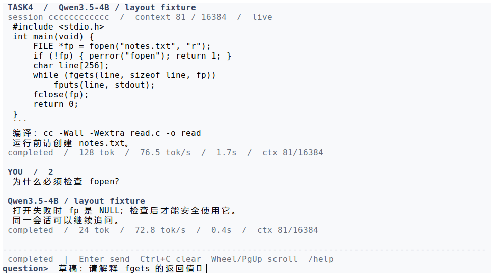
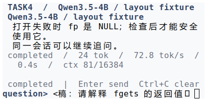
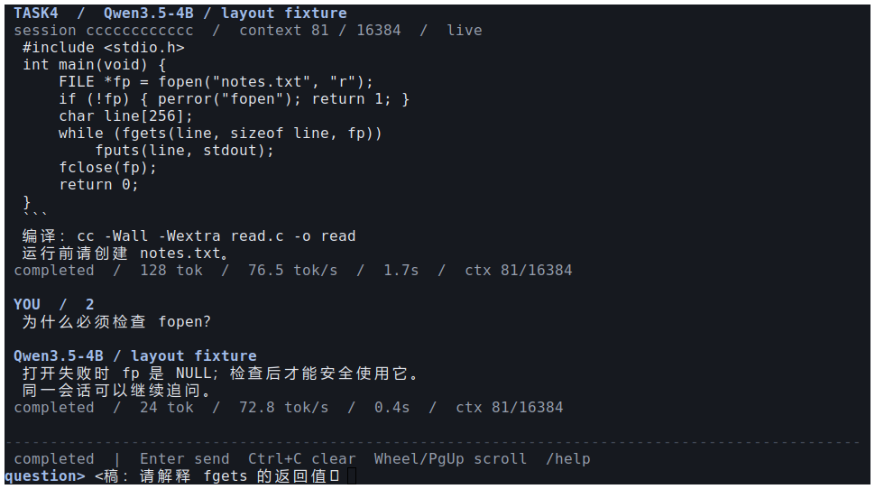
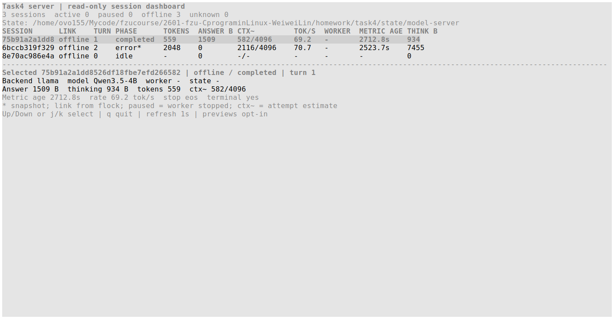
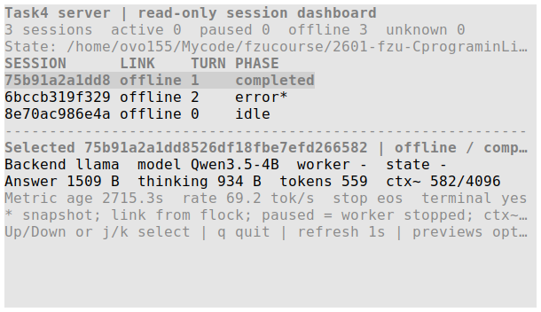

# 客户端 TUI 与服务端看板

在 `homework/task4` 编译后，每个终端直接运行 `./bin/stream_client`。默认浅色主题以纯黑显示问题与正式回答，以灰色显示思考、运行说明和每轮指标。`--theme dark` 或 `/theme dark` 适用于深色终端。TUI 使用备用屏幕，退出后恢复原终端；恢复路径会打印在命令行中。

## 显示与操作

| 区域/操作 | 行为 |
| --- | --- |
| 顶部 | 会话、模型及当前输入/上下文容量 |
| 对话区 | 问题、灰色思考、正式回答、每轮末尾的灰色状态属性 |
| 底栏 | 当前阶段和可用操作；STATUS 原地更新，心跳不显示 |
| 输入区 | 生成期间仍可编辑草稿，输出和缩放不清除草稿 |
| PgUp / PgDn | 对话翻页；翻到尾部后重新跟随生成 |
| 鼠标滚轮 | 每次滚动对话约 3 行，保留输入草稿；不调用问题历史 |
| ↑ / ↓ | 在输入区召回本会话问题历史，↓ 可回到未发送草稿 |
| Ctrl+L | 重绘整个界面 |
| `/thinking` | 隐藏/显示思考，仅影响界面，不发给模型 |
| `/theme light`、`/theme dark` | 切换配色，不改变当前轮次 |
| `/stop`、生成中 Ctrl+C | 取消当前轮，保留连接 |
| `/steer 修改要求` | 持久化要求、取消旧轮、合并原问题并提交新轮 |
| 空闲 Ctrl+C | 清除草稿 |
| `/quit` | 生成中先取消再退出；空闲时直接退出 |
| `/sessions` | 列出本地会话 ID 和是否正被其他客户端使用 |
| `/new` | 新建独立会话；生成中切出时保留旧断点 |
| `/switch ID` 或 `/switch FILE` | 切换到已保存会话，恢复已归档的多轮正文；未完成轮用 `/retry` 继续 |
| `/delete [ID]` | 将指定本地会话移入 `.trash`；省略 ID 表示当前受管理会话，其他客户端正在使用时拒绝 |
| `/retry` | 重新连接并续写当前断点；无待完成轮时仅重连 |

左右键、Home/End、Ctrl+A/E、Ctrl+U/K/W、Backspace/Delete 和 ↑/↓ 输入历史继续可用。编辑单位是 UTF-8 码点；组合字符和 emoji 字素簇不是整体编辑单位。bracketed paste 中的换行合并为空格，检查后按 Enter 提交。

`thinking`、`answering` 和 `finishing` 都仍是未完成阶段。模型上报结束指标后，课程服务端还要等待生成进程成功退出、保存完成标记并返回 END，客户端才显示 `completed`。token 与速度来自模型指标；思考消耗生成预算，但不会进入下一轮历史。

完整交互 TUI 的网络错误、模型错误和预算耗尽在对话中显示，进程和输入区保留。可用 `/retry` 继续，`/stop` 重连并取消旧轮，或 `/new`、`/switch` 切换会话。失败轮之后直接输入文字，会按纠偏处理，先持久保存要求并确认旧轮取消，再提交下一轮。批处理、`--plain`、`--resume-only` 保留命令行退出码行为。

删除只影响客户端的本地会话列表：整个目录连同 checkpoint、历史和原锁 inode 移入 `state/clients/.trash/`，服务端副本保留。可从回收目录的 `checkpoint.ckpt` 显式恢复；不要删除锁文件来强行解锁。切换遇到路径错误、损坏 checkpoint 或其他客户端持锁时，保留当前会话并继续接收当前生成；切回当前会话或删除其他闲置会话同样不打断输出。

## 流式显示与缓冲

绘制先构建完整行，再比较上一帧，只合并输出有变化的行和光标。刷新上限约 30 FPS；UTF-8 不完整字符先缓冲，状态、思考和正文均进入各自显示缓存。单个有界待发送帧通过独立的非阻塞终端描述符写出；终端输出拥塞时继续接收网络和保存 checkpoint，显示恢复后合并到最新画面，不积累无限帧，也不人为增加模型 token 或打印延迟。

在 140×38、32 个单字节增量、45 ms 间隔的受控负载下，ANSI 输出为 3,147 字节，包含 38 次行定位。这是界面输出量，不代表模型生成速度。真实 PTY 超过两秒不读取输出时，客户端在终端恢复读取前已接收 END 并保存完成断点。证据见 [渲染对照](../logs/render-benchmark.json) 和 `tests/verify_mouse_render.py`。

滚轮启用鼠标报告并关闭兼容终端的 alternate-scroll，避免备用屏幕把滚轮变成方向键。正常退出或暂停时关闭鼠标并尝试恢复原模式；不支持模式保存的终端至少恢复到鼠标报告关闭。具体支持依据 [xterm 控制序列](https://invisible-island.net/xterm/ctlseqs/ctlseqs.html) 和 [xterm.js 支持列表](https://xtermjs.org/docs/api/vtfeatures/)。

## 窗口适配与证据

客户端截图使用真实 C 客户端，其 stdin/stdout/stderr 同时接到一个 PTY。可控 T4 对端发送中文问题对应的思考、正文和指标；同一客户端连续缩放，再将各尺寸的实际 ANSI 重绘字节原样重放到相同尺寸的独立 xterm 截图。文字为布局测试夹具，不能当作 Qwen 回答质量证据。

以下截图来自 **PTY + xterm 验证**，未在 VS Code 集成终端实测。VS Code 可直接使用相同 ANSI/termios 客户端；字体、emoji 宽度及输入法最终以用户终端表现为准。

截图中的中文可正常显示，测试草稿末尾的 `🙂` 在该 xterm 字体组合下呈缺字方框；这是截图终端的字体限制。屏幕测试另行核对缩放、编辑后提交的原始 UTF-8 问题，确认 emoji 字节没有丢失。

布局断言、尺寸清单和实际 ANSI 分别保存在 [tui-layout.txt](../logs/tui-layout.txt)、[tui-layout-manifest.json](../logs/tui-layout-manifest.json) 与 `logs/tui-*.ansi`，本次截图命令和字体设置见 [采集方法](../logs/tui-capture-method.txt)。用 `python3 tests/verify_tui.py --capture` 重建这些记录；截图可选工具 `scripts/capture_terminal.py` 读取指定 ANSI，在自有 xterm 中校准实际行列后截取窗口，需要 xterm、Pillow、python-xlib，不属于客户端运行依赖。

在具备上述截图工具及 X11 显示的环境中，例如重放窄窗口：

```sh
python3 scripts/capture_terminal.py --log logs/tui-light-60x18.ansi \
  --output screenshots/16-tui-light-60x18.png --columns 60 --rows 18
```

| 尺寸（列 × 行） | 重点 |
| --- | --- |
| 140 × 38 | 完整多轮、思考与指标、宽输入区 |
| 96 × 28 | 常规终端重排 |
| 60 × 18 | 窄窗口换行，底部草稿仍保留 |
| 40 × 10 | 紧凑布局、对话可翻页 |
| 96 × 28 深色 | 即时主题切换 |









会话管理与错误恢复截图采用同样的真实 PTY → ANSI → 自有 xterm 采集方式，图内明确标注 `[UI fixture]`，不代表 Qwen 实际回答。96×28 中先完成两轮、创建另一个会话，再切回并列出会话；60×18 中对端注入错误后，客户端继续保留正文与中文输入草稿。


取消和纠偏同样使用当前客户端采集：


用 `python3 scripts/capture_conversation_ui.py` 可重建这三张图的实际 ANSI 和来源记录，截图环境与完整命令见 [采集方法](../logs/conversation-ui-capture-method.txt)。鼠标测试直接发送分段 SGR/X10 事件，核对视口变化、草稿不变和键盘历史仍可用；不会把用键盘模拟滚轮当作鼠标验证。

窄窗口使用紧凑布局；小于 12 列或 4 行时只显示放大提示，草稿保留，放大后恢复正文与输入行。极小窗口不适合完整阅读，可使用滚轮、PgUp/PgDn 或增大终端。UI 本地保留约 1 MiB、128 条记录，超出后淘汰旧显示内容；这不删除磁盘记录，也不截断模型历史。客户端将完成或取消的轮次另存到 `<checkpoint>.history/`，切回会话时恢复其中的多轮正文及输入历史。未归档的更早轮次无法恢复到显示区；现有 checkpoint 的当前轮仍可恢复，完整模型历史仍由服务端维护。

## 服务端看板

```sh
python3 scripts/server/dashboard.py --state state/model-server
```

此进程只读会话文件和 Linux 锁信息，默认不显示问题/思考正文。↑/↓、j/k 选择行，q 退出；`--preview` 显式开启短问题预览。非交互终端使用 `--once` 或 `--json`。看板每秒刷新，列不足时压缩表格、保留选中会话详情。





看板截图读取现有真实会话，三个会话当时均离线，包含完成、失败和未提问状态；旧轮仍显示其冻结的 4096 容量。`offline` 不等于完成，`paused` 指持锁 worker 被暂停。指标带快照年龄，`*` 表示不能当作实时进度；`ctx~` 是当前尝试的输入加已生成 token 估计，不代表 GPU KV cache 的精确占用。完整锁、刷新和缩放验证见 [当前验证记录](../logs/verify-current.txt)。

## 兼容与模块

`--plain` 使用传统逐行显示；非 TTY 和 `--input` 自动保持批处理行为。正式回答仍写 stdout，思考和最终统计写 stderr；`--verbose-status` 可在逐行模式下开启原始 STATUS 调试输出。重定向 stdout 不会把思考或界面控制码写进回答文件。

| 文件 | 职责 |
| --- | --- |
| `src/client/main.c` | 网络与交互状态机、独立网络期限、显示事件路由 |
| `src/client/terminal.c` | termios、按键编辑、信号生命周期、重绘节流 |
| `src/client/view.c` | 按列宽重排、主题、思考/正文配色、状态栏与翻页 |
| `src/client/screen.c` | 逐行差异、合帧、非阻塞输出和有界待发送帧 |
| `src/client/state.c` | 会话枚举、软删除、锁保护与终态正文归档 |
| `src/client/status.c` | 用 jsmn 解析显示指标，保留未更新字段 |
| `deps/jsmn/` | 固定版本的 MIT JSON tokenizer、许可证和来源哈希 |
| `scripts/server/dashboard.py` | 独立 Python curses 只读看板 |

界面交互参考 [OpenCode TUI 文档](https://opencode.ai/docs/tui/)，没有引入其框架或运行时。C 客户端无需安装终端 UI 库；看板使用 Linux Python 标准库 curses。STATUS、THINK 与界面缓存都不会作为模型历史消息。
