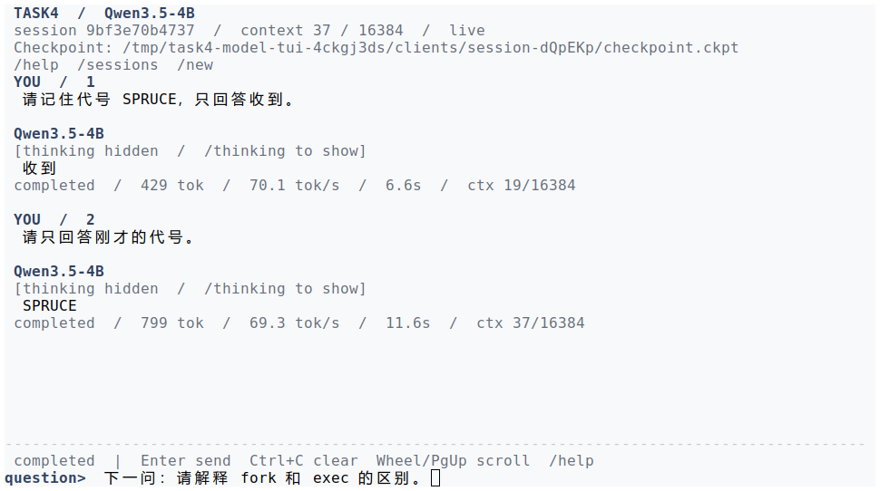
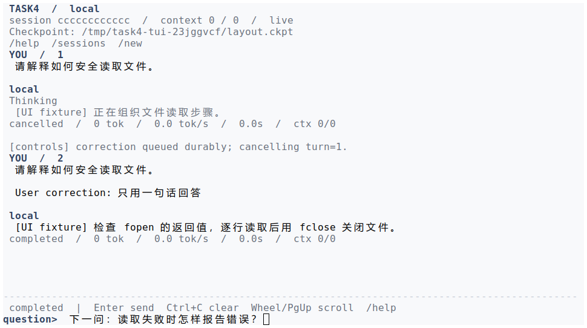
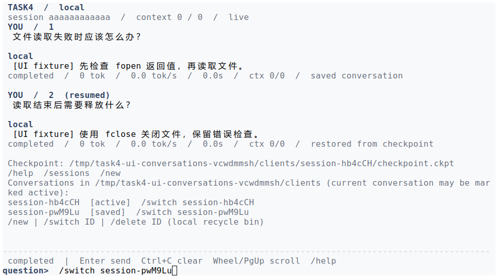

学号：待填写　　姓名：待填写（组长）　　专业：待填写　　班级：待填写

# 《Linux操作系统设计实践》实验四：综合应用

实验日期：2026 年 10 月 14 日　　选用方案：方案 4

本人分工：主负责人，负责系统设计、核心实现与集成；工作量占比 45%。

## 一、实验环境

| 项目 | 小组共用开发与验证环境 |
| --- | --- |
| 操作系统 | Ubuntu 24.04.2 LTS，WSL2，x86_64 |
| 内核 | 6.6.87.2-microsoft-standard-WSL2 |
| 编译与构建 | GCC 13.3.0、GNU Make 4.3 |
| 严格编译参数 | `-std=c11 -Wall -Wextra -Wpedantic -Werror -O2 -g` |
| CPU | AMD Ryzen AI 7 H 350，8 核 16 线程 |
| GPU | NVIDIA GeForce RTX 5060 Laptop GPU，约 8 GB 显存，通过 WSL `/dev/dxg` 使用 |
| 模型 | Qwen3.5-4B，Q5_K_M GGUF，文件 3,143,656,608 字节 |
| 推理引擎 | llama.cpp b11429，commit `d81235049384534c167caea52b85a694f6103d14` |
| CUDA 运行库 | 随固定引擎版本提供的 CUDA 13.4 用户态运行包，放在项目 `.runtime/` |
| 模型配置 | 全层 GPU；2 个槽，每槽 16384 token；新轮每次尝试最多生成 4096 token |
| 辅助语言 | Python 3.12，模型适配和验证使用标准库 |

本报告命令均从 `homework/task4` 目录执行。环境来自小组既有[硬件记录](../../logs/model-hardware.txt)和[模型说明](../../docs/local-model.md)，运行数字引用已保存的联合验证记录。下载依赖需要联网，推理仅访问本机回环地址。身份信息由本人填写。

## 二、系统开发情况介绍

### 2.1 背景与需求

本实验把前三次实验涉及的进程管理、进程间通信和文件操作组合成一个持续交互系统。选用方案 4 后，程序既要接入本地模型，又要让多个客户端在生成期间继续接收内容、提交控制操作，并在中断后保留已交付的回答。设计重点是连接、进程与持久状态之间的配合。

依据[实验指导书](../../../../ppt/《Linux操作系统设计实践》2026-2027第一学期-实验指导书.pdf)第 7–9 页（印刷页码 5–7），系统保留独立客户端、服务端和生成程序；支持多客户端并发、即时流式显示、文件和日志隔离，以及同连接多轮上下文。文本由本机模型生成，不调用外部大模型 API。模型回答质量不作为主要考察项。

| 需求 | 核心处理方式 | 判断依据 |
| --- | --- | --- |
| 多客户端并发 | 每连接独立 worker，每轮启动模型适配进程，共享双槽模型服务 | 客户端会话标识、轮次文件、流式进展分别检查 |
| 边生成边显示 | TCP 分帧；模型 SSE 转换为 THINK/DELTA | 正式回答按完整 UTF-8 码点交付 |
| 多轮上下文隔离 | 仅读取当前会话之前已完成的轮次 | 两路各自回忆代号，历史不混用 |
| 生成时取消和纠偏 | 控制帧与模型输出共同进入事件循环 | 确认旧轮终态后才提交新请求 |
| 中断后恢复 | journal、服务端正文和客户端 checkpoint 分层落盘 | 已保存前缀保持不变，重放缺口后继续 |
| 可操作的终端 | 固定输入区、非阻塞绘制、会话入口和错误后重试 | 界面阻塞不阻止网络接收与状态保存 |

系统按行收集问题，分帧上传，在 COMMIT 后开始推理；未提交的按键不进入模型。当前只处理文本，不支持工具执行、自动修改文件或视觉输入。

### 2.2 成员与任务分配

| 成员 | 姓名、学号 | 分工与涉及功能代码 | 工作量 |
| --- | --- | --- | ---: |
| 主负责人（本人，组长） | 姓名：待填写；学号：待填写 | 总体方案；`src/net/protocol.c`、`src/server/main.c` 的协议与服务端；`src/client/main.c` 主流程；`src/backend/` 和模型适配核心；构建配置、接口约定与最终集成 | 45% |
| 协作成员一 | 姓名：待填写；学号：待填写 | 在总体方案基础上协助客户端终端输入、界面呈现、控制操作联调和界面验证；重点涉及 `src/client/terminal.c`、`view.c`、`screen.c`、`status.c` 及相关头文件 | 27.5% |
| 协作成员二 | 姓名：待填写；学号：待填写 | 协助会话文件、断点恢复、服务发现、测试与运行记录核对；重点涉及 `src/storage/`、`src/client/state.c`、`src/net/discovery.c`、`src/model/discovery.py` 及相关头文件 | 27.5% |

工作量按需求分析、代码实现与协助完善、联调、验证和记录整理综合分配，合计 100%，不按文件行数或报告篇幅直接换算。本人承担系统主线和关键接口的设计实现，两位成员在此基础上完成各自范围的协作工作。最终完整代码由组长统一提交。

本人工作进一步分为总体方案和接口约定 10%、协议与服务端核心 15%、本地模型接入 12%、客户端主流程及最终集成 8%。这些比例用于说明任务范围，不是计时工具测得的工时。

### 2.3 架构与文件组成

```text
C client A --TCP-- C worker A --socketpair-- Python adapter A --HTTP/SSE--+
     |                 |                        |                       |
checkpoint A       session A             raw generation A               +-- llama-server -- CUDA GPU
C client B --TCP-- C worker B --socketpair-- Python adapter B --HTTP/SSE--+
     |                 |                        |
checkpoint B       session B             raw generation B
```

主服务进程接收 TCP 连接并派生 worker；worker 负责一个会话，每轮用 fork/exec 启动独立适配进程。适配进程通过本机 HTTP/SSE 使用常驻 llama-server，避免每轮重新加载模型权重。不同客户端的会话目录、问题、正式回答、原始生成记录和诊断日志分别保存。

| 目录或文件 | 职责 | 本人接口与集成工作 |
| --- | --- | --- |
| `include/task4/` | 协议、生成、存储和终端等公共接口 | 统一消息类型、字节游标和模块边界 |
| `src/net/protocol.c`、`src/server/main.c` | 完整帧收发、worker 状态与生成调度 | 核心实现 |
| `src/client/main.c` | 网络、终端、会话操作和控制状态的主循环 | 核心实现与客户端模块集成 |
| `src/backend/` | 适配进程启动/停止、模型配置冻结 | 核心实现 |
| `src/model/adapter.py`、`journal.py`、`stream.py`、`transport.py` | 历史构造、模板、SSE、思考解析和持久原始前缀 | 模型接入与恢复契约 |
| `src/client/` 其他文件 | 输入、布局、指标、显示、会话管理 | 按成员分工协作联调 |
| `src/storage/`、两层 `discovery` | 文件与终态保存、恢复和地址发现 | 确定持久顺序，与协作成员二联调 |
| `Makefile`、`config/model.json` | 构建与新轮模型配置 | 统一构建入口和配置边界 |
| `tests/`、`logs/`、`screenshots/` | 确定性检查、真实模型验证和演示证据 | 集成验收与记录核对 |

原报告的公共头文件 12 个、C 源文件 14 个、模型 Python 模块 5 个，共 6067 行，含注释和空行，不含构建、安装、测试辅助脚本和文档。本篇附录保留本人重点说明的 13 个源码/头文件，共 2785 行，另有 Makefile 53 行和模型配置 14 行，共 2852 行。代码行数用于说明规模，不等于个人独立编写量。

| 本篇附录文件 | 行数 | 本篇附录文件 | 行数 |
| --- | ---: | --- | ---: |
| `include/task4/backend.h` | 35 | `include/task4/files.h` | 12 |
| `include/task4/protocol.h` | 58 | `include/task4/text.h` | 22 |
| `src/backend/model.c` | 59 | `src/backend/process.c` | 82 |
| `src/client/main.c` | 1031 | `src/net/protocol.c` | 316 |
| `src/server/main.c` | 385 | `src/model/adapter.py` | 397 |
| `src/model/journal.py` | 126 | `src/model/stream.py` | 54 |
| `src/model/transport.py` | 208 | `Makefile` | 53 |
| `config/model.json` | 14 | 合计 | 2852 |

### 2.4 主要系统调用与关键顺序

| 接口 | 本实验中的用途 |
| --- | --- |
| `socket/bind/listen/accept/connect` | 建立客户端与服务端 TCP 连接 |
| `socketpair`、`fork/execvp/dup2` | 建立生成事件通道，启动独立适配进程并分离日志 |
| `poll/send/recv`、`pidfd_open` | 同时关注网络、生成输出和子进程退出，处理部分收发 |
| `sigaction/kill/waitpid/prctl` | 将信号转为控制事件，终止和回收子进程，处理父进程异常 |
| `open/read/write/close`、`fsync/rename` | 保存问题、回答和状态，先持久化再向下一层交付 |
| `flock` | 约束同一会话或 checkpoint 的写入者 |
| `clock_gettime` | 用单调时钟管理完整帧期限 |
| `tcgetattr/tcsetattr/ioctl` | 与客户端交互模块配合，管理终端模式和窗口尺寸 |

TCP 是字节流，不能假设一次 `recv` 得到完整消息。协议头由五个网络序 uint32 组成，分别是 magic、type、request_id、offset、length，共 20 字节。BEGIN/INPUT/COMMIT 负责上传问题；THINK、DELTA 分离思考与正式回答；END、CANCELLED 表示不同终态。STATUS 和 HEARTBEAT 不进入正文游标或下一轮模型历史。

正式回答的顺序为“原始 SSE 片段落盘 → 解析 → 服务端正文落盘 → 发送 DELTA → 客户端 checkpoint 落盘 → 显示”。这样服务端可以领先客户端，重连后重放差额；客户端不能凭未持久化的显示内容推进恢复偏移。思考标签可能跨 SSE 片段，解析器保留尚未确认的标签前缀，避免把半个标签写成正文。

### 2.5 本地模型接入与控制状态

模型适配器先用 `/apply-template` 固定聊天模板，再用 `/completion` 获取流。下一轮只从当前会话已完成轮次读取问题和正式回答，构造结构化 user/assistant 消息。取消轮次、半段回答、思考和状态不进入历史；`context.txt` 是供人核查的文本，不通过其中的角色字符串反向推断结构。

同一未完成轮恢复时，冻结提示词和 `raw-generation.jsonl` 中的原始生成前缀一起用于续写。恢复前核对模型、构建、模板和容量；运行地址可以变化，但推理配置沿用本轮快照。该方法保留已交付前缀，不保存 GPU KV cache 和采样器状态，因此新后缀可能与不中断的运行不同。

正常生成结束且子进程成功退出后才写 `done`。预算耗尽、上下文不足、HTTP 异常或缺少完成事件的 EOF 保持未完成状态。显式取消则先停止并回收适配进程，保存 `cancelled`，再确认；意外断线不等于取消。纠偏先把修改要求持久保存，收到旧轮终态后再提交包含原问题和修正的新请求。END 与 CANCEL 交叉到达时，按已保存终态处理，不让迟到确认污染下一轮。

### 2.6 模型选择与资源配置

| 本机短基准 | 生成速度 | 样本条件 |
| --- | ---: | --- |
| Q5_K_M / CUDA | 80.52 ± 0.52 token/s | 64 个生成 token，3 次 |
| Q4_K_M / CUDA | 86.34 ± 1.57 token/s | 64 个生成 token，3 次 |
| Q5_K_M / CPU | 14.78 token/s | 16 个生成 token，单次 |

记录见 [Q5 GPU](../../logs/model-q5-gpu-raw.txt)、[Q4 GPU](../../logs/model-q4-gpu-raw.txt)、[Q5 CPU](../../logs/model-q5-cpu-only-raw.txt)。这些样本只支持本机可运行及短时速度比较，不能推导长期并发吞吐，也不能用于比较回答质量。

双槽容量记录中，两路各输入 5529 token，分别在 3.768/4.040 秒以 EOS 结束，未截断上下文，显存占用约 5921/8151 MiB，含桌面等已有占用。该[容量探测](../../logs/model-context-16k.txt)实际只给每路 16 个输出 token；当时默认生成预算为 2048，当前新轮默认已为 4096。容量窗口、生成预算和网络等待期限分别限制不同资源，不应混为一谈。

## 三、程序运行演示说明

### 3.1 编译与启动

在 `homework/task4` 目录执行：

```sh
make -j4 CFLAGS='-std=c11 -Wall -Wextra -Wpedantic -Werror -O2 -g'
make verify
make -q
```

已有[验证记录](../../logs/verify-current.txt)包含严格构建和完整自动检查。检查使用真实 C 程序、隔离临时状态与可控模型事件或本机 HTTP 对端，覆盖协议、恢复、取消、发现、终端和适配器；它与真实模型测试分别支持不同结论。

首次部署执行 `python3 scripts/model/setup.py`，然后在不同终端依次运行模型服务、课程服务端和客户端：

```sh
# 终端一：本机模型
bash scripts/model/serve.sh gpu
# 终端二：课程服务端
./bin/stream_server --state state/model-server
# 终端三、四：分别启动独立客户端
./bin/stream_client
```

两层服务可自动分配端口。无参数客户端选择唯一活动服务；存在多个课程服务时，用 `./bin/stream_client --server-state state/model-server` 指定。模型启动器只在验证匹配后复用已有实例，运行地址与本轮冻结的推理参数分开处理。

### 3.2 并发与多轮上下文

```sh
python3 scripts/model/smoke.py
```

该脚本启动两个真实 C 客户端，第一轮分别设置代号，第二轮在各自连接中提问。已有[真实模型记录](../../logs/model-smoke.txt)显示两路分别回答 MAPLE、CEDAR，会话 token 不同，历史与正式正文分别保存，整项检查耗时 15.530 秒。另一次使用自动端口的检查耗时 21.825 秒，见[自动发现记录](../../logs/model-smoke-auto-ports.txt)。两次样本的耗时不作为并发速度上界。



图 1 为原项目真实模型 TUI 记录：两轮正确回忆 SPRUCE，新建后切回原会话仍能显示正文；思考只在界面隐藏。对应配置为 4096-token 尝试预算、16384-token 上下文，包含采集和会话切换的检查耗时 19.013 秒，见[日志](../../logs/model-tui-4096.txt)。

### 3.3 取消、纠偏与断点恢复

生成期间输入 `/stop` 或 Ctrl+C 取消；输入 `/steer 请只用中文，并把最终回答限制为一句话`，则终结旧轮并发起修正请求。`/retry` 恢复未完成轮；命令行也可以列出会话后指定 checkpoint：

```sh
./bin/stream_client --list-sessions
./bin/stream_client --resume 路径/checkpoint.ckpt --resume-only
```



图 2 使用可控对端提供的界面文本，展示当前 C 客户端的操作状态，不作为真实模型回答证据。真实控制结果见[模型控制日志](../../logs/model-controls.txt)：单次纠偏、停止确认分别为 8.363 ms、5.025 ms，纠偏后的正式回答为 LINUX。独立的 `thinking=false` 恢复检查在保存 8 字节正文后用 SIGTERM 中断，恢复后最终为 140 字节，并保留相同前缀、请求编号和模型快照。日常配置仍为 `thinking=true`。

客户端 checkpoint 和服务端原状态目录都需保留。完成轮只重放缓存，未完成轮才尝试续写。取消后的部分正文可留在磁盘，但不作为下一轮模型历史。

### 3.4 集成后的交互与观察入口

客户端提供 `/sessions`、`/new`、`/switch ID|FILE`、`/delete [ID]`。切出生成中的会话会保留断点，切回可重试；错误留在当前对话中，输入区继续可用。客户端显示与磁盘归档、模型历史分别管理，清理显示缓存不会修改模型输入。



图 3 使用界面夹具，重点说明会话切换后的正文恢复。图 1–3 均为小组已有白底截图；采集使用实际 C 客户端的全 stdio PTY 重绘，并原样重放到相同尺寸的 xterm，见[截图来源记录](../../logs/report-screenshots-current.json)。真实模型图与夹具图分别说明模型输出和交互行为。

```sh
python3 scripts/server/dashboard.py --state state/model-server
```

只读看板显示连接、阶段与带时效的模型指标，不获取业务锁，也不写会话文件。`ctx~` 是输入加已生成 token 的估计，不是 GPU KV cache 的精确用量。

## 四、实验结果总结

从系统集成角度，已有记录支持方案 4 的主要目标：两个客户端能经 C 服务端使用本机模型，边生成边接收正式回答；各自的多轮历史、问题、日志和恢复文件分离。取消、纠偏和意外中断具有不同状态，已落盘正文不会因为重连而整体丢失。客户端交互模块和存储模块接入同一套请求编号、游标与终态约定，使这些功能能够连续使用。

系统的优点是各层职责和交付顺序明确。C 负责连接、进程、信号与文件；Python 标准库模块处理模型模板和流协议；常驻推理服务共享权重，适配进程按轮次隔离。已有可控检查可以定位协议或状态问题，真实模型日志再验证整条调用链。取消时停止的是本轮适配进程，不需要结束共享模型服务。

限制也来自这些边界。恢复只保证已保存的文本前缀，不保证后续采样与连续推理完全一致；两个推理槽不能保证每路维持单路短基准速度。模型历史没有自动摘要，长对话可能用尽冻结容量；输出预算包含思考和正文，增加预算也不一定解决长思考。协议面向本机课程实验，没有 TLS 和独立账户认证。

后续改进应先补充更长时间、更多输入规模的并发和故障样本，再考虑排队提示、明确的历史裁剪策略及容量准入说明。任何历史处理都应让用户知道发生了什么，并保持当前恢复轮次的快照一致。就本人负责的整体设计而言，下一步重点是缩小客户端主流程的职责范围，使控制状态更容易单独检查。

## 五、编程工作总结

我在小组中承担总体方案、核心调用链和最终集成。对我而言，这次实验的主要工作是把进程管理、网络通信和文件操作组织成能够持续运行的系统。最初的功能要求可以写成“接收问题、生成文本、发送回答”，但真正落到程序中，还必须说明每个阶段由哪个进程负责，哪些数据已经保存，以及出现中断后允许从哪里继续。为此，我把请求编号、正文偏移、完成和取消状态作为各模块的共同约定。两位成员分别围绕交互和恢复验证协助完善，集成时仍按这些约定核对接口。

在网络部分，我重点梳理了字节流和消息之间的关系。TCP 不保留应用层消息边界，完整协议头也可能分几次收到，因此收发函数需要持续处理剩余字节，长度和类型检查不能只放在上层业务中。超时也不能因每次收到一点数据而无限延后，所以完整帧采用单调时钟期限。模型生成较慢时，由独立心跳维持连接等待，不能依赖终端不断重绘来证明网络仍然正常。这些处理让我进一步理解了 `poll`、部分读写和非阻塞操作各自解决的问题。

模型接入需要自学本地推理服务的模板和 SSE 事件格式，同时保留课程程序的进程边界。适配器以独立进程运行，正式事件与诊断日志分开，服务端才能在取消时终止并回收本轮进程。思考标签可能被拆在多个事件中，直接按单个片段替换标签会误把未完成标签当作正文。增量解析时保留待确认前缀，再按完整 UTF-8 码点交付，才使思考显示、正式回答和恢复游标保持一致。模型适配进程的输出 EOF 也不能直接视为回答完成，仍需检查完成事件和退出结果。

恢复设计中最需要明确的是落盘顺序。若先把文字发送出去，之后才保存，客户端看到的内容可能在服务端崩溃后无法重放。因此原始生成、服务端正文和客户端 checkpoint 都采用先保存再向下一层交付的顺序。各层记录的进度可以暂时不同，但已交付数据必须能由上游持久记录还原，客户端正文必须是服务端正式回答的前缀。重新执行模型并跳过若干字节不能保证得到原文本，因而未完成轮使用冻结提示词与原始生成前缀续写。我也保留了这一设计的限制：没有保存 KV cache 和随机采样状态，不能把前缀一致误写成整个推理过程完全重现。

取消与纠偏的处理进一步说明了状态顺序的重要性。取消必须在停止生成进程、保存终态之后确认；纠偏则还要先保存用户的修改，等待旧轮终结，再提交新轮。若 END 与 CANCEL 交叉到达，应按已经保存的状态回复，不能简单把迟到帧当成下一轮事件。主循环因此需要同时理解网络事件、进程状态和持久记录，而不是分别调用几个接口就算完成功能。

集成验收时，我把功能检查、界面夹具和真实模型记录分开看。可控对端适合复现半帧、取消竞争和错误路径，真实模型检查适合确认并发生成、上下文隔离与本地部署通路。界面截图能够说明操作呈现，却不能替代模型日志或文件核对。此次整理也促使我检查测试参数与文字说明是否一致，例如容量探测的输出预算不能与当时默认配置混用。我的收获是，系统是否可靠不仅取决于正常路径是否能运行，也取决于失败后的状态是否有清楚含义，以及报告中的每个结论能否对应到具体证据。

## 六、注释源码附录

以下按原报告保存本篇涉及的完整源码文件、Makefile 和配置，保留已有代码注释。附录范围对应上文职责说明，公共依赖在项目中统一编译；单篇报告不是可单独构建的源码包。完整可编译项目、其余模块及运行说明由组长统一提交，见[项目说明](../../README.md)。

附录阅读重点：`protocol.c` 的完整帧期限与 UTF-8 校验；`server/main.c` 的进程、落盘和终态顺序；`client/main.c` 的控制状态衔接；适配器的完成历史、模板快照与前缀恢复。代码正文与原报告对应文件一致。

<!-- source-appendix -->

### 附录 1：include/task4/backend.h

```c
#ifndef TASK4_BACKEND_H
#define TASK4_BACKEND_H

#include <stdint.h>
#include <sys/types.h>

struct t4_generation {
    pid_t pid;
    int fd; /* Nonblocking socket receiving the adapter's framed stdout. */
};

/*
 * prepare snapshots model configuration for a durable turn; start may be
 * called again after disconnect. Model output uses typed T4 frames, and its
 * own raw journal preserves the generated prefix across fresh inference jobs.
 */
struct t4_backend {
    const char *name;
    int (*prepare)(const char *model_config, const char *turn_dir);
    /* runtime_config supplies transport routing only; a model turn keeps its
     * frozen prompt, sampling options and limits across server port changes. */
    int (*start)(const char *adapter, const char *turn_dir,
                 const char *context_path, const char *runtime_config,
                 uint32_t offset,
                 struct t4_generation *generation);
};

extern const struct t4_backend t4_model_backend;

/* Closes the pipe, terminates and reaps the child, and sets both fields to -1. */
void t4_generation_stop(struct t4_generation *generation);
int t4_generation_spawn(char *const argv[], const char *log_path,
                        struct t4_generation *generation);

#endif
```

### 附录 2：include/task4/files.h

```c
#ifndef TASK4_FILES_H
#define TASK4_FILES_H

#include <limits.h>
#include <stddef.h>

/* 两侧共有的文件工具，不依赖服务端会话或生成后端。 */
int t4_path(char result[PATH_MAX], const char *directory, const char *name);
int t4_write_all(int fd, const void *data, size_t length);
int t4_directory_sync(const char *directory);

#endif
```

### 附录 3：include/task4/protocol.h

```c
#ifndef TASK4_PROTOCOL_H
#define TASK4_PROTOCOL_H

#include <stdint.h>

/* Five network-order uint32_t fields form the fixed 20-byte header. */
#define T4_MAGIC UINT32_C(0x54345331)
#define T4_MAX_FRAME UINT32_C(4096)
#define T4_MAX_PROMPT UINT32_C(4096)
#define T4_MAX_RESPONSE UINT32_C(16777216)

enum t4_frame_type {
    T4_HELLO = 1,
    T4_WELCOME = 2,
    T4_BEGIN = 3,
    T4_INPUT = 4,
    T4_COMMIT = 5,
    T4_DELTA = 6,
    T4_END = 7,
    T4_ERROR = 8,
    T4_HEARTBEAT = 9,
    T4_THINK = 10,       /* 独立思考流，不推进 final answer 的恢复游标。 */
    T4_CANCEL = 11,      /* 结束当前轮次；断线本身不等于取消。 */
    T4_CANCELLED = 12,
    T4_STATUS = 13,
    T4_PROBE = 14,      /* Optional read-only service identity check, before HELLO. */
    T4_SERVICE = 15     /* 32-byte instance nonce; never a session/history record. */
};

struct t4_frame {
    uint32_t type;
    uint32_t request_id;
    uint32_t offset;
    uint32_t length;
    unsigned char data[T4_MAX_FRAME + 1U];
};

/*
 * A complete frame has a monotonic-clock deadline of idle_ms milliseconds.
 * Partial transfers are completed internally. EINTR is returned to the caller
 * so a signal handler can ask its event loop to stop. Payloads are raw bytes;
 * applications must check their own text and state-machine requirements.
 */
/* Returns 1 for a complete send, and -1 on error. */
int t4_send(int fd, const struct t4_frame *frame, int idle_ms);
/* Returns 1 for a frame, 0 only for EOF between frames, and -1 on error. */
int t4_recv(int fd, struct t4_frame *frame, int idle_ms);

/* Returned sockets are nonblocking, close-on-exec, and use TCP_NODELAY. */
int t4_connect(const char *host, uint16_t port, int idle_ms);
/* IPv4 only; a NULL bind address selects 127.0.0.1. Port 0 selects a free port. */
int t4_listen(const char *bind_ipv4, uint16_t port, uint16_t *actual_port);

/* Strict unsigned decimal parsing: no signs, whitespace, or trailing text. */
int t4_uint(const char *text, uint32_t minimum, uint32_t maximum,
            uint32_t *value);

#endif
```

### 附录 4：include/task4/text.h

```c
#ifndef TASK4_TEXT_H
#define TASK4_TEXT_H
#include <stddef.h>

/* 检查一个完整 Unicode 码点；不允许过长编码、代理项或超出 U+10FFFF。 */
static inline unsigned t4_character_width(unsigned char c)
{
    if (c >= 1 && c <= 0x7f) return 1;
    if (c >= 0xc2 && c <= 0xdf) return 2;
    if (c >= 0xe0 && c <= 0xef) return 3;
    if (c >= 0xf0 && c <= 0xf4) return 4;
    return 0;
}
static inline int t4_character_valid(const unsigned char *p, size_t n)
{
    if (n == 0 || n != t4_character_width(p[0])) return 0;
    for (size_t i = 1; i < n; ++i) if (p[i] < 0x80 || p[i] > 0xbf) return 0;
    if (n == 3 && ((p[0] == 0xe0 && p[1] < 0xa0) || (p[0] == 0xed && p[1] >= 0xa0))) return 0;
    if (n == 4 && ((p[0] == 0xf0 && p[1] < 0x90) || (p[0] == 0xf4 && p[1] >= 0x90))) return 0;
    return 1;
}
#endif
```

### 附录 5：src/backend/model.c

```c
#include "task4/backend.h"
#include "task4/files.h"

#include <errno.h>
#include <fcntl.h>
#include <limits.h>
#include <stdio.h>
#include <unistd.h>

/* Freeze options with the turn; editing config affects new turns only. */
static int model_prepare(const char *config, const char *directory)
{
    char path[PATH_MAX];
    if (t4_path(path, directory, "model-config.json") < 0) return -1;
    int input = open(config, O_RDONLY | O_NOFOLLOW | O_CLOEXEC);
    if (input < 0) return -1;
    int output = open(path, O_WRONLY | O_CREAT | O_EXCL | O_CLOEXEC, 0600);
    int result = -1;
    if (output < 0) goto cleanup;
    char buffer[4096];
    size_t total = 0;
    for (;;) {
        ssize_t n = read(input, buffer, sizeof(buffer));
        if (n < 0 && errno == EINTR) continue;
        if (n < 0) goto cleanup;
        if (!n) break;
        total += (size_t)n;
        if (total > 65536) { errno = EFBIG; goto cleanup; }
        if (t4_write_all(output, buffer, (size_t)n) < 0) goto cleanup;
    }
    result = fsync(output);
cleanup:
    {
        int saved = errno;
        close(input);
        if (output >= 0) close(output);
        errno = saved;
        return result;
    }
}

static int model_start(const char *adapter, const char *directory,
                       const char *context, const char *runtime_config,
                       uint32_t offset,
                       struct t4_generation *generation)
{
    char config[PATH_MAX], log[PATH_MAX], cursor[11];
    if (t4_path(config, directory, "model-config.json") < 0 ||
        t4_path(log, directory, "generator.log") < 0) return -1;
    snprintf(cursor, sizeof(cursor), "%u", offset);
    char *const args[] = {"python3", (char *)adapter, "--turn", (char *)directory,
        "--context", (char *)context, "--offset", cursor, "--config", config,
        "--runtime-config", (char *)runtime_config, NULL};
    return t4_generation_spawn(args, log, generation);
}

const struct t4_backend t4_model_backend = {
    .name = "llama", .prepare = model_prepare, .start = model_start
};
```

### 附录 6：src/backend/process.c

```c
#define _GNU_SOURCE
#include "task4/backend.h"

#include <errno.h>
#include <fcntl.h>
#include <signal.h>
#include <stdio.h>
#include <string.h>
#include <sys/prctl.h>
#include <sys/socket.h>
#include <sys/wait.h>
#include <unistd.h>

/* The adapter has a bounded lifetime and owns only its stdio descriptors. */
int t4_generation_spawn(char *const argv[], const char *log_path,
                        struct t4_generation *generation)
{
    int pair[2], log = -1;
    generation->pid = generation->fd = -1;
    if (socketpair(AF_UNIX, SOCK_STREAM | SOCK_CLOEXEC, 0, pair) < 0) return -1;
    int flags = fcntl(pair[0], F_GETFL);
    if (flags < 0 || fcntl(pair[0], F_SETFL, flags | O_NONBLOCK) < 0) goto fail;
    log = open(log_path, O_WRONLY | O_CREAT | O_APPEND | O_CLOEXEC | O_NOFOLLOW, 0600);
    if (log < 0) goto fail;
    pid_t parent = getpid(), child = fork();
    if (child < 0) goto fail;
    if (!child) {
        struct sigaction action = {.sa_handler = SIG_DFL};
        sigset_t mask;
        sigemptyset(&action.sa_mask);
        const int signals[] = {SIGTERM, SIGINT, SIGHUP, SIGPIPE};
        for (unsigned i = 0; i < sizeof(signals) / sizeof(signals[0]); ++i)
            if (sigaction(signals[i], &action, NULL) < 0) _exit(126);
        sigemptyset(&mask);
        if (sigprocmask(SIG_SETMASK, &mask, NULL) < 0 ||
            prctl(PR_SET_PDEATHSIG, SIGTERM) < 0 || getppid() != parent) _exit(126);
        close(pair[0]);
        int null = open("/dev/null", O_RDONLY);
        if (null < 0 || dup2(null, STDIN_FILENO) < 0 ||
            dup2(pair[1], STDOUT_FILENO) < 0 || dup2(log, STDERR_FILENO) < 0 ||
            fcntl(STDIN_FILENO, F_SETFD, 0) < 0 ||
            fcntl(STDOUT_FILENO, F_SETFD, 0) < 0 ||
            fcntl(STDERR_FILENO, F_SETFD, 0) < 0) _exit(126);
        if (null > 2) close(null);
        if (pair[1] > 2) close(pair[1]);
        if (log > 2) close(log);
        execvp(argv[0], argv);
        dprintf(STDERR_FILENO, "exec generator: %s\n", strerror(errno));
        _exit(127);
    }
    close(pair[1]); close(log);
    generation->pid = child; generation->fd = pair[0];
    return 0;
fail:
    {
        int saved = errno;
        close(pair[0]); close(pair[1]);
        if (log >= 0) close(log);
        errno = saved;
        return -1;
    }
}

void t4_generation_stop(struct t4_generation *generation)
{
    int saved = errno;
    if (!generation) return;
    if (generation->fd >= 0) close(generation->fd);
    generation->fd = -1;
    if (generation->pid > 0) {
        kill(generation->pid, SIGTERM);
        pid_t reaped;
        do { reaped = waitpid(generation->pid, NULL, WNOHANG); } while (reaped < 0 && errno == EINTR);
        if (!reaped) {
            /* Cancellation remains bounded even for a misbehaving adapter. */
            kill(generation->pid, SIGKILL);
            while (waitpid(generation->pid, NULL, 0) < 0 && errno == EINTR) {}
        }
    }
    generation->pid = -1;
    errno = saved;
}
```

### 附录 7：src/client/main.c

```c
#define _GNU_SOURCE

#include "task4/checkpoint.h"
#include "task4/client_state.h"
#include "task4/discovery.h"
#include "task4/protocol.h"
#include "task4/status.h"
#include "task4/terminal.h"
#include "task4/text.h"

#include <errno.h>
#include <limits.h>
#include <locale.h>
#include <poll.h>
#include <signal.h>
#include <stdarg.h>
#include <stdio.h>
#include <stdlib.h>
#include <string.h>
#include <time.h>
#include <sys/stat.h>
#include <unistd.h>

static volatile sig_atomic_t stopped;
static volatile sig_atomic_t interrupt_requested;
static volatile sig_atomic_t resize_requested, suspend_requested;
static int interactive_signals;
static int verbose_status, show_thinking = 1;
static char last_server_error[T4_MAX_FRAME + 1];
static char timeout_detail[256];
static struct t4_terminal *terminal;

static int timeout_failure(const char *operation, int milliseconds, const char *limit)
{
    (void)snprintf(timeout_detail, sizeof(timeout_detail),
                   "Connection timed out while %s (%.1f s %s)",
                   operation, milliseconds / 1000.0, limit);
    errno = ETIMEDOUT;
    return -1;
}
static void stop_signal(int signo)
{
    if (signo == SIGINT && interactive_signals) interrupt_requested = 1;
    else if (signo == SIGWINCH) resize_requested = 1;
    else if (signo == SIGTSTP) suspend_requested = 1;
    else stopped = signo;
}

/* All terminal output uses the same renderer; the editable draft has its own
 * row and is never reconstructed from model text or discarded by an END. */
static void message(const char *format, ...)
{
    char text[8192];
    va_list args;
    va_start(args, format);
    int size = vsnprintf(text, sizeof(text), format, args);
    va_end(args);
    if (size < 0) return;
    size_t length = (size_t)size < sizeof(text) ? (size_t)size : sizeof(text) - 1;
    if (terminal) (void)t4_terminal_write(terminal, text, length);
    else { (void)fwrite(text, 1, length, stderr); (void)fflush(stderr); }
}

static int output(const void *data, size_t length, int answer)
{
    if (terminal && (answer ? t4_terminal_answer(terminal, data, length)
                           : t4_terminal_thinking(terminal, data, length)) < 0) return -1;
    if (!terminal || (answer && !isatty(STDOUT_FILENO))) {
        FILE *stream = answer ? stdout : stderr;
        if (fwrite(data, 1, length, stream) != length || fflush(stream) == EOF) return -1;
    }
    return 0;
}

static int terminal_signals(void)
{
    if (suspend_requested) {
        suspend_requested = 0;
        if (terminal && t4_terminal_suspend(terminal) < 0) return -1;
        /* Restore the shell's tty BEFORE stopping. SIGSTOP also works in a
         * session whose process group is orphaned (e.g. a PTY test harness). */
        if (raise(SIGSTOP)) return -1;
        if (terminal && t4_terminal_resume(terminal) < 0) return -1;
    }
    if (resize_requested) {
        resize_requested = 0;
        if (terminal && t4_terminal_resize(terminal) < 0) return -1;
    }
    return stopped ? (errno = EINTR, -1) : 0;
}

struct controls {
    int interactive, quit, cancel_pending;
    uint32_t previous_request, previous_offset;
    const char *session_dir;
};

struct connection_options;
struct conversation {
    const struct connection_options *options;
    char *path;
    struct t4_checkpoint *checkpoint;
    int *fd, *lock;
};

/* 0: not a navigation command; 1: handled in place; 2: changed conversation.
 * A rejected command must leave ask()'s socket and receive state untouched. */
static int navigation(const unsigned char *line, struct controls *u, struct conversation *chat);

static int session_row(const struct t4_client_session *session, void *opaque)
{
    (void)opaque;
    message("%s  [%s]  /switch %s\n", session->id, session->status, session->id);
    return 0;
}

static void sessions(const char *directory)
{
    message("Conversations in %s (current conversation may be marked active):\n", directory);
    if (t4_client_state_scan(directory, session_row, NULL) < 0)
        message("[sessions] %s\n", strerror(errno));
    message("/new | /switch ID | /delete ID (local recycle bin)\n");
}

static int64_t milliseconds(void)
{
    struct timespec now;
    if (clock_gettime(CLOCK_MONOTONIC, &now) < 0) return -1;
    return (int64_t)now.tv_sec * 1000 + now.tv_nsec / 1000000;
}

/* Block handlers while testing their flags, then atomically unblock inside
 * ppoll. Otherwise Ctrl+C between the flag check and poll could strand an
 * idle editor until another key was pressed. */
static int wait_descriptors(struct pollfd *fds, nfds_t count, int milliseconds)
{
    sigset_t mask, old;
    sigemptyset(&mask);
    sigaddset(&mask, SIGINT); sigaddset(&mask, SIGTERM); sigaddset(&mask, SIGHUP);
    sigaddset(&mask, SIGTSTP); sigaddset(&mask, SIGWINCH);
    if (sigprocmask(SIG_BLOCK, &mask, &old) < 0) return -1;
    int result;
    if (stopped || interrupt_requested || suspend_requested || resize_requested) {
        errno = EINTR; result = -1;
    } else {
        struct timespec timeout = {milliseconds / 1000, (milliseconds % 1000) * 1000000L};
        result = ppoll(fds, count, milliseconds < 0 ? NULL : &timeout, &old);
    }
    int saved = errno;
    if (sigprocmask(SIG_SETMASK, &old, NULL) < 0) return -1;
    errno = saved;
    return result;
}

static int read_line(FILE *input, unsigned char text[T4_MAX_PROMPT + 1], uint32_t *length);

/* Legacy file/canonical input uses 0 for EOF; the editor uses 0 for an edit
 * without submission. Keep those distinct in the protocol state machine. */
static int control_line(unsigned char *line, uint32_t *length)
{
    if (!terminal) return read_line(stdin, line, length);
    int result = t4_terminal_read(terminal, line, length);
    return result == 0 ? -3 : result == 2 ? 0 : result;
}

static int next_line(FILE *input, unsigned char *line, uint32_t *length)
{
    if (!terminal) return read_line(input, line, length);
    if (t4_terminal_prompt(terminal, "question> ") < 0) return -1;
    for (;;) {
        if (terminal_signals() < 0) return -1;
        if (t4_terminal_tick(terminal) < 0) return -1;
        if (interrupt_requested) {
            interrupt_requested = 0;
            t4_terminal_clear_input(terminal);
            message("[controls] input cleared; no active turn to cancel.\n");
        }
        int result = control_line(line, length);
        if (result != -3) return result;
        struct pollfd tty = {STDIN_FILENO, POLLIN, 0};
        int ready = wait_descriptors(&tty, 1, 33);
        if (ready < 0 && errno != EINTR) return -1;
    }
}

static void help(void)
{
    message("[conversations] /sessions: list | /new: new conversation | /switch ID or FILE\n"
                    "[conversations] /delete [ID]: move local conversation to recycle bin; server copy retained\n"
                    "[recovery] /retry: reconnect and continue the saved turn; errors stay in this screen\n"
                    "[controls] /stop or Ctrl+C: cancel this turn; /steer TEXT: cancel and correct\n"
                    "[controls] /quit: cancel and exit; /help: show controls\n"
                    "[controls] EOF/disconnect keeps the pending checkpoint for recovery.\n"
                    "[controls] While generating, submitting plain text also corrects this turn.\n"
                    "[controls] Arrows/Home/End edit; Up/Down history; pasted newlines become spaces.\n"
                    "[controls] Mouse wheel/PgUp/PgDn scroll chat; Up/Down recall input history.\n"
                    "[controls] /thinking hides/shows reasoning; /theme light|dark.\n"
                    "[controls] --cancel-pending cancels a saved pending turn on reconnect.\n");
}

/* Presentation controls never change a request, generation mode or history. */
static int display_control(const unsigned char *line, uint32_t length)
{
    if (!terminal) return 0;
    if (length == 9 && !memcmp(line, "/thinking", 9)) {
        show_thinking = !show_thinking;
        return t4_terminal_thinking_visible(terminal, show_thinking) < 0 ? -1 : 1;
    }
    if (length == 11 && !memcmp(line, "/theme dark", 11))
        return t4_terminal_theme(terminal, 1) < 0 ? -1 : 1;
    if (length == 12 && !memcmp(line, "/theme light", 12))
        return t4_terminal_theme(terminal, 0) < 0 ? -1 : 1;
    return 0;
}

static int text_valid(const unsigned char *text, uint32_t length)
{
    for (uint32_t at = 0; at < length;) {
        unsigned width = t4_character_width(text[at]);
        if (!width || width > length - at || !t4_character_valid(text + at, width)) return 0;
        at += width;
    }
    return 1;
}

/* A SIGINT must not discard a partially received/sent protocol frame. Defer
 * it only across one bounded frame transfer; SIGTERM still aborts recovery. */
static int frame_signal_mask(sigset_t *old)
{
    sigset_t mask;
    sigemptyset(&mask); sigaddset(&mask, SIGINT);
    sigaddset(&mask, SIGWINCH); sigaddset(&mask, SIGTSTP);
    return sigprocmask(SIG_BLOCK, &mask, old);
}

static int receive_frame(int fd, struct t4_frame *frame, int idle)
{
    sigset_t old;
    if (frame_signal_mask(&old) < 0) return -1;
    int result = t4_recv(fd, frame, idle), saved = errno;
    if (sigprocmask(SIG_SETMASK, &old, NULL) < 0) return -1;
    if (result < 0 && saved == ETIMEDOUT)
        return timeout_failure("receiving a complete server frame", idle, "frame deadline");
    if (!result) saved = ECONNRESET;
    errno = saved;
    return result;
}

static int send_frame(int fd, uint32_t type, uint32_t request, uint32_t offset,
                      const void *data, uint32_t length, int idle)
{
    struct t4_frame frame = {.type = type, .request_id = request,
                             .offset = offset, .length = length};
    if (length) memcpy(frame.data, data, length);
    sigset_t old;
    if (frame_signal_mask(&old) < 0) return -1;
    int result = t4_send(fd, &frame, idle), saved = errno;
    if (sigprocmask(SIG_SETMASK, &old, NULL) < 0) return -1;
    if (result < 0 && saved == ETIMEDOUT)
        return timeout_failure("sending a request frame", idle, "frame deadline");
    errno = saved;
    return result;
}

static int steer(const char *path, struct t4_checkpoint *c,
                 const unsigned char *correction, uint32_t length)
{
    static const unsigned char separator[] = "\n\nUser correction: ";
    const uint32_t extra = (uint32_t)sizeof(separator) - 1;
    if (!length || c->request >= 10000 || c->prompt_length > T4_MAX_PROMPT - extra ||
        length > T4_MAX_PROMPT - extra - c->prompt_length) {
        message("[controls] correction rejected: combined prompt must fit %u bytes.\n", T4_MAX_PROMPT);
        return 0;
    }
    if (c->queued_length) {
        message("[controls] correction already queued; waiting for cancellation.\n");
        return 0;
    }
    unsigned char combined[T4_MAX_PROMPT + 1];
    memcpy(combined, c->prompt, c->prompt_length);
    memcpy(combined + c->prompt_length, separator, extra);
    memcpy(combined + c->prompt_length + extra, correction, length);
    uint32_t total = c->prompt_length + extra + length;
    if (t4_checkpoint_queue(path, c, combined, total) < 0) return -1;
    message("[controls] correction queued durably; cancelling turn=%u.\n", c->request);
    return 1;
}

static int ask(int fd, const char *path, struct t4_checkpoint *c, int idle,
               struct controls *u, struct conversation *chat)
{
    last_server_error[0] = timeout_detail[0] = 0;
    if (send_frame(fd, T4_BEGIN, c->request, c->offset, NULL, 0, idle) < 0) return -1;
    for (uint32_t offset = 0; offset < c->prompt_length;) {
        uint32_t n = c->prompt_length - offset;
        if (n > 128) n = 128;
        if (send_frame(fd, T4_INPUT, c->request, offset, c->prompt + offset, n, idle) < 0) return -1;
        offset += n;
    }
    if (send_frame(fd, T4_COMMIT, c->request, c->prompt_length, NULL, 0, idle) < 0) return -1;
    if (terminal) {
        if (t4_terminal_begin_turn(terminal, c->request, (const char *)c->prompt, c->offset) < 0) return -1;
        if (c->offset && t4_terminal_answer(terminal, c->answer, c->offset) < 0) return -1;
    } else message("[client] turn=%u resume=%u prompt=%u bytes\n", c->request, c->offset, c->prompt_length);
    if (terminal && t4_terminal_prompt(terminal, "correct /stop> ") < 0) return -1;
    struct t4_frame frame;
    int cancel = c->queued_length != 0 || u->cancel_pending;
    u->cancel_pending = 0;
    int cancelled_sent = 0, phase = 0, thinking_seen = 0;
    uint32_t thinking_offset = 0;
    struct t4_client_status status;
    t4_status_init(&status);
    int64_t last_network = milliseconds();
    if (last_network < 0) return -1;
    for (;;) {
        if (terminal_signals() < 0) return -1;
        if (terminal && t4_terminal_tick(terminal) < 0) return -1;
        if (interrupt_requested) {
            interrupt_requested = 0; cancel = 1;
            if (terminal) t4_terminal_clear_input(terminal);
        }
        if (cancel && !cancelled_sent) {
            if (send_frame(fd, T4_CANCEL, c->request, c->offset, NULL, 0, idle) < 0) return -1;
            cancelled_sent = 1;
            if (terminal) {
                status.ui.phase = "cancelling";
                if (t4_terminal_status(terminal, &status.ui) < 0) return -1;
            } else message("[controls] cancellation requested for turn=%u; awaiting confirmation.\n", c->request);
        }
        struct pollfd descriptors[2] = {{fd, POLLIN, 0}, {STDIN_FILENO, POLLIN, 0}};
        int buffered = terminal && t4_terminal_pending(terminal);
        int64_t now = milliseconds();
        if (now < 0) return -1;
        int64_t remaining = idle - (now - last_network);
        /* A terminal write or suspended foreground job can delay this loop
         * while valid server frames accumulate in the socket. Inspect its
         * readiness before declaring silence; local rendering time does not
         * prove that the network was idle. Partial frames remain bounded by
         * receive_frame's independent, absolute transfer deadline. */
        int timeout = remaining <= 0 ? 0 : terminal && remaining > 33 ? 33 : (int)remaining;
        int ready = wait_descriptors(descriptors, u->interactive ? 2 : 1, buffered ? 0 : timeout);
        if (ready < 0 && errno == EINTR) continue;
        if (ready < 0) return -1;
        if (remaining <= 0 && !descriptors[0].revents)
            return timeout_failure("waiting for server data", idle, "network idle limit");
        if (!ready && !buffered) continue; /* Render clock never refreshes the network deadline. */
        if (buffered) descriptors[1].revents |= POLLIN;
        if (u->interactive && descriptors[1].revents) {
            unsigned char line[T4_MAX_PROMPT + 1];
            uint32_t length;
            int received = control_line(line, &length);
            if (received == -1 && errno == EINTR) { clearerr(stdin); continue; }
            if (received != -3 && received <= 0) {
                if (received == -2) {
                    message("[controls] invalid control line skipped.\n");
                    continue;
                }
                errno = received ? errno : ECONNRESET;
                return -1; /* EOF is a resumable disconnect, not an explicit CANCEL. */
            }
            int display = received == 1 ? display_control(line, length) : 0;
            if (display < 0) return -1;
            int navigated = received == 1 && !display ? navigation(line, u, chat) : 0;
            if (navigated < 0 || navigated == 2) return navigated;
            if (received == -3 || display || navigated) { /* UI-only edits never submit a request. */ }
            else if (length == 5 && !memcmp(line, "/help", 5)) help();
            else if (length == 9 && !memcmp(line, "/sessions", 9)) sessions(u->session_dir);
            else if (length == 6 && !memcmp(line, "/retry", 6)) message("[recovery] this turn is already running.\n");
            else if (cancelled_sent) message("[controls] waiting for cancellation confirmation.\n");
            else if (length == 5 && !memcmp(line, "/stop", 5)) cancel = 1;
            else if (length == 5 && !memcmp(line, "/quit", 5)) { cancel = 1; u->quit = 1; }
            else if (length > 7 && !memcmp(line, "/steer ", 7)) {
                int queued = steer(path, c, line + 7, length - 7);
                if (queued < 0) return -1;
                if (queued) cancel = 1;
            } else if (length && line[0] != '/') {
                int queued = steer(path, c, line, length);
                if (queued < 0) return -1;
                if (queued) cancel = 1;
            } else message("[controls] use /steer TEXT to correct an active turn, or /stop.\n");
            if (cancel && !cancelled_sent) continue;
        }
        if (!(descriptors[0].revents)) continue;
        if (receive_frame(fd, &frame, idle) != 1) return -1;
        last_network = milliseconds();
        if (last_network < 0) return -1;
        if (frame.type == T4_ERROR) {
            memcpy(last_server_error, frame.data, frame.length);
            last_server_error[frame.length] = 0;
            if (terminal) (void)t4_terminal_end_turn(terminal, "error", (const char *)frame.data);
            message("[server error] %.*s\n", (int)frame.length, frame.data);
            errno = EPROTO; return -1;
        }
        /* END may win a race with CANCEL. The READY server can then acknowledge
         * the already terminal old turn while we have started the next one. */
        if (u->previous_request && (frame.type == T4_END || frame.type == T4_CANCELLED) && !frame.length &&
            frame.request_id == u->previous_request && frame.offset == u->previous_offset) continue;
        if (frame.request_id != c->request) {
            errno = EPROTO; return -1;
        }
        if (frame.type == T4_THINK) {
            if (!frame.length || !text_valid(frame.data, frame.length) ||
                (thinking_seen && frame.offset != thinking_offset) ||
                frame.offset > T4_MAX_RESPONSE ||
                frame.length > T4_MAX_RESPONSE - frame.offset) { errno = EPROTO; return -1; }
            thinking_seen = 1; thinking_offset = frame.offset + frame.length;
            if (phase != 1) {
                if (!terminal) message("\n[thinking] ");
                phase = 1;
            }
            if (output(frame.data, frame.length, 0) < 0) return -1;
            continue;
        }
        if (frame.offset != c->offset) { errno = EPROTO; return -1; }
        if (frame.type == T4_STATUS && text_valid(frame.data, frame.length)) {
            if (t4_status_update(&status, (const char *)frame.data, frame.length) == 0) {
                /* Generator metrics precede worker exit and durable END. */
                if (!strcmp(status.phase, "completed")) strcpy(status.phase, "finishing");
                if (!strcmp(status.phase, "generating"))
                    status.ui.phase = phase == 2 ? "answering" : phase == 1 ? "thinking" : "generating";
                if (cancelled_sent) status.ui.phase = "cancelling";
                if (terminal && t4_terminal_status(terminal, &status.ui) < 0) return -1;
                if (!terminal && verbose_status) message("\n[status] %.*s\n", (int)frame.length, frame.data);
            } else if (!terminal && verbose_status) {
                /* Retain support for older peers' one-line textual STATUS. */
                message("\n[status] %.*s\n", (int)frame.length, frame.data);
            }
            continue;
        }
        if (frame.type == T4_HEARTBEAT && !frame.length) continue;
        if ((frame.type == T4_END || frame.type == T4_CANCELLED) && !frame.length) {
            c->done = frame.type == T4_END ? 1U : 2U;
            if (t4_checkpoint_save(path, c) < 0) return -1;
            if (!terminal) { if (output("\n", 1, 1) < 0) return -1; }
            else if (!isatty(STDOUT_FILENO) && (fputc('\n', stdout) == EOF || fflush(stdout) == EOF)) return -1;
            if (terminal) {
                if (t4_terminal_end_turn(terminal, c->done == 2 ? "cancelled" : "completed", NULL) < 0) return -1;
            } else {
                message("\n[client] %s turn=%u bytes=%u\n",
                        c->done == 2 ? "cancelled" : "completed", c->request, c->offset);
                if (status.ui.context_tokens)
                    message("[stats] input=%u context=%u generated=%u elapsed=%.1fs rate=%.1f tok/s\n",
                            status.ui.prompt_tokens, status.ui.context_tokens, status.ui.generated_tokens,
                            status.ui.elapsed_seconds, status.ui.tokens_per_second);
            }
            u->previous_request = c->request; u->previous_offset = c->offset;
            return 0;
        }
        if (frame.type != T4_DELTA || !t4_character_valid(frame.data, frame.length) ||
            frame.length > T4_MAX_RESPONSE - c->offset) { errno = EPROTO; return -1; }
        memcpy(c->answer + c->offset, frame.data, frame.length);
        c->offset += frame.length;
        /* 游标与完整正文先落盘；终端不是持久介质，恢复只打印尚未保存的后缀。 */
        if (t4_checkpoint_save(path, c) < 0) return -1;
        if (phase != 2) { if (!terminal) message("\n[answer]\n"); phase = 2; }
        if (output(frame.data, frame.length, 1) < 0) return -1;
        if (stopped) return -1;
    }
}

/* 消费超长/NUL整行，尾部不会被错误地变成下一条问题。 */
static int read_line(FILE *input, unsigned char text[T4_MAX_PROMPT + 1], uint32_t *length)
{
    int byte, invalid = 0, any = 0;
    *length = 0;
    while ((byte = fgetc(input)) != EOF && byte != '\n') {
        any = 1;
        if (!byte || *length == T4_MAX_PROMPT) invalid = 1;
        else text[(*length)++] = (unsigned char)byte;
    }
    text[*length] = 0;
    if (ferror(input)) return -1;
    if (invalid) return -2;
    return byte == EOF && !any ? 0 : 1;
}

static void usage(const char *program)
{
    message("Usage: %s [--host HOST --port 1..65535 | --server-state DIR]\n"
            "  [--discovery-dir DIR]\n"
            "  [--session-dir DIR | --resume FILE | --checkpoint FILE]\n"
            "  [--input FILE] [--resume-only | --cancel-pending] [--idle-ms 1500..3600000]\n"
            "  [--theme light|dark] [--plain] [--verbose-status]\n"
            "  %s --list-sessions [--session-dir DIR]\n"
            "Default: discover one active local server via state/services, then create an independent session.\n"
            "--resume requires an existing checkpoint; --checkpoint creates or resumes.\n", program, program);
}

static int discover(const char *registry, const char *state, const char *token,
                    struct t4_endpoint *endpoint)
{
    if (t4_service_discover(registry, state, token, endpoint) == 0) return 0;
    int saved = errno;
    if (saved == EEXIST)
        message("[client] multiple matching servers; select --server-state DIR or --host HOST --port PORT.\n");
    else if (saved == ENOENT)
        message("[client] no active matching server in %s; start the server first%s.\n",
                state ? state : registry,
                token && *token ? " using the original --state directory for this checkpoint" : "");
    else message("[client] cannot discover server: %s; check --server-state or --discovery-dir.\n", strerror(saved));
    errno = saved;
    return -1;
}

struct connection_options {
    const char *host, *server_state, *discovery_dir;
    uint32_t port, idle;
    int explicit_port;
};

/* Every reconnect resolves the current endpoint; inference and checkpoint
 * identity remain owned by the existing session, never by a cached port. */
static int connect_session(const struct connection_options *options, const char *path,
                           struct t4_checkpoint *c)
{
    last_server_error[0] = timeout_detail[0] = 0;
    struct t4_endpoint endpoint;
    const char *host = options->host;
    uint16_t port = (uint16_t)options->port;
    int idle = (int)options->idle;
    if (!options->explicit_port) {
        if (discover(options->discovery_dir, options->server_state, c->session, &endpoint) < 0) return -1;
        host = endpoint.host; port = endpoint.port;
    }
    int fd = t4_connect(host, port, idle);
    if (fd < 0) {
        if (errno == ETIMEDOUT) return timeout_failure("connecting to the server", idle, "connection deadline");
        return -1;
    }
    struct t4_frame frame;
    if (!options->explicit_port) {
        if (t4_service_validate(&endpoint) < 0 || send_frame(fd, T4_PROBE, 0, 0, NULL, 0, idle) < 0 ||
            receive_frame(fd, &frame, idle) != 1) goto failed;
        if (frame.type == T4_ERROR) goto server_error;
        if (frame.type != T4_SERVICE || frame.request_id || frame.offset || frame.length != 32 ||
            memcmp(frame.data, endpoint.instance, 32) || t4_service_validate(&endpoint) < 0) {
            message("[client] discovered server changed; no HELLO was sent. Retry after startup completes.\n");
            errno = ESTALE; goto failed;
        }
        message("[client] discovered %s:%u state=%s\n", host, port, endpoint.state);
    }
    if (send_frame(fd, T4_HELLO, 0, 0, c->session, (uint32_t)strlen(c->session), idle) < 0 ||
        receive_frame(fd, &frame, idle) != 1) goto failed;
    if (frame.type == T4_ERROR) goto server_error;
    if (frame.type != T4_WELCOME || frame.request_id || frame.offset || frame.length != 32) {
        errno = EPROTO; goto failed;
    }
    for (uint32_t i = 0; i < 32; ++i)
        if (!((frame.data[i] >= '0' && frame.data[i] <= '9') ||
              (frame.data[i] >= 'a' && frame.data[i] <= 'f'))) { errno = EPROTO; goto failed; }
    if (c->session[0] && memcmp(c->session, frame.data, 32)) { errno = EPROTO; goto failed; }
    memcpy(c->session, frame.data, 32); c->session[32] = 0;
    if (t4_checkpoint_save(path, c) < 0) goto failed;
    return fd;
server_error:
    memcpy(last_server_error, frame.data, frame.length); last_server_error[frame.length] = 0;
    errno = EPROTO;
failed:
    {
        int saved = errno ? errno : ECONNRESET;
        close(fd); errno = saved; return -1;
    }
}

static int display_saved(const struct t4_checkpoint *saved, void *opaque)
{
    uint32_t skip = *(const uint32_t *)opaque;
    if (!saved->request || saved->request == skip) return 0;
    return t4_terminal_history(terminal, (const char *)saved->prompt) < 0 ||
           t4_terminal_begin_turn(terminal, saved->request, (const char *)saved->prompt, 0) < 0 ||
           t4_terminal_answer(terminal, saved->answer, saved->offset) < 0 ||
           t4_terminal_end_turn(terminal, saved->done == 2 ? "cancelled" : "completed", "saved conversation") < 0 ? -1 : 0;
}

static int restore_display(const char *path, const struct t4_checkpoint *c, int show_pending)
{
    if (t4_terminal_reset(terminal) < 0 || t4_terminal_session(terminal, c->session, "local") < 0) return -1;
    if (c->session[0] && t4_client_history_scan(path, c->session, display_saved, (void *)&c->request) < 0)
        message("[history] saved history unavailable: %s; current checkpoint retained.\n", strerror(errno));
    if (c->request && t4_terminal_history(terminal, (const char *)c->prompt) < 0) return -1;
    if (c->request && (c->done || show_pending)) {
        if (t4_terminal_begin_turn(terminal, c->request, (const char *)c->prompt, c->offset) < 0 ||
            t4_terminal_answer(terminal, c->answer, c->offset) < 0 ||
            t4_terminal_end_turn(terminal, c->done == 2 ? "cancelled" : c->done ? "completed" : "paused",
                                 c->done ? "restored from checkpoint" : "/retry to continue") < 0) return -1;
    }
    message("Checkpoint: %s\n/help  /sessions  /new\n", path);
    return 0;
}

static int archive_turn(const char *path, const struct t4_checkpoint *c)
{
    if (c->request && c->done && t4_client_history_archive(path, c) < 0) {
        message("[history] could not archive this turn: %s; latest checkpoint remains saved.\n", strerror(errno));
        return -1;
    }
    return 0;
}

static void disconnect_session(int *fd)
{
    if (*fd >= 0) close(*fd);
    *fd = -1;
}

static void conversation_error(int *fd)
{
    int saved = errno ? errno : EPROTO;
    const char *detail = last_server_error[0] ? last_server_error :
        saved == ETIMEDOUT && timeout_detail[0] ? timeout_detail : strerror(saved);
    disconnect_session(fd);
    (void)t4_terminal_end_turn(terminal, "error", detail);
    message("[conversation error] %s\nSaved checkpoint retained. /retry to reconnect; /stop to cancel; /new or /switch to change conversation.\n", detail);
    last_server_error[0] = timeout_detail[0] = 0;
    errno = saved;
}

static int same_file(const char *a, const char *b)
{
    struct stat left, right;
    return stat(a, &left) == 0 && stat(b, &right) == 0 &&
           left.st_dev == right.st_dev && left.st_ino == right.st_ino;
}

/* Stage and lock the destination before releasing the current checkpoint.
 * Return navigation's handled/changed result; -1 is a terminal failure after
 * committing the switch. Rejected targets preserve a live generation too. */
static int switch_session(const char *target, const struct connection_options *options,
                          struct controls *u, char path[PATH_MAX], struct t4_checkpoint *c,
                          int *fd, int *lock)
{
    char next_path[PATH_MAX];
    if (target) {
        if (t4_client_state_resolve(u->session_dir, target, next_path, sizeof(next_path)) < 0) goto rejected;
        if (same_file(path, next_path)) { message("[sessions] already in this conversation.\n"); return 1; }
    } else if (t4_client_state_new(u->session_dir, next_path, sizeof(next_path)) < 0) goto rejected;
    struct t4_checkpoint next = {0};
    next.answer = malloc(T4_MAX_RESPONSE);
    if (!next.answer) goto rejected;
    int next_lock = t4_checkpoint_lock(next_path);
    if (next_lock < 0 || t4_checkpoint_load(next_path, &next) < 0) {
        int saved = errno;
        if (next_lock >= 0) close(next_lock);
        free(next.answer); errno = saved; goto rejected;
    }
    if (archive_turn(path, c) < 0) {
        int saved = errno; close(next_lock); free(next.answer); errno = saved; goto rejected;
    }
    disconnect_session(fd); close(*lock);
    free(c->answer); *c = next; *lock = next_lock;
    strcpy(path, next_path);
    u->previous_request = u->previous_offset = 0; u->cancel_pending = 0;
    if (restore_display(path, c, 1) < 0) return -1;
    *fd = connect_session(options, path, c);
    if (*fd < 0) { conversation_error(fd); return 2; }
    if (t4_terminal_session(terminal, c->session, "local") < 0) return -1;
    if (c->request && !c->done) message("[sessions] pending turn paused; /retry continues its saved prefix.\n");
    return 2;
rejected:
    message("[sessions] switch failed: %s; use /sessions to select an available conversation%s.\n",
            strerror(errno), *fd < 0 && c->request && !c->done ? "; current turn is paused, /retry to continue" : "");
    return 1;
}

static int navigation(const unsigned char *line, struct controls *u, struct conversation *chat)
{
    const char *command = (const char *)line;
    if (strcmp(command, "/new") && strcmp(command, "/switch") && strncmp(command, "/switch ", 8)
        && strcmp(command, "/delete") && strncmp(command, "/delete ", 8)) return 0;
    if (!chat) { message("[sessions] conversation switching requires the interactive TUI.\n"); return 1; }
    if (!strcmp(command, "/switch")) {
        message("[sessions] /switch requires an ID or checkpoint path from /sessions.\n"); return 1;
    }
    if (!strcmp(command, "/new") || !strncmp(command, "/switch ", 8))
        return switch_session(command[1] == 'n' ? NULL : command + 8, chat->options, u,
                              chat->path, chat->checkpoint, chat->fd, chat->lock);

    char id[15], selected[PATH_MAX], trash[PATH_MAX];
    int implicit = !strcmp(command, "/delete");
    const char *target = command + 7;
    if (implicit) {
        char parent[PATH_MAX]; strcpy(parent, chat->path);
        char *slash = strrchr(parent, '/');
        if (slash) *slash = 0;
        const char *base = strrchr(parent, '/'); base = base ? base + 1 : parent;
        if (strlen(base) != 14) { message("[sessions] /delete requires a managed session ID from /sessions.\n"); return 1; }
        strcpy(id, base); target = id;
    } else ++target;
    /* Deletion accepts a managed ID, never a checkpoint path. Validate this
     * before a path alias could cause us to leave the current conversation. */
    if (strlen(target) != 14 || strncmp(target, "session-", 8) ||
        strspn(target + 8, "0123456789ABCDEFGHIJKLMNOPQRSTUVWXYZabcdefghijklmnopqrstuvwxyz") != 6) {
        message("[sessions] /delete requires a managed session ID from /sessions.\n"); return 1;
    }
    if (t4_client_state_resolve(u->session_dir, target, selected, sizeof(selected)) < 0) {
        message("[sessions] delete failed: %s\n", strerror(errno)); return 1;
    }
    int current = same_file(chat->path, selected);
    if (implicit && !current) {
        message("[sessions] current checkpoint is outside this managed list; select an explicit ID with /sessions.\n");
        return 1;
    }
    if (current) {
        int changed = switch_session(NULL, chat->options, u, chat->path, chat->checkpoint, chat->fd, chat->lock);
        if (changed != 2) return changed;
    }
    if (t4_client_state_delete(u->session_dir, target, trash, sizeof(trash)) < 0)
        message("[sessions] delete failed: %s (active conversations cannot be deleted).\n", strerror(errno));
    else message("[sessions] deleted locally; recoverable at %s; server copy retained.\n", trash);
    return current ? 2 : 1;
}

/* Persistent TUI shell. Network failures end an attempt, never this UI. Batch
 * and --resume-only callers retain their exit-status contract in main(). */
static int interactive_chat(const struct connection_options *options, struct controls *u,
                            char path[PATH_MAX], struct t4_checkpoint *c, int *fd, int *lock)
{
    struct conversation chat = {options, path, c, fd, lock};
    archive_turn(path, c);
    if (restore_display(path, c, 0) < 0) return -1;
    int run = c->request && (!c->done || c->queued_length);
    while (!stopped && !u->quit) {
        if (run) {
            run = 0;
            /* CANCELLED may have committed just before a crash, with the
             * durable correction still queued. Finish that transaction once
             * before accepting any unrelated new question. */
            if (c->done && c->queued_length) {
                if (c->request >= 10000) { errno = EOVERFLOW; conversation_error(fd); continue; }
                if (archive_turn(path, c) < 0) { conversation_error(fd); continue; }
                c->prompt_length = c->queued_length;
                memcpy(c->prompt, c->queued_prompt, c->prompt_length + 1);
                ++c->request; c->offset = 0; c->done = 0;
                if (t4_checkpoint_save(path, c) < 0) { conversation_error(fd); continue; }
            }
            if (*fd < 0) {
                *fd = connect_session(options, path, c);
                if (*fd < 0) { conversation_error(fd); continue; }
            }
            int result = ask(*fd, path, c, (int)options->idle, u, &chat);
            if (stopped) break;
            if (result < 0) { conversation_error(fd); continue; }
            if (result == 2) {
                run = c->done && c->queued_length;
                continue; /* Navigation already committed the new conversation. */
            }
            else {
                int archived = archive_turn(path, c);
                if (u->quit) break;
                if (c->queued_length) {
                    if (archived < 0) { conversation_error(fd); continue; }
                    if (c->request >= 10000) { errno = EOVERFLOW; conversation_error(fd); continue; }
                    c->prompt_length = c->queued_length;
                    memcpy(c->prompt, c->queued_prompt, c->prompt_length + 1);
                    ++c->request; c->offset = 0; c->done = 0;
                    if (t4_checkpoint_save(path, c) < 0) { conversation_error(fd); continue; }
                    run = 1; continue;
                }
            }
        }
        unsigned char line[T4_MAX_PROMPT + 1];
        uint32_t length;
        int received = next_line(stdin, line, &length);
        if (received == -1 && errno == EINTR && !stopped) continue;
        if (!received) return 0;
        if (received == -2) { message("[input] question is too long or invalid; edit and retry.\n"); continue; }
        if (received < 0) return -1;
        if (stopped) break;
        if (display_control(line, length)) continue;
        const char *command = (const char *)line;
        if (!strcmp(command, "/quit")) return 0;
        if (!strcmp(command, "/help")) { help(); continue; }
        if (!strcmp(command, "/sessions")) { sessions(u->session_dir); continue; }
        int navigated = navigation(line, u, &chat);
        if (navigated < 0) return -1;
        if (navigated) {
            if (navigated == 2 && c->done && c->queued_length) run = 1;
            continue;
        }
        if (!strcmp(command, "/retry") || !strcmp(command, "/stop")) {
            if (c->request && (!c->done || c->queued_length)) {
                u->cancel_pending = !strcmp(command, "/stop");
                if (restore_display(path, c, 0) < 0) return -1;
                run = 1;
            } else if (!strcmp(command, "/retry")) {
                disconnect_session(fd); *fd = connect_session(options, path, c);
                if (*fd < 0) conversation_error(fd); else message("[recovery] connected; no pending turn.\n");
            } else message("[controls] no active turn to cancel.\n");
            continue;
        }
        if (length && line[0] == '/' && strncmp(command, "/steer ", 7)) {
            message("[controls] unknown command; /help lists available commands.\n"); continue;
        }
        if (c->done && c->queued_length) {
            message("[recovery] a saved correction is waiting; /retry submits it before another question.\n");
            continue;
        }
        if (c->request && !c->done) {
            const unsigned char *correction = line;
            uint32_t size = length;
            if (!strncmp(command, "/steer ", 7)) { correction += 7; size -= 7; }
            int queued = steer(path, c, correction, size);
            if (queued < 0) { conversation_error(fd); continue; }
            if (queued) { if (restore_display(path, c, 0) < 0) return -1; run = 1; }
            continue;
        }
        if (!strncmp(command, "/steer ", 7)) { message("[controls] no pending turn; enter a new question.\n"); continue; }
        if (c->request >= 10000) { message("[conversation] turn limit reached; /new starts another conversation.\n"); continue; }
        if (*fd < 0) {
            *fd = connect_session(options, path, c);
            if (*fd < 0) { conversation_error(fd); continue; }
        }
        if (archive_turn(path, c) < 0) continue;
        memcpy(c->prompt, line, length + 1); c->prompt_length = length;
        ++c->request; c->offset = 0; c->done = 0;
        if (t4_checkpoint_save(path, c) < 0) { conversation_error(fd); continue; }
        run = 1;
    }
    return stopped ? -1 : 0;
}

int main(int argc, char **argv)
{
    const char *host = "127.0.0.1", *path = NULL, *input_path = NULL;
    const char *session_dir = "state/clients";
    const char *server_state = NULL, *discovery_dir = "state/services";
    struct t4_endpoint endpoint;
    char automatic_path[PATH_MAX];
    uint32_t port = 0, idle = 10000;
    int explicit_port = 0, explicit_host = 0;
    int resume_only = 0, cancel_pending = 0, require_existing = 0, list = 0, plain = 0, dark = 0;
    for (int i = 1; i < argc; ++i) {
        if (!strcmp(argv[i], "--help") && argc == 2) { usage(argv[0]); help(); return 0; }
        if (!strcmp(argv[i], "--list-sessions")) { list = 1; continue; }
        if (!strcmp(argv[i], "--plain")) { plain = 1; continue; }
        if (!strcmp(argv[i], "--verbose-status")) { verbose_status = 1; continue; }
        if (!strcmp(argv[i], "--resume-only")) { resume_only = 1; continue; }
        if (!strcmp(argv[i], "--cancel-pending")) { cancel_pending = 1; resume_only = 1; continue; }
        if (i + 1 == argc) goto usage;
        const char *key = argv[i], *value = argv[++i];
        if (!strcmp(key, "--host")) { host = value; explicit_host = 1; }
        else if (!strcmp(key, "--checkpoint") || !strcmp(key, "--resume")) {
            if (path) goto usage;
            path = value; require_existing = !strcmp(key, "--resume");
        }
        else if (!strcmp(key, "--session-dir")) session_dir = value;
        else if (!strcmp(key, "--server-state")) server_state = value;
        else if (!strcmp(key, "--discovery-dir")) discovery_dir = value;
        else if (!strcmp(key, "--theme")) {
            if (strcmp(value, "light") && strcmp(value, "dark")) goto usage;
            dark = !strcmp(value, "dark");
        }
        else if (!strcmp(key, "--input")) input_path = value;
        else if (!strcmp(key, "--port")) {
            if (t4_uint(value, 1, 65535, &port) < 0) goto usage;
            explicit_port = 1;
        }
        else if (!strcmp(key, "--idle-ms")) { if (t4_uint(value, 1500, 3600000, &idle) < 0) goto usage; }
        else goto usage;
    }
    if (list) {
        if (path || input_path || resume_only) goto usage;
        if (t4_client_state_list(session_dir) == 0) return 0;
        perror("list sessions"); return 1;
    }
    if ((explicit_host && !explicit_port) || (server_state && (explicit_host || explicit_port))) {
        message("[client] --host requires --port; --server-state selects a discovered local service.\n");
        goto usage;
    }
    if (resume_only && !path) {
        message("[client] recovery requires --resume FILE or --checkpoint FILE.\n");
        goto usage;
    }
    if (require_existing && access(path, F_OK) < 0) {
        message("[client] cannot resume %s: %s; select an existing checkpoint.\n", path, strerror(errno));
        return 1;
    }
    if (!path) {
        /* Do not create an empty client directory when no service is available. */
        if (!explicit_port) {
            if (discover(discovery_dir, server_state, NULL, &endpoint) < 0) return 1;
        }
        if (t4_client_state_new(session_dir, automatic_path, sizeof(automatic_path)) < 0) {
            perror("create independent session"); return 1;
        }
        path = automatic_path;
    }
    (void)setlocale(LC_CTYPE, "");
    struct controls u = {.interactive = !input_path && isatty(STDIN_FILENO), .session_dir = session_dir};
    interactive_signals = u.interactive;
    if (u.interactive) {
        /* Poll and stdio must observe the same tty bytes without read-ahead. */
        if (setvbuf(stdin, NULL, _IONBF, 0) != 0) { message("stdin buffering failed.\n"); return 1; }
    }
    struct sigaction action = {0};
    action.sa_handler = stop_signal;
    sigemptyset(&action.sa_mask);
    if (sigaction(SIGINT, &action, NULL) < 0 || sigaction(SIGTERM, &action, NULL) < 0 ||
        sigaction(SIGHUP, &action, NULL) < 0 || sigaction(SIGWINCH, &action, NULL) < 0 ||
        (u.interactive && sigaction(SIGTSTP, &action, NULL) < 0)) {
        perror("sigaction"); return 1;
    }
    struct t4_checkpoint c = {0};
    c.answer = malloc(T4_MAX_RESPONSE);
    if (!c.answer) { perror("malloc"); return 1; }
    int lock = -1, fd = -1, result = 1, failure_errno = 0, used_tui = 0;
    FILE *input = stdin;
    lock = t4_checkpoint_lock(path);
    if (lock < 0 || t4_checkpoint_load(path, &c) < 0) {
        t4_client_state_lock_error(path, errno); goto cleanup;
    }
    u.cancel_pending = cancel_pending && !c.done && c.request != 0;
    if (input_path && !(input = fopen(input_path, "r"))) { perror("input"); goto cleanup; }
    if (input_path && !resume_only) {
        /* 批量输入恢复沿用原文件，跳过已持久提交的整行，不重复提问。 */
        for (uint32_t line = 0; line < c.file_lines; ++line) {
            int byte, any = 0;
            while ((byte = fgetc(input)) != EOF && byte != '\n') any = 1;
            if (ferror(input) || (byte == EOF && !any)) { errno = EINVAL; goto failure; }
        }
    }
    const struct connection_options options = {host, server_state, discovery_dir, port, idle, explicit_port};
    fd = connect_session(&options, path, &c);
    if (fd < 0) goto failure;
    if (u.interactive && isatty(STDERR_FILENO) && !plain) {
        terminal = t4_terminal_open();
        if (!terminal) goto failure;
        used_tui = 1;
        if (t4_terminal_theme(terminal, dark) < 0 || t4_terminal_session(terminal, c.session, "local") < 0)
            goto failure;
    }
    if (terminal) {
        message("Checkpoint: %s\n/help for keys; /thinking toggles reasoning visibility.\n", path);
    } else {
        message("[client] session=%s checkpoint=%s\n", c.session, path);
        message("[client] reconnect with --resume %s (same server state; auto-discovery follows port changes).\n", path);
        if (u.interactive) help();
    }
    if (terminal && !resume_only && !input_path) {
        if (path != automatic_path) {
            if (strlen(path) >= sizeof(automatic_path)) { errno = ENAMETOOLONG; goto failure; }
            strcpy(automatic_path, path); path = automatic_path;
        }
        result = interactive_chat(&options, &u, automatic_path, &c, &fd, &lock);
        if (result < 0) goto failure;
        goto cleanup;
    }
    if (terminal && c.done && c.request) {
        /* A local checkpoint contains the latest saved turn. Restore its visible
         * answer for orientation; older server history remains model-owned. */
        if (t4_terminal_begin_turn(terminal, c.request, (const char *)c.prompt, c.offset) < 0 ||
            t4_terminal_answer(terminal, c.answer, c.offset) < 0 ||
            t4_terminal_end_turn(terminal, c.done == 2 ? "cancelled" : "completed", "restored from checkpoint") < 0)
            goto failure;
    }
    if (!c.done) {
        message("[client] resuming pending answer; durable prefix=%u bytes\n", c.offset);
        if (ask(fd, path, &c, (int)idle, &u, NULL) < 0) goto failure;
    }
    while (!stopped) {
        if (u.quit) { result = 0; break; }
        if (c.queued_length) {
            if (c.request >= 10000) { errno = EOVERFLOW; goto failure; }
            c.prompt_length = c.queued_length;
            memcpy(c.prompt, c.queued_prompt, c.prompt_length + 1);
            ++c.request; c.offset = 0; c.done = 0;
            /* Save new request first; checkpoint_save then removes the sidecar.
             * A crash in between is recognized by matching request + prompt. */
            if (t4_checkpoint_save(path, &c) < 0 || ask(fd, path, &c, (int)idle, &u, NULL) < 0)
                goto failure;
            continue;
        }
        if (resume_only) { result = 0; break; }
        if (terminal_signals() < 0) goto failure;
        if (u.interactive && !terminal) {
            message("question (/help for controls)> "); fflush(stderr);
        }
        int received = next_line(input, c.prompt, &c.prompt_length);
        if (received == -1 && u.interactive && errno == EINTR) {
            if (stopped) goto failure;
            clearerr(input); interrupt_requested = 0;
            if (terminal_signals() < 0) goto failure;
            continue;
        }
        if (!received) { result = 0; break; }
        if (input_path) ++c.file_lines;
        if (received == -1) goto failure;
        if (received == -2) {
            message("[client] invalid line skipped (max %u bytes, no NUL).\n", T4_MAX_PROMPT);
            continue;
        }
        int display = display_control(c.prompt, c.prompt_length);
        if (display < 0) goto failure;
        if (display) continue;
        if (c.prompt_length == 5 && !memcmp(c.prompt, "/quit", 5)) { result = 0; break; }
        if (u.interactive && c.prompt_length == 5 && !memcmp(c.prompt, "/help", 5)) { help(); continue; }
        if (u.interactive && ((c.prompt_length == 5 && !memcmp(c.prompt, "/stop", 5)) ||
            (c.prompt_length >= 6 && !memcmp(c.prompt, "/steer", 6)))) {
            message("[controls] no active turn; enter the corrected question.\n");
            continue;
        }
        if (c.request >= 10000) { errno = EOVERFLOW; goto failure; }
        ++c.request;
        c.offset = 0; c.done = 0;
        if (t4_checkpoint_save(path, &c) < 0 || ask(fd, path, &c, (int)idle, &u, NULL) < 0) goto failure;
    }
    goto cleanup;
failure:
    if (!errno) errno = EPROTO;
    failure_errno = errno;
    const char *detail = last_server_error[0] ? last_server_error :
        failure_errno == ETIMEDOUT && timeout_detail[0] ? timeout_detail : strerror(failure_errno);
    if (terminal) (void)t4_terminal_end_turn(terminal, "error", detail);
    else message("[client] stream/checkpoint: %s; reconnect with --resume %s\n", detail, path);
cleanup:
    if (terminal) { t4_terminal_close(terminal); terminal = NULL; }
    if (used_tui) {
        if (last_server_error[0]) message("[server error] %s\n", last_server_error);
        if (failure_errno) message("[client] %s; saved session: --resume %s\n",
                failure_errno == ETIMEDOUT && timeout_detail[0] ? timeout_detail : strerror(failure_errno), path);
        else message("[client] saved session: --resume %s\n", path);
    }
    if (fd >= 0) close(fd);
    if (lock >= 0) close(lock);
    if (input && input != stdin && fclose(input) == EOF) result = 1;
    free(c.answer);
    return stopped ? 128 + stopped : result;
usage:
    usage(argv[0]);
    return 2;
}
```

### 附录 8：src/net/protocol.c

```c
#define _POSIX_C_SOURCE 200809L

#include "task4/protocol.h"

#include <arpa/inet.h>
#include <errno.h>
#include <fcntl.h>
#include <limits.h>
#include <netdb.h>
#include <netinet/tcp.h>
#include <poll.h>
#include <stddef.h>
#include <stdio.h>
#include <string.h>
#include <sys/socket.h>
#include <time.h>
#include <unistd.h>

static int deadline_after(int milliseconds, struct timespec *deadline)
{
    if (milliseconds <= 0) {
        errno = EINVAL;
        return -1;
    }
    if (clock_gettime(CLOCK_MONOTONIC, deadline) == -1) {
        return -1;
    }
    deadline->tv_sec += milliseconds / 1000;
    deadline->tv_nsec += (long)(milliseconds % 1000) * 1000000L;
    if (deadline->tv_nsec >= 1000000000L) {
        deadline->tv_sec++;
        deadline->tv_nsec -= 1000000000L;
    }
    return 0;
}

static int wait_ready(int fd, short events, const struct timespec *deadline)
{
    struct timespec now;
    struct pollfd descriptor = { .fd = fd, .events = events, .revents = 0 };
    int64_t remaining;
    int result;

    if (clock_gettime(CLOCK_MONOTONIC, &now) == -1) {
        return -1;
    }
    remaining = (int64_t)(deadline->tv_sec - now.tv_sec) * INT64_C(1000000000)
              + deadline->tv_nsec - now.tv_nsec;
    if (remaining <= 0) {
        errno = ETIMEDOUT;
        return -1;
    }
    /* Round upward: a sub-millisecond remainder must still wait for data. */
    remaining = (remaining + 999999) / 1000000;
    result = poll(&descriptor, 1, remaining > INT_MAX ? INT_MAX : (int)remaining);
    if (result == -1) {
        return -1;
    }
    if (result == 0) {
        errno = ETIMEDOUT;
        return -1;
    }
    if ((descriptor.revents & POLLNVAL) != 0) {
        errno = EBADF;
        return -1;
    }
    /* recv/send and SO_ERROR report the precise hangup or socket error. */
    return 0;
}

static int transfer(int fd, void *buffer, size_t length, int writing,
                    const struct timespec *deadline, int boundary_eof)
{
    unsigned char *bytes = buffer;
    size_t done = 0;

    while (done < length) {
        ssize_t count;

        if (wait_ready(fd, writing ? POLLOUT : POLLIN, deadline) == -1) {
            return -1;
        }
        count = writing ? send(fd, bytes + done, length - done,
                               MSG_NOSIGNAL | MSG_DONTWAIT)
                        : recv(fd, bytes + done, length - done, MSG_DONTWAIT);
        if (count > 0) {
            done += (size_t)count;
        } else if (count == 0) {
            if (!writing && done == 0 && boundary_eof) {
                return 0;
            }
            errno = writing ? EPIPE : ECONNRESET;
            return -1;
        } else if (errno != EAGAIN && errno != EWOULDBLOCK) {
            return -1;
        }
    }
    return 1;
}

int t4_send(int fd, const struct t4_frame *frame, int idle_ms)
{
    uint32_t header[5];
    struct timespec deadline;

    if (frame == NULL || frame->length > T4_MAX_FRAME) {
        errno = EINVAL;
        return -1;
    }
    if (deadline_after(idle_ms, &deadline) == -1) {
        return -1;
    }
    header[0] = htonl(T4_MAGIC);
    header[1] = htonl(frame->type);
    header[2] = htonl(frame->request_id);
    header[3] = htonl(frame->offset);
    header[4] = htonl(frame->length);
    if (transfer(fd, header, sizeof(header), 1, &deadline, 0) == -1) {
        return -1;
    }
    if (transfer(fd, (void *)frame->data, frame->length, 1, &deadline, 0) == -1) {
        return -1;
    }
    return 1;
}

int t4_recv(int fd, struct t4_frame *frame, int idle_ms)
{
    uint32_t header[5];
    struct timespec deadline;
    int result;

    if (frame == NULL) {
        errno = EINVAL;
        return -1;
    }
    if (deadline_after(idle_ms, &deadline) == -1) {
        return -1;
    }
    result = transfer(fd, header, sizeof(header), 0, &deadline, 1);
    if (result != 1) {
        return result;
    }
    if (ntohl(header[0]) != T4_MAGIC || ntohl(header[4]) > T4_MAX_FRAME) {
        errno = EPROTO;
        return -1;
    }
    frame->type = ntohl(header[1]);
    frame->request_id = ntohl(header[2]);
    frame->offset = ntohl(header[3]);
    frame->length = ntohl(header[4]);
    result = transfer(fd, frame->data, frame->length, 0, &deadline, 0);
    if (result == -1) {
        return -1;
    }
    /* Convenience terminator; the framing layer accepts embedded NUL bytes. */
    frame->data[frame->length] = '\0';
    return 1;
}

static int configure_socket(int fd)
{
    int flags = fcntl(fd, F_GETFL);
    int enabled = 1;

    if (flags == -1 || fcntl(fd, F_SETFL, flags | O_NONBLOCK) == -1
        || fcntl(fd, F_SETFD, FD_CLOEXEC) == -1
        || setsockopt(fd, IPPROTO_TCP, TCP_NODELAY, &enabled,
                      sizeof(enabled)) == -1) {
        return -1;
    }
    return 0;
}

int t4_connect(const char *host, uint16_t port, int idle_ms)
{
    struct addrinfo hints;
    struct addrinfo *addresses = NULL;
    struct addrinfo *address;
    struct timespec deadline;
    char service[6];
    int connected = -1;
    int saved_error = ECONNREFUSED;
    int lookup;

    if (host == NULL || *host == '\0' || port == 0) {
        errno = EINVAL;
        return -1;
    }
    if (deadline_after(idle_ms, &deadline) == -1) {
        return -1;
    }
    (void)snprintf(service, sizeof(service), "%u", (unsigned int)port);
    memset(&hints, 0, sizeof(hints));
    hints.ai_family = AF_UNSPEC;
    hints.ai_socktype = SOCK_STREAM;
    lookup = getaddrinfo(host, service, &hints, &addresses);
    if (lookup != 0) {
        if (lookup != EAI_SYSTEM) {
            errno = EHOSTUNREACH;
        }
        return -1;
    }
    for (address = addresses; address != NULL; address = address->ai_next) {
        int fd = socket(address->ai_family, address->ai_socktype,
                        address->ai_protocol);
        int error = 0;
        socklen_t error_length = sizeof(error);

        if (fd == -1) {
            saved_error = errno;
            continue;
        }
        if (configure_socket(fd) == -1) {
            saved_error = errno;
            (void)close(fd);
            continue;
        }
        if (connect(fd, address->ai_addr, address->ai_addrlen) == 0) {
            connected = fd;
            break;
        }
        if (errno == EINPROGRESS) {
            if (wait_ready(fd, POLLOUT, &deadline) == 0
                && getsockopt(fd, SOL_SOCKET, SO_ERROR, &error,
                              &error_length) == 0) {
                if (error == 0) {
                    connected = fd;
                    break;
                }
                errno = error;
            }
        }
        saved_error = errno;
        (void)close(fd);
        if (saved_error == EINTR || saved_error == ETIMEDOUT) {
            break;
        }
    }
    freeaddrinfo(addresses);
    if (connected == -1) {
        errno = saved_error;
    }
    return connected;
}

int t4_listen(const char *bind_ipv4, uint16_t port, uint16_t *actual_port)
{
    struct sockaddr_in address;
    socklen_t address_length = sizeof(address);
    int enabled = 1;
    int fd;

    memset(&address, 0, sizeof(address));
    address.sin_family = AF_INET;
    address.sin_port = htons(port);
    if (inet_pton(AF_INET, bind_ipv4 == NULL ? "127.0.0.1" : bind_ipv4,
                  &address.sin_addr) != 1) {
        errno = EINVAL;
        return -1;
    }
    fd = socket(AF_INET, SOCK_STREAM, 0);
    if (fd == -1) {
        return -1;
    }
    if (configure_socket(fd) == -1
        || setsockopt(fd, SOL_SOCKET, SO_REUSEADDR, &enabled,
                      sizeof(enabled)) == -1
        || bind(fd, (struct sockaddr *)&address, sizeof(address)) == -1
        || listen(fd, 64) == -1
        || getsockname(fd, (struct sockaddr *)&address, &address_length) == -1) {
        int saved_error = errno;

        (void)close(fd);
        errno = saved_error;
        return -1;
    }
    if (actual_port != NULL) {
        *actual_port = ntohs(address.sin_port);
    }
    return fd;
}

int t4_uint(const char *text, uint32_t minimum, uint32_t maximum,
            uint32_t *value)
{
    uint32_t parsed = 0;
    const unsigned char *cursor = (const unsigned char *)text;

    if (text == NULL || *text == '\0' || value == NULL || minimum > maximum) {
        errno = EINVAL;
        return -1;
    }
    while (*cursor != '\0') {
        uint32_t digit;

        if (*cursor < '0' || *cursor > '9') {
            errno = EINVAL;
            return -1;
        }
        digit = (uint32_t)(*cursor - '0');
        if (parsed > UINT32_MAX / 10U
            || (parsed == UINT32_MAX / 10U && digit > UINT32_MAX % 10U)) {
            errno = ERANGE;
            return -1;
        }
        parsed = parsed * 10U + digit;
        cursor++;
    }
    if (parsed < minimum || parsed > maximum) {
        errno = ERANGE;
        return -1;
    }
    *value = parsed;
    return 0;
}
```

### 附录 9：src/server/main.c

```c
#include "task4/backend.h"
#include "task4/discovery.h"
#include "task4/protocol.h"
#include "task4/store.h"
#include "task4/text.h"

#include <errno.h>
#include <fcntl.h>
#include <netinet/in.h>
#include <netinet/tcp.h>
#include <poll.h>
#include <signal.h>
#include <stdio.h>
#include <stdlib.h>
#include <string.h>
#include <sys/socket.h>
#include <sys/prctl.h>
#include <sys/syscall.h>
#include <sys/wait.h>
#include <unistd.h>

static volatile sig_atomic_t stopped;
static void stop_signal(int signo) { stopped = signo; }

struct configuration {
    const char *bind, *state, *adapter, *model_config, *discovery;
    char instance[33];
    uint32_t port, idle, capacity;
    const struct t4_backend *backend;
};

static int signals(void)
{
    struct sigaction action = {0};
    action.sa_handler = stop_signal;
    sigemptyset(&action.sa_mask);
    return sigaction(SIGTERM, &action, NULL) < 0 ||
           sigaction(SIGINT, &action, NULL) < 0 ? -1 : 0;
}

static int send_event(int fd, uint32_t type, uint32_t request, uint32_t offset,
                      const void *data, uint32_t length, int idle)
{
    struct t4_frame frame = {.type = type, .request_id = request,
                             .offset = offset, .length = length};
    if (length) memcpy(frame.data, data, length);
    return t4_send(fd, &frame, idle);
}

static void send_error(int fd, const char *message, int idle)
{
    (void)send_event(fd, T4_ERROR, 0, 0, message, (uint32_t)strlen(message), idle);
}

static int replay(int client, int response, uint32_t request, uint32_t from,
                  uint32_t until, int idle)
{
    if (lseek(response, from, SEEK_SET) < 0) return -1;
    while (from < until && !stopped) {
        unsigned char character[4];
        if (read(response, character, 1) != 1) return -1;
        unsigned width = t4_character_width(character[0]);
        if (!width || width > until - from) { errno = EPROTO; return -1; }
        if (width > 1 && read(response, character + 1, width - 1) != (ssize_t)(width - 1)) return -1;
        if (!t4_character_valid(character, width)) { errno = EPROTO; return -1; }
        if (send_event(client, T4_DELTA, request, from, character, width, idle) < 0) return -1;
        from += width;
    }
    return stopped ? -1 : 0;
}

static int valid_text(const unsigned char *data, uint32_t length)
{
    for (uint32_t i = 0; i < length;) {
        unsigned width = t4_character_width(data[i]);
        if (!width || width > length - i || !t4_character_valid(data + i, width)) return 0;
        i += width;
    }
    return 1;
}

/* 0 completed, 1 cancelled, -1 failure, -2 error already sent by model adapter. */
static int generate(int client, struct t4_session *session, const char *directory,
                    uint32_t request, uint32_t offset, const struct configuration *cfg,
                    uint32_t *finished_offset)
{
    char path[PATH_MAX];
    struct t4_generation generation = {.pid = -1, .fd = -1};
    int response = -1, result = -1, status, exit_fd = -1;
    if (t4_path(path, directory, "response.txt") < 0) return -1;
    response = open(path, O_WRONLY | O_APPEND | O_NOFOLLOW | O_CLOEXEC);
    if (response < 0 || cfg->backend->start(cfg->adapter, directory, session->context, cfg->model_config,
                                              offset, &generation) < 0) goto cleanup;
    /* Linux pidfd is pollable even if a child closes stdout before exiting.
     * A blocking waitpid at output EOF would make CANCEL stop responding. */
    exit_fd = (int)syscall(SYS_pidfd_open, generation.pid, 0);
    if (exit_fd < 0) goto cleanup;
    printf("[worker %ld] session=%s turn=%u generator=%ld resume=%u\n",
           (long)getpid(), session->token, request, (long)generation.pid, offset);
    int model_end = 0, output_closed = 0;
    for (;;) {
        if (output_closed) {
            pid_t waited = waitpid(generation.pid, &status, WNOHANG);
            if (waited == generation.pid) { generation.pid = -1; break; }
            if (waited < 0 && errno != EINTR) goto cleanup;
        }
        struct pollfd descriptors[3] = {
            {generation.fd, POLLIN, 0}, {client, POLLIN, 0}, {exit_fd, POLLIN, 0}};
        int ready = poll(descriptors, 3, 1000);
        if (stopped) goto cleanup;
        if (ready < 0) { if (errno == EINTR) continue; goto cleanup; }
        if (!ready) {
            /* 心跳只表示连接存活，不能推进恢复游标或伪造生成进度。 */
            if (send_event(client, T4_HEARTBEAT, request, offset, NULL, 0, (int)cfg->idle) < 0)
                goto cleanup;
            continue;
        }
        if (descriptors[1].revents) {
            struct t4_frame control;
            if (t4_recv(client, &control, (int)cfg->idle) != 1) goto cleanup;
            if (control.type != T4_CANCEL || control.request_id != request || control.length) {
                errno = EPROTO; goto cleanup;
            }
            /* Stop inference before acknowledging cancellation or accepting another turn. */
            t4_generation_stop(&generation);
            if (t4_turn_cancel(directory) < 0 || t4_event(session, "cancelled", request, offset) < 0 ||
                send_event(client, T4_CANCELLED, request, offset, NULL, 0, (int)cfg->idle) < 0)
                goto cleanup;
            result = 1;
            goto cleanup;
        }
        if (descriptors[0].revents & (POLLIN | POLLHUP)) {
            struct t4_frame event;
            int got = t4_recv(generation.fd, &event, 1500);
            if (!got) {
                close(generation.fd); generation.fd = -1;
                output_closed = 1;
                continue;
            }
            if (got < 0 || event.request_id || model_end) { errno = EPROTO; goto cleanup; }
            if (event.type == T4_END && !event.length && event.offset == offset) {
                model_end = 1;
                continue; /* Require a successful child exit as well as its END event. */
            }
            if (event.type == T4_ERROR) {
                if (valid_text(event.data, event.length))
                    send_error(client, (char *)event.data, (int)cfg->idle);
                result = -2;
                goto cleanup;
            }
            if ((event.type == T4_THINK || event.type == T4_STATUS) &&
                event.length && valid_text(event.data, event.length)) {
                if (send_event(client, event.type, request,
                        event.type == T4_THINK ? event.offset : offset,
                        event.data, event.length, (int)cfg->idle) < 0) goto cleanup;
                continue;
            }
            if (event.type != T4_DELTA || event.offset != offset || event.length < 1 ||
                event.length > 4 || t4_character_width(event.data[0]) != event.length ||
                !t4_character_valid(event.data, event.length) ||
                offset > T4_MAX_RESPONSE - event.length) { errno = EPROTO; goto cleanup; }
            if (t4_write_all(response, event.data, event.length) < 0 || fsync(response) < 0 ||
                send_event(client, T4_DELTA, request, offset, event.data, event.length,
                           (int)cfg->idle) < 0) goto cleanup;
            offset += event.length;
            continue;
        } else if (descriptors[0].revents) { errno = EIO; goto cleanup; }
        else if (!output_closed && descriptors[2].revents) {
            /* A descendant retaining stdout must not outlive its generator. */
            errno = EIO; goto cleanup;
        }
    }
    if (!model_end ||
        !WIFEXITED(status) || WEXITSTATUS(status) != 0) { errno = EIO; goto cleanup; }
    if (t4_turn_done(directory) < 0 || t4_event(session, "completed", request, offset) < 0 ||
        send_event(client, T4_END, request, offset, NULL, 0, (int)cfg->idle) < 0) goto cleanup;
    result = 0;
cleanup:
    {
        int saved = errno;
        *finished_offset = offset;
        t4_generation_stop(&generation);
        if (exit_fd >= 0) close(exit_fd);
        if (response >= 0) close(response);
        errno = saved;
        return result;
    }
}

static int worker(int client, const struct configuration *cfg)
{
    struct t4_session session = {.lock_fd = -1, .log_fd = -1};
    struct t4_frame frame;
    int result = 1, idle = (int)cfg->idle;
    uint32_t last_request = 0, last_offset = 0, last_terminal = 0;
    if (t4_recv(client, &frame, idle) != 1) goto protocol_error;
    if (frame.type == T4_PROBE) {
        if (frame.request_id || frame.offset || frame.length ||
            send_event(client, T4_SERVICE, 0, 0, cfg->instance, 32, idle) < 0) goto protocol_error;
        /* Discovery does not create a session or acquire its conversation lock. */
        if (t4_recv(client, &frame, idle) != 1) goto cleanup;
    }
    if (frame.type != T4_HELLO ||
        frame.request_id || frame.offset || (frame.length != 0 && frame.length != 32) ||
        memchr(frame.data, 0, frame.length)) goto protocol_error;
    frame.data[frame.length] = 0;
    if (t4_session_open(cfg->state, (char *)frame.data, &session) < 0) {
        send_error(client, "session unavailable (unknown token, busy lock or storage error)", idle);
        goto cleanup;
    }
    if (send_event(client, T4_WELCOME, 0, 0, session.token, 32, idle) < 0) goto cleanup;
    printf("[worker %ld] connected session=%s\n", (long)getpid(), session.token);
    while (!stopped) {
        int received = t4_recv(client, &frame, idle);
        if (!received) { result = 0; break; }
        if (received != 1) goto cleanup;
        /* A CANCEL can cross END in flight. Return the existing terminal state. */
        if (frame.type == T4_CANCEL && last_terminal && frame.request_id == last_request &&
            !frame.length) {
            if (send_event(client, last_terminal, last_request, last_offset, NULL, 0, idle) < 0)
                goto cleanup;
            continue;
        }
        if (frame.type != T4_BEGIN || !frame.request_id || frame.length) goto protocol_error;
        uint32_t request = frame.request_id, resume = frame.offset, length = 0;
        unsigned char prompt[T4_MAX_PROMPT + 1];
        /* 输入可拆为多个 INPUT 帧；只在 COMMIT 后开始生成。 */
        for (;;) {
            if (t4_recv(client, &frame, idle) != 1 || frame.request_id != request) goto protocol_error;
            if (frame.type == T4_COMMIT) {
                if (frame.length || frame.offset != length) goto protocol_error;
                break;
            }
            if (frame.type != T4_INPUT || !frame.length || frame.offset != length ||
                frame.length > T4_MAX_PROMPT - length || memchr(frame.data, 0, frame.length))
                goto protocol_error;
            memcpy(prompt + length, frame.data, frame.length);
            length += frame.length;
        }
        prompt[length] = 0;
        char directory[PATH_MAX], response_path[PATH_MAX];
        uint32_t cached;
        int done;
        if (t4_turn_open(&session, request, prompt, length, directory, &cached, &done,
                         cfg->model_config, cfg->backend) < 0 ||
            resume > cached || t4_path(response_path, directory, "response.txt") < 0) {
            send_error(client, "request rejected (sequence, changed prompt, offset or storage)", idle);
            goto cleanup;
        }
        int response = open(response_path, O_RDONLY | O_NOFOLLOW | O_CLOEXEC);
        if (response < 0) goto cleanup;
        int replayed = replay(client, response, request, resume, cached, idle);
        close(response);
        if (replayed < 0) goto cleanup;
        if (done) {
            last_terminal = done == 2 ? T4_CANCELLED : T4_END;
            if (send_event(client, last_terminal, request, cached, NULL, 0, idle) < 0) goto cleanup;
        } else {
            int generated = generate(client, &session, directory, request, cached, cfg, &cached);
            if (generated < 0) {
                if (!stopped && generated != -2)
                    send_error(client, "generation interrupted; checkpoint retained; see generator.log", idle);
                goto cleanup;
            }
            last_terminal = generated == 1 ? T4_CANCELLED : T4_END;
        }
        last_request = request; last_offset = cached;
    }
    goto cleanup;
protocol_error:
    send_error(client, "invalid protocol frame or input", idle);
cleanup:
    if (session.log_fd >= 0) (void)t4_event(&session, "disconnected", 0, 0);
    t4_session_close(&session);
    close(client);
    return stopped ? 128 + stopped : result;
}

static int configuration(int argc, char **argv, struct configuration *cfg)
{
    *cfg = (struct configuration){.bind = "127.0.0.1", .state = "state/server",
        .adapter = "src/model/adapter.py", .model_config = "config/model.json", .discovery = "state/services", .port = 0,
        .idle = 600000, .capacity = 32, .backend = &t4_model_backend};
    for (int i = 1; i < argc; i += 2) {
        if (i + 1 == argc) return -1;
        const char *key = argv[i], *value = argv[i + 1];
        if (!strcmp(key, "--bind")) cfg->bind = value;
        else if (!strcmp(key, "--state")) cfg->state = value;
        else if (!strcmp(key, "--adapter")) cfg->adapter = value;
        else if (!strcmp(key, "--model-config")) cfg->model_config = value;
        else if (!strcmp(key, "--discovery-dir")) cfg->discovery = value;
        else if (!strcmp(key, "--backend")) {
            if (strcmp(value, "llama")) return -1;
        }
        else if (!strcmp(key, "--port")) { if (t4_uint(value, 0, 65535, &cfg->port) < 0) return -1; }
        else if (!strcmp(key, "--idle-ms")) { if (t4_uint(value, 100, 3600000, &cfg->idle) < 0) return -1; }
        else if (!strcmp(key, "--max-clients")) { if (t4_uint(value, 1, 64, &cfg->capacity) < 0) return -1; }
        else return -1;
    }
    return 0;
}

int main(int argc, char **argv)
{
    struct configuration cfg;
    if (configuration(argc, argv, &cfg) < 0) {
        fprintf(stderr, "Usage: %s [--bind IPv4] [--port 0..65535] [--state DIR]\n"
                        "  [--adapter PATH]\n"
                        "  [--backend llama] [--model-config config/model.json]\n"
                        "  [--discovery-dir DIR] [--idle-ms 100..3600000] [--max-clients 1..64]\n"
                        "Default port: auto (kernel-assigned); clients discover via state/services.\n", argv[0]);
        return 2;
    }
    setvbuf(stdout, NULL, _IOLBF, 0);
    if (signals() < 0) { perror("sigaction"); return 1; }
    struct t4_service service;
    struct t4_endpoint existing;
    int acquired = t4_service_acquire(cfg.state, &service, &existing);
    if (acquired < 0) { perror("server state/lease (another server may still be starting)"); return 1; }
    if (acquired == 1) {
        printf("[server] already running on %s:%u for state=%s; reuse with stream_client --server-state '%s'\n",
               existing.host, existing.port, existing.state, existing.state);
        return 0;
    }
    memcpy(cfg.instance, service.instance, sizeof(cfg.instance));
    cfg.state = service.state;
    uint16_t port;
    int listener = t4_listen(cfg.bind, (uint16_t)cfg.port, &port);
    if (listener < 0) {
        perror("listen (omit --port, or use --port 0, for automatic allocation)");
        t4_service_close(&service); return 1;
    }
    if (t4_service_publish(&service, cfg.discovery, cfg.bind, port) < 0) {
        perror("publish service endpoint"); close(listener); t4_service_close(&service); return 1;
    }
    pid_t children[64] = {0};
    printf("[server] pid=%ld listening on %s:%u backend=%s",
           (long)getpid(), cfg.bind, port, cfg.backend->name);
    printf(" model-config=%s (native token speed)\n", cfg.model_config);
    printf("[server] discovery=%s state=%s; clients may omit --port\n", cfg.discovery, cfg.state);
    while (!stopped) {
        for (uint32_t i = 0; i < cfg.capacity; ++i) {
            if (children[i] && waitpid(children[i], NULL, WNOHANG) == children[i]) children[i] = 0;
        }
        struct pollfd descriptor = {listener, POLLIN, 0};
        int ready = poll(&descriptor, 1, 500);
        if (ready < 0) { if (errno == EINTR) continue; perror("poll listener"); break; }
        if (!ready) continue;
        int client = accept(listener, NULL, NULL);
        if (client < 0) { if (errno == EAGAIN || errno == EINTR) continue; perror("accept"); break; }
        int flags = fcntl(client, F_GETFL), enabled = 1;
        if (flags < 0 || fcntl(client, F_SETFL, flags | O_NONBLOCK) < 0 ||
            fcntl(client, F_SETFD, FD_CLOEXEC) < 0 ||
            setsockopt(client, IPPROTO_TCP, TCP_NODELAY, &enabled, sizeof(enabled)) < 0) {
            perror("configure accepted socket"); close(client); continue;
        }
        uint32_t slot = 0;
        /* poll 等待期间旧 worker 也可能结束；接受新连接后再次回收。 */
        for (uint32_t i = 0; i < cfg.capacity; ++i)
            if (children[i] && waitpid(children[i], NULL, WNOHANG) == children[i]) children[i] = 0;
        while (slot < cfg.capacity && children[slot]) ++slot;
        if (slot == cfg.capacity) { send_error(client, "server at connection capacity", 100); close(client); continue; }
        pid_t parent = getpid();
        pid_t pid = fork();
        if (pid == 0) {
            if (prctl(PR_SET_PDEATHSIG, SIGTERM) < 0 || getppid() != parent) _exit(1);
            close(listener);
            t4_service_child_close(&service);
            int result = worker(client, &cfg);
            _exit(result);
        }
        close(client);
        if (pid < 0) { perror("fork worker"); continue; }
        children[slot] = pid;
    }
    close(listener);
    /* 终止时回收所有工作进程；工作进程负责结束并回收自己的生成器。 */
    for (uint32_t i = 0; i < cfg.capacity; ++i) if (children[i]) kill(children[i], SIGTERM);
    for (uint32_t i = 0; i < cfg.capacity; ++i) if (children[i]) {
        while (waitpid(children[i], NULL, 0) < 0 && errno == EINTR) {}
    }
    printf("[server] all workers reaped; state retained.\n");
    t4_service_close(&service);
    return stopped ? 0 : 1;
}
```

### 附录 10：src/model/adapter.py

```python
#!/usr/bin/env python3
"""One turn's durable streaming adapter for an already-running local model.

The C worker owns sessions, client sockets, cancellation and response.txt.
This process owns model templates, raw generation, thinking and model metrics.
Its stdout is exclusively binary T4 frames; diagnostics go to stderr.
"""

import argparse
import json
import math
from pathlib import Path
import re
import sys
import time

from journal import Journal, atomic_bytes, atomic_json
from stream import ThinkingParser
from transport import (DELTA, END, ERROR, THINK, MAX_RAW, MAX_RESPONSE,
                       Frames, LocalServer, checked_text, normalize_config)


def read_text(path, limit=MAX_RESPONSE):
    with Path(path).open("rb") as source:
        data = source.read(limit + 1)
    if len(data) > limit:
        raise ValueError(f"{path}: text exceeds {limit} bytes")
    return checked_text(data.decode("utf-8", "strict"), str(path))


def history_messages(turn):
    """Use completed structured turns; cancelled answers never become context."""
    match = re.fullmatch(r"turn-([0-9]{8})", turn.name)
    if not match:
        raise ValueError("turn directory must be named turn-00000001, etc.")
    current = int(match.group(1))
    messages = []
    total = 0
    for prior in sorted(turn.parent.iterdir()):
        identity = re.fullmatch(r"turn-([0-9]{8})", prior.name)
        if (identity is None or int(identity.group(1)) >= current
                or not prior.is_dir() or not (prior / "done").is_file()
                or (prior / "cancelled").exists()):
            continue
        question = read_text(prior / "prompt.txt", 4096)
        answer = read_text(prior / "response.txt")
        total += len(question.encode("utf-8")) + len(answer.encode("utf-8"))
        if total > MAX_RAW:
            raise ValueError("completed history exceeds 32 MiB; start a new session")
        messages.extend(({"role": "user", "content": question},
                         {"role": "assistant", "content": answer}))
    messages.append({"role": "user", "content": read_text(turn / "prompt.txt", 4096)})
    return messages


def model_identity(properties):
    model_path = checked_text(properties.get("model_path"), "llama-server model_path")
    template = checked_text(properties.get("chat_template"), "llama-server chat_template")
    identity = {"model_path": model_path, "chat_template": template,
                "build_info": properties.get("build_info", "unknown")}
    default = properties.get("default_generation_settings", {})
    capacity = default.get("n_ctx") if isinstance(default, dict) else None
    if type(capacity) is int and capacity > 0:
        identity["context_tokens"] = capacity
    # Same path with a replaced GGUF must not silently change a resumed turn.
    try:
        metadata = Path(model_path).stat()
    except (FileNotFoundError, OSError):
        pass
    else:
        identity["model_file"] = {"size": metadata.st_size, "mtime_ns": metadata.st_mtime_ns}
    return identity


def context_capacity_compatible(saved, current):
    """Accept unchanged identity/config, or only an explicit capacity increase.

    Existing turns still use their frozen context ceiling. A larger runtime
    must never silently change sampling, model, template or other identities.
    """
    if saved == current:
        return True
    if not isinstance(saved, dict) or not isinstance(current, dict):
        return False
    old_capacity, new_capacity = saved.get("context_tokens"), current.get("context_tokens")
    return (type(old_capacity) is int and type(new_capacity) is int
            and 0 < old_capacity <= new_capacity
            and {key: value for key, value in saved.items() if key != "context_tokens"}
            == {key: value for key, value in current.items() if key != "context_tokens"})


def snapshot_for(turn, config, server):
    path = turn / "model-snapshot.json"
    if path.exists():
        document = json.loads(read_text(path, MAX_RAW))
        if not isinstance(document, dict) or document.get("version") != 1:
            raise ValueError("unsupported model snapshot")
        if not context_capacity_compatible(document.get("config"), config):
            raise ValueError("model config changed during this turn; restore the saved config or start a new turn")
        checked_text(document.get("prompt"), "frozen prompt")
        if document.get("messages", [])[-1:] != [{"role": "user", "content": read_text(turn / "prompt.txt", 4096)}]:
            raise ValueError("prompt changed after the model template was frozen")
    else:
        identity = model_identity(server.json_request("/props"))
        messages = history_messages(turn)
        rendered = server.json_request("/apply-template", {
            "messages": messages, "model": config["model"],
            "add_generation_prompt": True, "reasoning_format": "none",
            "chat_template_kwargs": {"enable_thinking": config["thinking"]},
        })
        prompt = checked_text(rendered.get("prompt"), "rendered prompt")
        # User text can mention tags; only the rendered assistant prefill opens reasoning.
        initial_thinking = prompt.rstrip().endswith("<think>")
        ThinkingParser(config["thinking"], initial_thinking)
        document = {"version": 1, "config": config, "identity": identity,
                    "messages": messages, "prompt": prompt,
                    "initial_thinking": initial_thinking}
        atomic_json(path, document)
    # Derived readable evidence can be rebuilt if the process died after snapshot fsync.
    atomic_bytes(turn / "rendered-prompt.txt", document["prompt"].encode("utf-8"))
    return document


def sanitized_timings(event):
    raw = event.get("timings", {})
    if not isinstance(raw, dict):
        return {}
    return {key: value for key, value in raw.items()
            if type(value) in (int, float) and math.isfinite(value)}


REPLAY_COUNTS = ("generated_tokens", "prompt_tokens", "context_tokens",
                 "attempt_max_tokens", "raw_prefix_bytes")
REPLAY_DURATIONS = ("elapsed_seconds", "first_content_seconds", "tokens_per_second")


def completed_metrics(turn, finished, final_bytes):
    """Restore observed completion statistics without timing the disk replay.

    New journals contain the final attempt's statistics before END is emitted.
    Older journals can use a completed derived metrics file or native timings;
    a missing count or duration remains absent, rather than becoming zero.
    """
    result = {}
    try:
        saved = json.loads(read_text(turn / "metrics.json", 65536))
    except (OSError, ValueError):
        saved = {}
    if not isinstance(saved, dict) or saved.get("phase") != "completed" or saved.get("final_bytes") != final_bytes:
        saved = {}
    durable = finished.get("metrics", {})
    for source in (saved, durable if isinstance(durable, dict) else {}):
        for key in REPLAY_COUNTS:
            value = source.get(key)
            if type(value) is int and value >= 0:
                result[key] = value
        for key in REPLAY_DURATIONS:
            value = source.get(key)
            if type(value) in (int, float) and math.isfinite(value) and value >= 0:
                result[key] = value
            elif key == "first_content_seconds" and key in source and value is None:
                result[key] = None
    timings = sanitized_timings(finished)
    count = timings.get("predicted_n")
    if type(count) is int and count >= 0:
        result["generated_tokens"] = count
    speed = timings.get("predicted_per_second")
    if type(speed) in (int, float) and speed >= 0:
        result["tokens_per_second"] = speed
    return result


class TurnAdapter:
    def __init__(self, turn, context, offset, config, frames, runtime_config=None):
        self.turn, self.context, self.offset = turn, context, offset
        self.config, self.frames = config, frames
        self.runtime_config = runtime_config
        self.final_offset = 0
        self.thinking_offset = 0
        self.metrics = {"phase": "loading", "model": config["model"],
                        "endpoint": config["endpoint"], "thinking": config["thinking"],
                        "resumed_at": offset, "generated_tokens": 0}

    def metrics_save(self, phase, **fields):
        self.metrics.update(phase=phase, final_bytes=self.final_offset,
                            thinking_bytes=self.thinking_offset, **fields)
        atomic_json(self.turn / "metrics.json", self.metrics)

    def emit(self, pieces, thinking_file):
        for kind, content in pieces:
            size = len(content.encode("utf-8"))
            if kind == "thinking":
                if self.thinking_offset + size > MAX_RESPONSE:
                    raise ValueError("thinking exceeds 16 MiB")
                thinking_file.write(content.encode("utf-8"))
                thinking_file.flush()
                # This is derived evidence; the raw journal was fsynced first.
                self.thinking_offset = self.frames.chunks(THINK, self.thinking_offset, content)
            else:
                if self.final_offset + size > MAX_RESPONSE:
                    raise ValueError("final answer exceeds 16 MiB")
                for character in content:
                    self.frames.send(DELTA, self.final_offset, character)
                    self.final_offset += len(character.encode("utf-8"))

    def execute(self):
        transport_config = self.config
        if self.runtime_config is not None:
            # This separate transport copy never enters model-snapshot.json;
            # the full frozen config still has its original strict comparison.
            transport_config = {**self.config, "endpoint": self.runtime_config["endpoint"]}
        server = LocalServer(transport_config)
        self.frames.status(phase="loading", model=self.config["model"], resumed_at=self.offset)
        frozen = snapshot_for(self.turn, self.config, server)
        journal = Journal(self.turn / "raw-generation.jsonl")
        thinking_file = None
        stream = None
        try:
            parser = ThinkingParser(self.config["thinking"], frozen["initial_thinking"])
            thoughts, answers, raw = [], [], []
            for record in journal.records:
                raw.append(record["text"])
                for kind, content in parser.feed(record["text"]):
                    (thoughts if kind == "thinking" else answers).append(content)
            if journal.finished:
                answers.extend(content for kind, content in parser.finish() if kind == "final")
            answer = "".join(answers).encode("utf-8")
            thought = "".join(thoughts)
            if len(answer) > MAX_RESPONSE or len(thought.encode("utf-8")) > MAX_RESPONSE:
                raise ValueError("derived model text exceeds 16 MiB")
            response = read_text(self.turn / "response.txt").encode("utf-8")
            if len(response) != self.offset or response != answer[:self.offset]:
                raise ValueError("response.txt does not match the durable raw-generation prefix")
            if self.offset > len(answer):
                raise ValueError("resume offset exceeds the durable answer")
            suffix = answer[self.offset:].decode("utf-8", "strict")
            atomic_bytes(self.turn / "thinking.txt", thought.encode("utf-8"))
            self.frames.status(phase="replaying", thinking_reset=True,
                               durable_answer_bytes=len(answer), durable_raw_bytes=journal.raw_bytes)
            self.thinking_offset = self.frames.chunks(THINK, 0, thought)
            self.final_offset = self.offset
            for character in suffix:
                self.frames.send(DELTA, self.final_offset, character)
                self.final_offset += len(character.encode("utf-8"))
            if journal.finished:
                self.metrics.pop("generated_tokens", None)
                self.metrics.update(completed_metrics(self.turn, journal.finished, len(answer)))
                self.metrics_save("completed", stop_type=journal.finished["stop_type"], replay_only=True,
                                  timings=sanitized_timings(journal.finished))
                self.frames.status(**self.metrics)
                self.frames.send(END, self.final_offset)
                return
            # Never render another template on resume, and never resample old bytes.
            # Fresh inference begins strictly after the persisted raw continuation.
            identity = model_identity(server.json_request("/props"))
            if not context_capacity_compatible(frozen["identity"], identity):
                raise ValueError("local model, build, template or context changed; restore the frozen runtime before resuming")
            self.metrics["endpoint"] = getattr(server, "endpoint", self.config["endpoint"])
            prompt = frozen["prompt"] + "".join(raw)
            tokens = server.json_request("/tokenize", {"content": prompt, "add_special": True,
                                                       "parse_special": True}).get("tokens")
            if not isinstance(tokens, list) or any(type(token) is not int for token in tokens):
                raise ValueError("/tokenize returned an invalid token list")
            # A resource upgrade permits old snapshots to reconnect, but the
            # old turn's budget stays frozen; only new turns use the larger cap.
            frozen_capacity = frozen["config"]["context_tokens"]
            capacity = min(frozen_capacity, identity.get("context_tokens", frozen_capacity))
            remaining = capacity - len(tokens) - 8
            if remaining <= 0:
                raise ValueError(f"context exhausted: {len(tokens)} prompt tokens, capacity {capacity}; /stop this turn and start a new session")
            budget = min(self.config["max_tokens"], remaining)
            payload = {"prompt": prompt, "stream": True, "n_predict": budget,
                       "cache_prompt": True, "return_progress": True,
                       "temperature": self.config["temperature"], "top_p": self.config["top_p"],
                       "top_k": self.config["top_k"], "min_p": self.config["min_p"],
                       "presence_penalty": self.config["presence_penalty"],
                       "model": self.config["model"]}
            self.metrics_save("processing", prompt_tokens=len(tokens), context_tokens=capacity,
                              attempt_max_tokens=budget, raw_prefix_bytes=journal.raw_bytes)
            self.frames.status(**self.metrics)
            thinking_file = (self.turn / "thinking.txt").open("ab")
            start = time.monotonic()
            first_content = None
            last_status = start
            generated_tokens = 0
            stream = server.completion(payload)
            for event in stream:
                if event is None:
                    break
                content = checked_text(event.get("content", ""), "model content")
                token_ids = event.get("tokens", [])
                # b11429 prompt-progress SSE includes a placeholder tokens=[0].
                # Empty generated text can still contain real sampled token IDs.
                token_count = (len(token_ids) if isinstance(token_ids, list)
                               and "prompt_progress" not in event else 0)
                if content:
                    if first_content is None:
                        first_content = time.monotonic()
                    journal.append({"kind": "raw", "text": content, "token_count": token_count})
                    self.emit(parser.feed(content), thinking_file)
                native_count = event.get("tokens_predicted")
                if type(native_count) is int and native_count >= 0:
                    generated_tokens = native_count
                else:
                    generated_tokens += token_count
                self.metrics["generated_tokens"] = generated_tokens
                now = time.monotonic()
                if now - last_status >= 1:
                    self.metrics_save("generating", elapsed_seconds=now - start,
                                      tokens_per_second=generated_tokens / max(now - start, 0.001))
                    self.frames.status(**self.metrics)
                    last_status = now
                if type(event.get("stop", False)) is not bool:
                    raise ValueError("llama-server stop flag is not boolean")
                if not event.get("stop", False):
                    continue
                stop_type = event.get("stop_type")
                timings = sanitized_timings(event)
                native_total = timings.get("predicted_n")
                if type(native_total) is int and native_total >= 0:
                    generated_tokens = native_total
                    self.metrics["generated_tokens"] = generated_tokens
                record = {"kind": "stopped", "stop_type": str(stop_type), "timings": timings}
                if event.get("truncated", False) or stop_type not in ("eos", "word"):
                    journal.append(record)
                    self.metrics_save("interrupted", stop_type=stop_type, timings=timings)
                    raise RuntimeError(f"generation stopped at {stop_type} (context_truncated={bool(event.get('truncated', False))}); raw checkpoint retained; rerun the same turn to continue, or /stop to cancel")
                try:
                    tail = parser.finish()
                except ValueError:
                    journal.append(record)
                    raise
                record["kind"] = "finished"
                elapsed = time.monotonic() - start
                completion_metrics = {
                    "elapsed_seconds": elapsed,
                    "first_content_seconds": None if first_content is None else first_content - start,
                    "generated_tokens": generated_tokens,
                    "tokens_per_second": timings.get("predicted_per_second", generated_tokens / max(elapsed, 0.001)),
                }
                # The journal is authoritative even if the adapter exits before
                # the derived metrics.json file can be replaced.
                record["metrics"] = {key: self.metrics[key] for key in REPLAY_COUNTS if key in self.metrics}
                record["metrics"].update(completion_metrics)
                journal.append(record)
                self.emit(tail, thinking_file)
                self.metrics_save("completed", stop_type=stop_type, timings=timings,
                                  **completion_metrics)
                self.frames.status(**self.metrics)
                self.frames.send(END, self.final_offset)
                return
            raise RuntimeError("model stream ended without an EOS/stop record; raw checkpoint retained for continuation")
        except Exception as error:
            self.metrics_save("error", error=str(error))
            raise
        finally:
            if stream is not None:
                stream.close()
            if thinking_file is not None:
                thinking_file.close()
            journal.close()


def main():
    argument_parser = argparse.ArgumentParser(description=__doc__)
    argument_parser.add_argument("--turn", required=True, type=Path)
    argument_parser.add_argument("--context", required=True, type=Path,
                                 help="reserved C interface; structured completed turns are authoritative")
    argument_parser.add_argument("--offset", required=True, type=int)
    argument_parser.add_argument("--config", required=True, type=Path)
    argument_parser.add_argument("--runtime-config", type=Path,
                                 help="current config supplies only transport endpoint; turn inference settings stay frozen")
    args = argument_parser.parse_args()
    frames = Frames()
    try:
        if not 0 <= args.offset <= MAX_RESPONSE:
            raise ValueError("offset must be 0..16777216 UTF-8 bytes")
        config = normalize_config(json.loads(read_text(args.config, 65536)))
        runtime_config = (normalize_config(json.loads(read_text(args.runtime_config, 65536)))
                          if args.runtime_config is not None else None)
        TurnAdapter(args.turn, args.context, args.offset, config, frames, runtime_config).execute()
        return 0
    except BrokenPipeError:
        print("model adapter: C worker disconnected; raw checkpoint retained", file=sys.stderr)
        return 1
    except Exception as error:
        message = str(error)
        print("model adapter: " + message, file=sys.stderr)
        try:
            frames.send(ERROR, args.offset, message.encode("utf-8", "replace")[:4096].decode("utf-8", "ignore"))
        except (OSError, ValueError):
            pass
        return 1


if __name__ == "__main__":
    sys.exit(main())
```

### 附录 11：src/model/journal.py

```python
"""Durable, append-only raw-generation authority and atomic small snapshots."""

import json
import os
from pathlib import Path
import tempfile

from transport import MAX_RAW, checked_text


def atomic_bytes(path, content):
    path = Path(path)
    descriptor, temporary = tempfile.mkstemp(prefix=path.name + ".tmp-", dir=path.parent)
    try:
        with os.fdopen(descriptor, "wb") as output:
            output.write(content)
            output.flush()
            os.fsync(output.fileno())
        os.replace(temporary, path)
        directory = os.open(path.parent, os.O_RDONLY | os.O_DIRECTORY)
        try:
            os.fsync(directory)
        finally:
            os.close(directory)
    finally:
        try:
            os.unlink(temporary)
        except FileNotFoundError:
            pass


def atomic_json(path, document):
    atomic_bytes(path, (json.dumps(document, ensure_ascii=False, sort_keys=True,
                                 indent=2, allow_nan=False) + "\n").encode("utf-8"))


class Journal:
    """An incomplete final JSONL line is uncommitted and safely discarded.

    Newline-terminated malformed records are corruption and fail closed. Each
    chunk is fsynced before its corresponding display frames can be emitted.
    A 'finished' record is authoritative even if C did not create turn/done.
    """

    def __init__(self, path):
        self.path = Path(path)
        self.raw_bytes = 0
        self.finished = None
        self.last_stop = None
        self.records = self._load()
        self.output = self.path.open("ab", buffering=0)
        directory = os.open(self.path.parent, os.O_RDONLY | os.O_DIRECTORY)
        try:
            os.fsync(directory)
        finally:
            os.close(directory)

    def _load(self):
        records = []
        if not self.path.exists():
            return records
        with self.path.open("r+b", buffering=0) as source:
            good = 0
            while True:
                line = source.readline(2 * 1024 * 1024 + 1)
                if not line:
                    break
                if len(line) > 2 * 1024 * 1024:
                    raise ValueError("raw journal line exceeds limit")
                if not line.endswith(b"\n"):
                    source.truncate(good)
                    os.fsync(source.fileno())
                    break
                record = json.loads(line.decode("utf-8"))
                if not isinstance(record, dict) or self.finished is not None:
                    raise ValueError("invalid raw journal record ordering")
                kind = record.get("kind")
                if kind == "raw":
                    text = checked_text(record.get("text"), "journal text")
                    self.raw_bytes += len(text.encode("utf-8"))
                    if self.raw_bytes > MAX_RAW:
                        raise ValueError("raw generation exceeds journal byte limit")
                    records.append(record)
                elif kind in ("stopped", "finished"):
                    if not isinstance(record.get("stop_type"), str):
                        raise ValueError("invalid raw journal stop record")
                    self.last_stop = record
                    if kind == "finished":
                        if record["stop_type"] not in ("eos", "word"):
                            raise ValueError("a token limit cannot be a finished journal")
                        self.finished = record
                else:
                    raise ValueError("unknown raw journal record")
                good = source.tell()
        return records

    def append(self, record):
        if self.finished is not None:
            raise ValueError("cannot append after finished generation")
        kind = record.get("kind")
        if kind == "raw":
            text = checked_text(record.get("text"), "model content")
            size = len(text.encode("utf-8"))
            if self.raw_bytes + size > MAX_RAW:
                raise ValueError("raw generation exceeds journal byte limit")
        payload = (json.dumps(record, ensure_ascii=False, separators=(",", ":"),
                              allow_nan=False) + "\n").encode("utf-8")
        if len(payload) > 2 * 1024 * 1024:
            raise ValueError("raw journal record exceeds byte limit")
        pending = memoryview(payload)
        while pending:
            count = self.output.write(pending)
            if not count:
                raise OSError("short raw journal write")
            pending = pending[count:]
        os.fsync(self.output.fileno())
        if kind == "raw":
            self.raw_bytes += size
            self.records.append(record)
        elif kind in ("stopped", "finished"):
            self.last_stop = record
            if kind == "finished":
                self.finished = record

    def close(self):
        self.output.close()
```

### 附录 12：src/model/stream.py

```python
"""Incremental separation of Qwen-style <think> markup from the final answer.

Only the opening reasoning block is interpreted. Literal markup in a final
answer is preserved. Pending marker prefixes stay in memory and in the raw
journal until later chunks disambiguate them.
"""

from transport import checked_text


class ThinkingParser:
    def __init__(self, thinking=True, initial_thinking=False):
        if initial_thinking and not thinking:
            raise ValueError("template opened <think> although thinking=false; check --jinja/template settings")
        self.mode = "thinking" if initial_thinking else ("prefix" if thinking else "final")
        self.pending = ""

    def feed(self, text):
        checked_text(text, "model content")
        self.pending += text
        if self.mode == "prefix":
            candidate = self.pending.lstrip()
            if candidate.startswith("<think>"):
                self.pending = candidate[len("<think>"):]
                self.mode = "thinking"
            elif not candidate or "<think>".startswith(candidate):
                return []
            else:
                self.mode = "final"
        if self.mode == "final":
            output, self.pending = self.pending, ""
            return [("final", output)] if output else []
        marker = "</think>"
        position = self.pending.find(marker)
        if position != -1:
            thought = self.pending[:position]
            answer = self.pending[position + len(marker):]
            self.pending = ""
            self.mode = "final"
            return [(kind, content) for kind, content in (("thinking", thought), ("final", answer)) if content]
        keep = 0
        for length in range(1, min(len(marker), len(self.pending) + 1)):
            if self.pending.endswith(marker[:length]):
                keep = length
        emit = self.pending[:-keep] if keep else self.pending
        self.pending = self.pending[-keep:] if keep else ""
        return [("thinking", emit)] if emit else []

    def finish(self):
        if self.mode == "thinking":
            raise ValueError("model stopped before </think>; raw checkpoint retained for continuation")
        text, self.pending = self.pending, ""
        self.mode = "final"
        return [("final", text)] if text else []
```

### 附录 13：src/model/transport.py

```python
"""Local-only llama.cpp HTTP and the generator's binary frame transport.

API reference: llama.cpp d81235049384534c167caea52b85a694f6103d14,
tools/server/README.md: /props, /apply-template, /tokenize and /completion.
http.client deliberately bypasses environment proxy settings and redirects.
"""

import http.client
import ipaddress
import json
import math
import os
import struct
from urllib.parse import urlsplit

MAGIC = 0x54345331
DELTA, END, ERROR, THINK, STATUS = 6, 7, 8, 10, 13
MAX_FRAME = 4096
MAX_RESPONSE = 16 * 1024 * 1024
MAX_RAW = 32 * 1024 * 1024


def checked_text(value, label):
    if not isinstance(value, str) or "\0" in value:
        raise ValueError(f"{label} must be NUL-free text")
    value.encode("utf-8", "strict")
    return value


def normalize_config(document):
    if not isinstance(document, dict):
        raise ValueError("model config must be a JSON object")
    defaults = {
        "endpoint": "http://127.0.0.1:8081", "model": "local-model",
        "thinking": True, "max_tokens": 4096, "context_tokens": 4096,
        "temperature": 0.6, "top_p": 0.95, "top_k": 20,
        "min_p": 0.0, "presence_penalty": 0.0,
        "model_file": "", "slots": 1,
    }
    unknown = set(document) - set(defaults)
    if unknown:
        raise ValueError("unknown model config fields: " + ", ".join(sorted(unknown)))
    config = {**defaults, **document}
    checked_text(config["model"], "model")
    checked_text(config["model_file"], "model_file")
    if not config["model"]:
        raise ValueError("model identity cannot be empty")
    checked_text(config["endpoint"], "endpoint")
    if config["endpoint"] == "auto":
        if not config["model_file"]:
            raise ValueError("automatic model discovery requires model_file")
    else:
        parsed = urlsplit(config["endpoint"])
        if (parsed.scheme != "http" or parsed.username is not None
                or parsed.password is not None or parsed.path not in ("", "/")
                or parsed.query or parsed.fragment or parsed.hostname is None):
            raise ValueError("endpoint must be auto or an http:// loopback IP and port, with no path/auth/query")
        try:
            address = ipaddress.ip_address(parsed.hostname)
            port = 80 if parsed.port is None else parsed.port
        except ValueError as error:
            raise ValueError("endpoint must use a literal loopback IP, never a hostname") from error
        if not address.is_loopback or "%" in parsed.hostname or not 1 <= port <= 65535:
            raise ValueError("only a literal loopback endpoint is permitted")
        host = f"[{address}]" if address.version == 6 else str(address)
        config["endpoint"] = f"http://{host}:{port}"
    if type(config["thinking"]) is not bool:
        raise ValueError("thinking must be true or false")
    for name, minimum, maximum in (("max_tokens", 1, 131072),
                                   ("context_tokens", 256, 1048576),
                                   ("top_k", 0, 10000), ("slots", 1, 64)):
        value = config[name]
        if type(value) is not int or not minimum <= value <= maximum:
            raise ValueError(f"{name} must be an integer in {minimum}..{maximum}")
    for name, minimum, maximum in (("temperature", 0.0, 2.0),
                                   ("top_p", 0.0, 1.0),
                                   ("min_p", 0.0, 1.0),
                                   ("presence_penalty", -2.0, 2.0)):
        value = config[name]
        if type(value) not in (int, float) or not math.isfinite(value) or not minimum <= value <= maximum:
            raise ValueError(f"{name} must be a finite number in {minimum}..{maximum}")
    return config


class LocalServer:
    """Each request owns its connection; closing a stream cancels its inference."""

    def __init__(self, config, timeout=600):
        self.config = config
        self.endpoint = config["endpoint"]
        parsed = urlsplit(self.endpoint) if self.endpoint != "auto" else None
        self.host, self.port = (parsed.hostname, parsed.port) if parsed else (None, None)
        self.timeout = timeout

    def _request(self, path, document=None):
        if self.host is None:
            from discovery import resolve_endpoint
            self.endpoint = resolve_endpoint(self.config)
            parsed = urlsplit(self.endpoint)
            self.host, self.port = parsed.hostname, parsed.port
        connection = http.client.HTTPConnection(self.host, self.port, timeout=self.timeout)
        body = None if document is None else json.dumps(document, ensure_ascii=False, allow_nan=False).encode("utf-8")
        try:
            connection.request("GET" if document is None else "POST", path, body,
                               {"Content-Type": "application/json", "Connection": "close"})
            response = connection.getresponse()
            if response.status != 200:
                message = response.read(MAX_FRAME).decode("utf-8", "replace")
                raise RuntimeError(f"local llama-server {path}: HTTP {response.status}: {message}")
            return connection, response
        except BaseException:
            connection.close()
            raise

    def json_request(self, path, document=None):
        connection, response = self._request(path, document)
        try:
            body = response.read(MAX_RAW + 1)
            if len(body) > MAX_RAW:
                raise ValueError(f"{path} JSON response exceeds {MAX_RAW} bytes")
            result = json.loads(body.decode("utf-8"))
            if not isinstance(result, dict):
                raise ValueError(f"{path} must return a JSON object")
            return result
        finally:
            response.close()
            connection.close()

    def completion(self, document):
        connection, response = self._request("/completion", document)
        data = []
        event_bytes = 0
        try:
            while True:
                line = response.readline(1024 * 1024 + 1)
                if len(line) > 1024 * 1024:
                    raise ValueError("oversized SSE line")
                if not line:
                    if data:
                        yield self._event(data)
                    break
                line = line.rstrip(b"\r\n")
                if not line:
                    if data:
                        event = self._event(data)
                        data, event_bytes = [], 0
                        if event is None:
                            break
                        yield event
                elif line.startswith(b"data:"):
                    piece = line[5:]
                    if piece.startswith(b" "):
                        piece = piece[1:]
                    data.append(piece)
                    event_bytes += len(piece)
                    if event_bytes > 1024 * 1024:
                        raise ValueError("oversized SSE event")
                # SSE comments/pings and optional event/id fields carry no text.
        finally:
            response.close()
            connection.close()

    @staticmethod
    def _event(lines):
        data = b"\n".join(lines)
        if data == b"[DONE]":
            return None
        event = json.loads(data.decode("utf-8"))
        if not isinstance(event, dict):
            raise ValueError("SSE data must be a JSON object")
        if "error" in event:
            raise RuntimeError("local inference error: " + json.dumps(event["error"], ensure_ascii=False))
        return event


class Frames:
    def __init__(self, fd=1):
        self.fd = fd

    def send(self, kind, offset=0, text=""):
        payload = checked_text(text, "frame").encode("utf-8")
        if len(payload) > MAX_FRAME or not 0 <= offset <= 0xffffffff:
            raise ValueError("frame length or offset out of range")
        packet = struct.pack("!IIIII", MAGIC, kind, 0, offset, len(payload)) + payload
        remaining = memoryview(packet)
        while remaining:
            count = os.write(self.fd, remaining)
            if not count:
                raise BrokenPipeError("generator frame socket closed")
            remaining = remaining[count:]

    def chunks(self, kind, offset, text):
        pending, size = [], 0
        for character in checked_text(text, "stream"):
            width = len(character.encode("utf-8"))
            if size + width > MAX_FRAME:
                self.send(kind, offset, "".join(pending))
                offset += size
                pending, size = [], 0
            pending.append(character)
            size += width
        if pending:
            self.send(kind, offset, "".join(pending))
            offset += size
        return offset

    def status(self, **fields):
        self.send(STATUS, 0, json.dumps(fields, ensure_ascii=False, separators=(",", ":"), allow_nan=False))
```

### 附录 14：Makefile

```makefile
CC = gcc
CPPFLAGS += -D_POSIX_C_SOURCE=200809L -D_DEFAULT_SOURCE -Iinclude -Ideps
CFLAGS ?= -std=c11 -Wall -Wextra -Wpedantic -O2 -g
DEPFLAGS = -MMD -MP
COMMON = build/net/protocol.o build/net/discovery.o build/storage/files.o
BACKENDS = build/backend/model.o build/backend/process.o
CLIENT = build/client/main.o build/client/terminal.o build/client/view.o build/client/screen.o build/client/status.o build/client/state.o build/storage/checkpoint.o
OBJECTS = $(COMMON) $(BACKENDS) $(CLIENT) build/storage/session.o build/server/main.o
TARGETS = bin/stream_server bin/stream_client

.PHONY: all verify clean
all: $(TARGETS)

bin/stream_server: build/server/main.o build/storage/session.o $(BACKENDS) $(COMMON)
	@mkdir -p $(@D)
	$(CC) $(LDFLAGS) -o $@ $^$(if $(strip $(LDLIBS)), $(LDLIBS))

bin/stream_client: $(CLIENT) $(COMMON)
	@mkdir -p $(@D)
	$(CC) $(LDFLAGS) -o $@ $^$(if $(strip $(LDLIBS)), $(LDLIBS))

build/%.o: src/%.c
	@mkdir -p $(@D)
	$(CC) $(CPPFLAGS) $(CFLAGS) $(DEPFLAGS) -c $< -o $@

build/tests/status_unit: tests/status_unit.c build/client/status.o include/task4/status.h include/task4/terminal.h
	@mkdir -p $(@D)
	$(CC) $(CPPFLAGS) $(CFLAGS) $(LDFLAGS) -o $@ tests/status_unit.c build/client/status.o $(LDLIBS)

build/tests/checkpoint_faults: tests/checkpoint_faults.c build/storage/checkpoint.o build/storage/files.o include/task4/checkpoint.h
	@mkdir -p $(@D)
	$(CC) $(CPPFLAGS) $(CFLAGS) $(LDFLAGS) -Wl,--wrap=write,--wrap=fsync,--wrap=close,--wrap=unlink -o $@ tests/checkpoint_faults.c build/storage/checkpoint.o build/storage/files.o $(LDLIBS)

verify: all build/tests/status_unit build/tests/checkpoint_faults
	./build/tests/status_unit
	./build/tests/checkpoint_faults
	python3 tests/verify.py
	python3 tests/verify_discovery.py
	python3 tests/verify_controls.py
	python3 tests/verify_terminal.py
	python3 tests/verify_tui.py
	python3 tests/verify_mouse_render.py
	python3 tests/client_sessions_unit.py
	python3 tests/verify_client_sessions.py
	python3 tests/verify_dashboard.py
	python3 tests/model_adapter_unit.py
	python3 tests/model_launch_unit.py
	python3 tests/verify_model.py

clean:
	rm -rf build bin

-include $(OBJECTS:.o=.d)
```

### 附录 15：config/model.json

```json
{
  "endpoint": "auto",
  "model": "Qwen3.5-4B",
  "model_file": ".runtime/models/Qwen3.5-4B-Q5_K_M.gguf",
  "thinking": true,
  "max_tokens": 4096,
  "context_tokens": 16384,
  "slots": 2,
  "temperature": 1.0,
  "top_p": 0.95,
  "top_k": 20,
  "min_p": 0.0,
  "presence_penalty": 1.5
}
```
