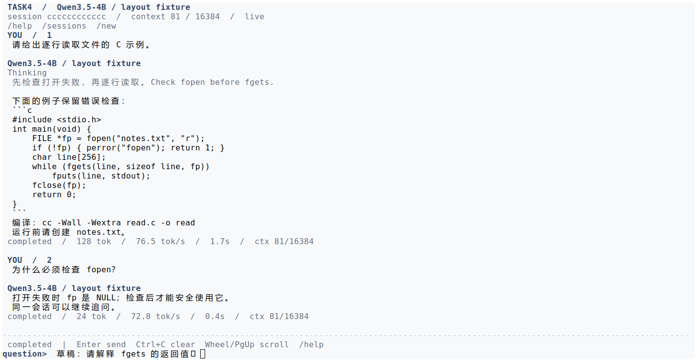
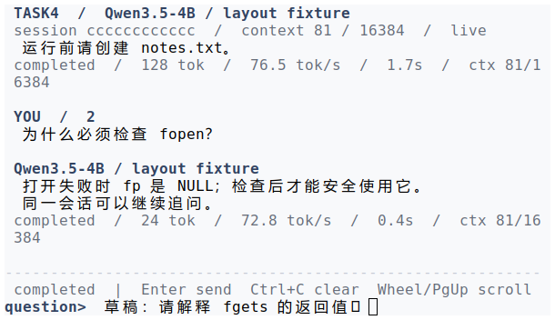

学号：待填写　　姓名：待填写　　专业：待填写　　班级：待填写

# 《Linux操作系统设计实践》实验四：综合应用

实验日期：2026 年 10 月 14 日　　选用方案：方案 4

个人角色：协作成员一——客户端终端交互与界面辅助开发　　任务量占比：27.5%

## 一、实验环境

| 项目 | 项目已有实测环境 |
| --- | --- |
| 操作系统 | Ubuntu 24.04.2 LTS，WSL2，x86_64 |
| 内核 | 6.6.87.2-microsoft-standard-WSL2 |
| 编译工具 | GCC 13.3.0、GNU Make 4.3 |
| 编译参数 | `-std=c11 -Wall -Wextra -Wpedantic -Werror -O2 -g` |
| CPU | AMD Ryzen AI 7 H 350，8 核 16 线程 |
| GPU | NVIDIA GeForce RTX 5060 Laptop GPU，约 8 GB 显存 |
| 本地模型 | Qwen3.5-4B，Q5_K_M GGUF，文件 3,143,656,608 字节 |
| 推理引擎 | llama.cpp b11429，commit `d81235049384534c167caea52b85a694f6103d14` |
| 推理配置 | CUDA 全层 GPU、2 个推理槽、每槽 16384 token；新轮每次尝试最多生成 4096 token |
| 辅助运行环境 | Python 3.12；模型适配与验证脚本使用标准库 |
| 界面验证方式 | 真实 C 客户端的 stdin/stdout/stderr 接入同一 PTY；白底 xterm 重放实际 ANSI 输出并截图 |

硬件与版本依据为[硬件记录](../../logs/model-hardware.txt)和[模型说明](../../docs/local-model.md)。下文命令均在 `homework/task4` 目录执行。首次准备模型需要下载依赖，运行时模型推理访问本机回环地址。

## 二、系统开发情况介绍

### 2.1 设计背景与需求

本实验依据[《Linux操作系统设计实践》实验指导书](../../../../ppt/《Linux操作系统设计实践》2026-2027第一学期-实验指导书.pdf)方案 4，构建由 C 客户端、C 服务端及独立生成程序组成的本地模型交互系统。系统需要支持多个客户端同时提问，生成结果逐步返回，各连接的数据和日志相互隔离，同一会话的新问题能够使用已有对话上下文。实验重点是进程、网络、文件与交互控制的协同，模型回答质量不作为核心评价项。

客户端在模型持续输出时还需要接收输入。若只按到达顺序直接打印文本，中文草稿可能被输出覆盖，长回答会挤占输入位置，用户也难以判断程序正在思考、生成还是已经结束。因此，本人分工集中在主负责人确定的协议与客户端主流程之上，协助完善终端输入、界面呈现、控制操作联调与界面验证。

本部分的具体要求是：中文编辑不截断 UTF-8 码点；缩放和异步输出保留草稿；思考、正式回答和状态分区显示；生成期间能够取消或提交纠偏；窗口较窄时仍可编辑；终端输出缓慢时不阻塞网络接收和断点保存；退出或作业控制后正确恢复终端设置。

### 2.2 系统整体方案与三人分工

整体数据链路为：C 客户端通过 TCP 连接 C 服务端，每个连接由独立 worker 处理；每轮 worker 启动 Python 模型适配进程，通过本机 HTTP/SSE 调用常驻 llama-server。模型权重共享，课程会话、请求文件、生成日志与客户端 checkpoint 分别保存。问题经 BEGIN/INPUT/COMMIT 提交，思考和正文分别由 THINK、DELTA 帧传输；STATUS 只更新显示指标，HEARTBEAT 维持网络等待期限。正常结束最终由 END 确认。

| 成员 | 姓名 / 学号 | 任务量 | 分工 |
| --- | --- | ---: | --- |
| 主负责人（组长） | 待填写 / 待填写 | 45% | 总体方案、核心协议与服务端、客户端主流程、模型接入及最终集成；主要涉及 `src/net/protocol.c`、`src/server/main.c`、`src/client/main.c`、`src/backend/` 和模型适配核心 |
| 协作成员一（本人） | 待填写 / 待填写 | 27.5% | 在主负责人方案基础上，协助客户端终端输入、界面呈现、控制操作联调和界面验证 |
| 协作成员二 | 待填写 / 待填写 | 27.5% | 协助会话文件与断点恢复、服务发现、测试与运行记录核对；主要涉及 `src/storage/`、`src/client/state.c`、`src/net/discovery.c`、`src/model/discovery.py` 及相关头文件 |

任务比例按设计、实现协助、联调、验证和文档整理综合估算。核心系统及客户端网络主流程由主负责人完成；下文详述本人分工涉及的接口、协助内容和分析。源码附录保留小组项目的对应模块，文件行数表示模块规模，不直接换算为个人工作量。

### 2.3 本人分工涉及的代码与接口

| 模块 | 代码行数 | 本人分工与联调关注点 |
| --- | ---: | --- |
| `include/task4/terminal.h` | 49 | 终端输入、草稿、界面事件及暂停恢复接口 |
| `src/client/terminal.c` | 579 | 协助 UTF-8 编辑、按键与粘贴处理、输入历史、窗口尺寸处理和终端恢复 |
| `include/task4/view.h` | 30 | 对话内容、主题、状态和视口接口 |
| `src/client/view.c` | 446 | 协助对话重排、思考与正文区分、状态栏、滚动及窄窗口布局 |
| `include/task4/screen.h` | 21 | 屏幕行缓冲与非阻塞输出接口 |
| `src/client/screen.c` | 161 | 协助行差分输出、合帧与终端拥塞时的显示行为联调 |
| `include/task4/status.h` | 16 | 运行指标解析后的拥有型状态结构 |
| `src/client/status.c` | 134 | 协助核对 JSON 指标解析、局部字段更新与非法状态处理 |
| **合计** | **1436** | **4 个头文件、4 个 C 实现文件，含注释和空行** |

上述行数按原报告对应源码块实际统计。相关完整源码见本报告附录；客户端网络状态机 `src/client/main.c`、存储与模型适配模块不属于本篇个人源码范围。本人的接口联调依赖主负责人提供的主循环和事件路由，取消、纠偏的协议顺序也沿用其总体设计。

### 2.4 本部分使用的主要系统接口

| 系统调用或库接口 | 本部分用途与注意点 |
| --- | --- |
| `tcgetattr/tcsetattr` | 保存原终端属性、进入编辑模式；退出、暂停及恢复时切换属性 |
| `ioctl(TIOCGWINSZ)` | 查询实际终端行列数，触发布局重排并保留未发送草稿 |
| `poll/read` | 及时读取终端字节和分段转义序列，使输入处理可与网络事件循环交替运行 |
| `open/write/close` | 打开独立非阻塞终端描述符，写出 ANSI 差分并回收资源 |
| `poll(POLLOUT)` | 退出时在有限等待内尝试送出剩余终端控制序列 |
| `clock_gettime(CLOCK_MONOTONIC)` | 依据单调时钟合并重绘，避免每个生成字节都立即刷新全屏 |
| `isatty` | 判断是否启用交互界面，保留重定向与批处理方式 |

其中 `tcgetattr/tcsetattr`、`isatty` 等为终端相关库接口。本报告不将它们统称为直接内核系统调用。SIGINT、SIGTSTP、SIGCONT 等信号的总体处理和网络超时由客户端主流程协调，本部分提供可在安全位置调用的界面清理及恢复接口。

### 2.5 交互与显示设计

输入按行编辑，按 Enter 后才由主流程提交模型。编辑以 UTF-8 码点为单位，支持左右移动、Home/End、删除、历史召回及 bracketed paste；粘贴中的换行合并为空格，仍需要确认提交。↑/↓ 负责问题历史，鼠标滚轮和 PgUp/PgDn 负责对话视口，避免浏览旧回答时覆盖草稿。生成期间输入文字按纠偏处理，完成后输入文字作为下一轮问题。

界面顶部显示会话与模型，对话区显示问题、灰色思考、正式回答及每轮指标，底部保留操作状态和输入区。`/thinking` 与主题切换仅改变本地显示。模型报告结束指标时界面仍处于 finishing，直到 C 服务端完成进程回收、保存完成状态并发送 END，才显示 completed；界面不能先于持久状态宣布成功。

显示层先生成完整行，再比较上一帧，只写变化的行及光标。终端输出使用独立非阻塞描述符和有界待发送缓冲；遇到 EAGAIN 保留余量，待可写时继续，主循环仍可接收网络帧。每次排空限制写入次数，避免长时间独占事件循环。显示缓存约 1 MiB、最多 128 条记录，淘汰旧画面不删除磁盘数据，也不改变模型历史。有关输入与界面的完整约定见[TUI 说明](../../docs/tui.md)。

## 三、程序运行演示说明

本节使用小组已有编译、联合验证记录和截图。可控对端用于确定性界面检查，真实模型用于验证本地推理链路，两类证据分别说明。

### 3.1 编译与启动

```sh
make -j4 CFLAGS='-std=c11 -Wall -Wextra -Wpedantic -Werror -O2 -g'
make verify
make -q
```

[联合验证记录](../../logs/verify-current.txt)显示严格编译及自动验证通过。与本篇直接相关的记录包括 5 项状态解析检查、7 项终端检查、12 项 TUI 屏幕检查、6 项鼠标与渲染检查，以及 11 项控制集成检查。

首次准备模型使用 `python3 scripts/model/setup.py`，日常在三个终端分别启动：

```sh
bash scripts/model/serve.sh gpu
./bin/stream_server --state state/model-server
./bin/stream_client
```

模型服务与 C 服务端默认自动分配端口。客户端无参数时选择唯一活动服务，存在多个候选时需要通过 `--server-state DIR` 指定。源码、构建目标和完整命令见[项目 README](../../README.md)。

### 3.2 真实模型多轮交互

[真实模型 TUI 记录](../../logs/model-tui-4096.txt)使用全 stdio PTY，完成两轮对话，第二轮正确回忆代号 SPRUCE；两轮均采用 4096-token 输出预算和 16384-token 上下文。新建其他会话后切回原会话，两轮已归档正文恢复。包含截图采集和会话切换的既有检查耗时 19.013 秒，这不是纯生成延迟或运行速度上界。


图 1 为真实本地 Qwen 输出。思考在界面中隐藏，仅影响呈现，不改变模型生成和历史保存规则。

### 3.3 宽窄窗口与输入保持



图 2 为 140×38 窗口，展示对话、思考、指标和独立输入区。



图 3 为 60×18 窗口，展示窄窗口换行和保留草稿。两图来自真实 C 客户端，文本为界面夹具，不是 Qwen 实际回答。原项目屏幕验证还覆盖 96×28、40×10，并核对多次缩放与编辑后提交的原始 UTF-8 字节。截图终端字体对部分 emoji 的显示有限，因此文字字节完整性由验证记录补充，不能只凭截图判断。

### 3.4 取消、纠偏与错误显示

生成期间执行 `/stop` 或按 Ctrl+C 取消当前轮且保留连接；`/steer 修改要求` 则先持久保存纠偏要求，再取消并等待旧轮确认，最后将原问题和修改要求作为新轮提交。交互侧要把操作及时交给主流程，并在等待确认时保持正确的状态显示。


图 4 使用可控对端展示取消和纠偏界面。真实模型的控制验证另见[控制记录](../../logs/model-controls.txt)：其中 `/steer`、`/stop` 的单次确认分别为 8.363 ms、5.025 ms，只表示该次测量，不代表固定延迟。


图 5 使用注入错误的界面夹具，展示错误出现后保留对话和可编辑草稿。用户可以 `/retry` 续写、`/new` 新建或切换会话；批处理方式仍保留失败退出码。以上夹具截图均由全 stdio PTY 的实际 ANSI 重绘原样重放到相同尺寸的白底 xterm 后采集，未在 VS Code 集成终端实测。来源见[截图记录](../../logs/report-screenshots-current.json)。

## 四、实验结果与分析

本部分在项目总体方案下完成终端输入与显示的辅助工作，使模型流式生成时仍可编辑草稿、浏览旧回答和发起控制操作。现有联合记录能支持下列结论：

| 验证内容 | 已有结果及意义 |
| --- | --- |
| 输入编辑与终端恢复 | UTF-8 删除、移动、历史编辑、粘贴及作业控制检查通过；正常退出和受测信号路径恢复终端属性 |
| 缩放与草稿保持 | 140×38、96×28、60×18、40×10 重排后仍提交相同 UTF-8 草稿 |
| 状态显示 | STATUS 不进入对话正文；不完整更新保留旧字段；非法状态不部分替换可见指标 |
| 显示输出量 | 140×38、32 次单字节增量、间隔 45 ms 的受控负载产生 3147 字节 ANSI、38 次行定位，无全屏清除 |
| 终端阻塞 | PTY 超过两秒不读取输出时，客户端仍在恢复读取前接收 END 并保存完成 checkpoint |
| 网络期限 | 频繁界面刷新不延长网络期限；静默对端超时后保留未完成断点及可编辑错误界面 |

显示输出量数据来自[渲染测量](../../logs/render-benchmark.json)，其他结论来自[联合验证记录](../../logs/verify-current.txt)。这些结果说明界面输出与网络接收能够解耦；3147 字节不是模型吞吐量，也不是系统调用次数。

优点是输入区稳定、状态与正文分离，宽窄窗口具有一致操作方式，终端变慢不会直接阻塞完成状态落盘。不足是当前编辑单位为码点，组合字符和 emoji 字素簇不保证整体编辑；不同终端的字体、颜色和鼠标模式仍有兼容差异；极小于 12 列或 4 行的窗口只能提示放大；旧显示内容受缓存容量限制。后续可在不改动核心协议的前提下，补充字素簇编辑支持和更多终端环境验证，并完善紧凑尺寸下的操作提示。

系统整体已具备多客户端本地推理、会话隔离、多轮上下文、取消和恢复能力，但仍受上下文与生成预算限制；恢复不保存 GPU KV cache 或随机采样器，不能保证后续文本与未中断推理逐 token 一致。界面的 completed、cancelled 和失败状态必须忠实反映这些边界，不能用显示上的流畅代替运行正确性。

## 五、编程工作总结

本人在本实验中的分工是协助完成客户端终端输入、界面显示和控制联调。主负责人已经确定客户端、服务端与生成程序的关系，我需要理解这些模块传来的事件，再把它们转换为用户能够操作和判断的界面。通过这一部分工作，我认识到终端界面不仅是把字符串打印出来，还要保存输入草稿、光标位置、窗口大小、当前轮次和显示进度之间的关系。每个状态都应有明确来源，否则输出、输入和缩放同时发生时，就容易出现看似偶然的错误。

首先需要理解的是字节和字符的区别。中文在 UTF-8 中由多个字节表示，如果退格时只减少一个字节，草稿就会变成非法文本。为配合输入模块的联调，我重点学习了 UTF-8 码点边界、终端转义序列和 bracketed paste 的处理方式，并结合已有终端记录核对删除、左右移动、输入历史及分段按键的行为。粘贴换行不能直接作为多次提交，而应合并到可编辑草稿中，等待 Enter 确认。这也提醒我，界面支持中文不仅是字体能够显示，还包括编辑和提交后的字节保持完整。

其次是异步输出对输入的影响。模型生成时，用户可能正在输入修改要求，也可能翻看前面的回答。如果重绘直接覆盖底部区域，草稿与光标便会丢失。因此，显示内容与输入状态需要分别保存，窗口变化时根据新列宽重新布局，而不是从已经画出的文字反推内容。滚轮应改变对话视口，上下方向键则召回问题历史，两种操作不能混用。对已有宽窄窗口截图和验证记录的核对，使我理解了同一段文本在不同尺寸下保持内容一致与显示一致是两个不同问题。

第三个问题是终端写出也可能阻塞。起初只看正常输出，很容易忽略终端停止读取时的情况。相关实现采用独立非阻塞描述符、行差分和有界待发送缓冲；遇到暂时不可写时保留余量，让主循环继续接收数据。已有记录中，即使 PTY 超过两秒不读取，完成断点仍能先保存。这让我把课堂上的非阻塞 I/O 与实际交互联系起来：界面可以稍后更新，但不能让显示速度决定网络接收和文件状态是否推进。

控制联调还要求区分“提出操作”与“操作完成”。用户输入取消后，界面不能直接把本轮标为已取消；纠偏也不能立即发出新问题，而应等待主流程确认旧轮终结。同样，模型指标中的完成提示还需要经过生成进程退出和服务端 END 确认。通过梳理这些顺序，我认识到界面状态必须服从系统状态，而不能为了响应快就提前宣告成功。

本次分工使我进一步理解了模块接口、终端属性恢复、事件循环以及证据边界。可控夹具适合复现缩放和错误，真实模型记录适合说明完整推理链路；两者都需要，但不能相互替代。我在总结中保留现有实现对字素簇、终端兼容和显示缓存的限制，也把联合验证与个人分工区分开来。后续继续完善这部分时，应先明确操作和状态约定，再用能够稳定复现问题的输入验证行为。

## 六、注释源码附录

本附录完整收录本篇分工涉及的 8 个头文件与 C 源文件，共 1436 行（含原注释和空行），代码逐块取自原 `homework/task4/report.md` 的源码附录，保留其中实现及注释。各文件前另加阅读要点。源码用于说明共同项目中本人协助的模块范围，不代表本人独立编写了全部附录代码。

### 附录 1：include/task4/terminal.h

声明输入编辑、界面事件和暂停恢复接口。接口注释说明草稿保持、返回值和安全调用位置。

```c
#ifndef TASK4_TERMINAL_H
#define TASK4_TERMINAL_H

#include <stddef.h>
#include <stdint.h>

struct t4_terminal;

/* Borrowed strings are copied immediately; one cached status belongs to a turn. */
struct t4_ui_status {
    const char *phase;
    const char *model;
    uint32_t prompt_tokens, context_tokens, generated_tokens;
    double tokens_per_second, elapsed_seconds;
};

/* NULL leaves legacy I/O untouched unless both stdin and stderr are terminals. */
struct t4_terminal *t4_terminal_open(void);
/* Nonblocking: 0 edits/no input, 1 line, 2 EOF, -1 error, -2 invalid long line. */
int t4_terminal_read(struct t4_terminal *terminal, unsigned char line[4097],
                     uint32_t *length);
int t4_terminal_pending(const struct t4_terminal *terminal);
/* Output and prompt/resize updates preserve the unsent draft and its cursor. */
int t4_terminal_prompt(struct t4_terminal *terminal, const char *prompt);
int t4_terminal_write(struct t4_terminal *terminal, const void *data, size_t length);
int t4_terminal_resize(struct t4_terminal *terminal);
int t4_terminal_session(struct t4_terminal *terminal, const char *session, const char *model);
int t4_terminal_begin_turn(struct t4_terminal *terminal, uint32_t request,
                           const char *prompt, uint32_t resume_offset);
int t4_terminal_thinking(struct t4_terminal *terminal, const void *data, size_t length);
int t4_terminal_answer(struct t4_terminal *terminal, const void *data, size_t length);
int t4_terminal_status(struct t4_terminal *terminal, const struct t4_ui_status *status);
int t4_terminal_end_turn(struct t4_terminal *terminal, const char *state, const char *summary);
int t4_terminal_theme(struct t4_terminal *terminal, int dark);
int t4_terminal_thinking_visible(struct t4_terminal *terminal, int show);
/* Call tick every event-loop pass with a poll cap of 33 ms; flush forces paint. */
int t4_terminal_tick(struct t4_terminal *terminal);
int t4_terminal_flush(struct t4_terminal *terminal);
/* Switch conversation while preserving theme and thinking visibility. */
int t4_terminal_reset(struct t4_terminal *terminal);
/* Seed keyboard history from a restored user prompt, without submitting it. */
int t4_terminal_history(struct t4_terminal *terminal, const char *prompt);
void t4_terminal_clear_input(struct t4_terminal *terminal);
/* Call at safe points around job control; none of these are signal handlers. */
int t4_terminal_suspend(struct t4_terminal *terminal);
int t4_terminal_resume(struct t4_terminal *terminal);
void t4_terminal_close(struct t4_terminal *terminal);

#endif
```

### 附录 2：include/task4/view.h

声明对话内容与视口接口，将逻辑消息组织与终端输入处理分开。

```c
#ifndef TASK4_VIEW_H
#define TASK4_VIEW_H

#include "task4/terminal.h"

/* Internal transcript/layout component; terminal.c owns keyboard and termios. */
struct t4_view;
struct t4_screen;
enum t4_view_style { T4_VIEW_TEXT, T4_VIEW_MUTED, T4_VIEW_ACCENT, T4_VIEW_BORDER };
struct t4_view *t4_view_open(void);
void t4_view_close(struct t4_view *view);
void t4_view_resize(struct t4_view *view, unsigned rows, unsigned columns);
void t4_view_dirty(struct t4_view *view);
int t4_view_is_dirty(const struct t4_view *view);
int t4_view_render(struct t4_view *view, struct t4_screen *screen);
void t4_view_reset(struct t4_view *view);
const char *t4_view_style(const struct t4_view *view, enum t4_view_style style);
int t4_view_notice(struct t4_view *view, const void *data, size_t length);
int t4_view_session(struct t4_view *view, const char *session, const char *model);
int t4_view_begin(struct t4_view *view, uint32_t request, const char *prompt, uint32_t offset);
int t4_view_thinking(struct t4_view *view, const void *data, size_t length);
int t4_view_answer(struct t4_view *view, const void *data, size_t length);
int t4_view_status(struct t4_view *view, const struct t4_ui_status *status);
int t4_view_end(struct t4_view *view, const char *state, const char *summary);
void t4_view_theme(struct t4_view *view, int dark);
void t4_view_thinking_visible(struct t4_view *view, int show);
void t4_view_page(struct t4_view *view, int backward);
void t4_view_scroll(struct t4_view *view, int backward, size_t lines);

#endif
```

### 附录 3：include/task4/screen.h

声明屏幕行、光标、待发送缓冲和排空接口，为视图层提供统一输出边界。

```c
#ifndef TASK4_SCREEN_H
#define TASK4_SCREEN_H

#include <stddef.h>

/* Internal, bounded nonblocking screen transport. One immutable frame may be
 * in flight; callers keep newer transcript state until it has drained. */
struct t4_screen;
struct t4_screen *t4_screen_open(void);
void t4_screen_close(struct t4_screen *screen);
int t4_screen_resize(struct t4_screen *screen, unsigned rows, unsigned columns);
void t4_screen_invalidate(struct t4_screen *screen);
int t4_screen_row(struct t4_screen *screen, unsigned row, const char *style);
int t4_screen_append(struct t4_screen *screen, const void *data, size_t length);
void t4_screen_cursor(struct t4_screen *screen, unsigned row, unsigned column);
int t4_screen_submit(struct t4_screen *screen);
int t4_screen_drain(struct t4_screen *screen);
int t4_screen_busy(const struct t4_screen *screen);
int t4_screen_control(struct t4_screen *screen, const char *text);

#endif
```

### 附录 4：include/task4/status.h

为显示指标保存稳定拥有的字符串和数值字段，避免界面引用已失效的临时解析数据。

```c
#ifndef TASK4_STATUS_H
#define TASK4_STATUS_H

#include "task4/terminal.h"

/* STATUS is presentation data. Parsing never changes a checkpoint or prompt. */
struct t4_client_status {
    struct t4_ui_status ui;
    char phase[32], model[128];
};

void t4_status_init(struct t4_client_status *status);
/* Merge known top-level properties atomically; leave old values on failure. */
int t4_status_update(struct t4_client_status *status, const char *json, size_t length);

#endif
```

### 附录 5：src/client/terminal.c

集中处理终端属性、UTF-8 输入和按键序列，并协调重绘节流、窗口变化与暂停恢复。阅读时重点关注草稿状态如何在输出和尺寸变化后保持。

```c
#define _XOPEN_SOURCE 700

#include "task4/terminal.h"
#include "task4/text.h"
#include "task4/view.h"
#include "task4/screen.h"

#include <errno.h>
#include <locale.h>
#include <poll.h>
#include <stdio.h>
#include <stdlib.h>
#include <string.h>
#include <sys/ioctl.h>
#include <termios.h>
#include <time.h>
#include <unistd.h>
#include <wchar.h>
#include <wctype.h>

#define HISTORY 50U
#define LIMIT 4096U

struct t4_terminal {
    struct termios original, editing;
    unsigned rows, columns;
    unsigned char draft[LIMIT + 1], backup[LIMIT + 1], input[4096], utf8[4];
    size_t length, cursor, view, backup_length, backup_cursor;
    size_t input_at, input_length;
    unsigned utf8_have, utf8_width;
    char prompt[128], escape[64];
    size_t escape_length;
    char *history[HISTORY];
    unsigned history_count, history_at;
    int invalid, paste, suspended, discard_escape, mouse_remaining;
    unsigned char mouse[3];
    struct t4_view *view_state;
    struct t4_screen *screen;
    int64_t last_paint;
};

static int output(struct t4_terminal *terminal, const void *data, size_t length)
{ return t4_screen_append(terminal->screen, data, length); }
static int command(struct t4_terminal *terminal, const char *text)
{ return output(terminal, text, strlen(text)); }

static size_t next(const unsigned char *text, size_t at, size_t length)
{
    unsigned width = t4_character_width(text[at]);
    return at + (width && width <= length - at ? width : 1);
}

static size_t previous(const unsigned char *text, size_t at)
{
    if (!at) return 0;
    --at;
    while (at && (text[at] & 0xc0U) == 0x80U) --at;
    return at;
}

static wchar_t wide(const unsigned char *text, size_t width)
{
    mbstate_t state = {0};
    wchar_t result;
    size_t consumed = mbrtowc(&result, (const char *)text, width, &state);
    return consumed == (size_t)-1 || consumed == (size_t)-2 ? L'?' : result;
}

static unsigned cells(const unsigned char *text, size_t from, size_t until)
{
    unsigned total = 0;
    while (from < until) {
        size_t after = next(text, from, until);
        int width = wcwidth(wide(text + from, after - from));
        total += width < 0 ? 1U : (unsigned)width;
        from = after;
    }
    return total;
}

static int geometry(struct t4_terminal *terminal)
{
    struct winsize size = {0};
    if (ioctl(STDIN_FILENO, TIOCGWINSZ, &size) < 0) return -1;
    terminal->rows = size.ws_row ? size.ws_row : 24;
    terminal->columns = size.ws_col ? size.ws_col : 80;
    /* Bound screen memory even if a peer sends an unreasonable winsize. */
    if (terminal->rows > 512) terminal->rows = 512;
    if (terminal->columns > 2048) terminal->columns = 2048;
    if (t4_screen_resize(terminal->screen, terminal->rows, terminal->columns) < 0) return -1;
    if (terminal->view_state) t4_view_resize(terminal->view_state, terminal->rows, terminal->columns);
    return 0;
}

static int paint(struct t4_terminal *terminal)
{
    if (t4_view_render(terminal->view_state, terminal->screen) < 0) return -1;
    if (terminal->rows < 4 || terminal->columns < 12) {
        t4_screen_cursor(terminal->screen, 1, 1);
        return t4_screen_submit(terminal->screen);
    }
    size_t prompt_length = strlen(terminal->prompt), shown_prompt = 0;
    unsigned prompt_cells = 0;
    while (shown_prompt < prompt_length) {
        size_t after = next((const unsigned char *)terminal->prompt, shown_prompt, prompt_length);
        unsigned width = cells((const unsigned char *)terminal->prompt, shown_prompt, after);
        if (prompt_cells + width > terminal->columns / 3) break;
        shown_prompt = after; prompt_cells += width;
    }
    unsigned available = terminal->columns - prompt_cells - 2;
    if (terminal->view > terminal->cursor) terminal->view = terminal->cursor;
    while (cells(terminal->draft, terminal->view, terminal->cursor) >= available)
        terminal->view = next(terminal->draft, terminal->view, terminal->length);
    size_t end = terminal->view;
    unsigned visible = 0;
    while (end < terminal->length) {
        size_t after = next(terminal->draft, end, terminal->length);
        unsigned width = cells(terminal->draft, end, after);
        if (visible + width > available) break;
        visible += width; end = after;
    }
    if (t4_screen_row(terminal->screen, terminal->rows, t4_view_style(terminal->view_state, T4_VIEW_ACCENT)) < 0
        || output(terminal, terminal->prompt, shown_prompt) < 0
        || command(terminal, t4_view_style(terminal->view_state, T4_VIEW_TEXT)) < 0
        || command(terminal, terminal->view ? "<" : " ") < 0
        || output(terminal, terminal->draft + terminal->view, end - terminal->view) < 0
        || command(terminal, end < terminal->length ? ">" : " ") < 0) return -1;
    t4_screen_cursor(terminal->screen, terminal->rows, prompt_cells + 2
                     + cells(terminal->draft, terminal->view, terminal->cursor));
    return t4_screen_submit(terminal->screen);
}

static int refresh(struct t4_terminal *terminal, int force)
{
    if (terminal->suspended) return 0;
    if (t4_screen_drain(terminal->screen) < 0) return -1;
    if (t4_screen_busy(terminal->screen)) return 0;
    if (!force && !t4_view_is_dirty(terminal->view_state)) return 0;
    struct timespec now;
    if (clock_gettime(CLOCK_MONOTONIC, &now) < 0) return -1;
    int64_t milliseconds = (int64_t)now.tv_sec * 1000 + now.tv_nsec / 1000000;
    if (!force && milliseconds - terminal->last_paint < 34) return 0;
    if (paint(terminal) < 0) return -1;
    terminal->last_paint = milliseconds;
    return 0;
}

static int draw(struct t4_terminal *terminal)
{
    t4_view_dirty(terminal->view_state);
    return refresh(terminal, 0);
}

static int layout(struct t4_terminal *terminal)
{
    /* Save only private mouse modes that we change, and restore them on exit.
     * Terminals lacking xterm's save/restore simply ignore those controls; we
     * explicitly disable mouse reporting before returning to the shell. */
    if (t4_screen_control(terminal->screen, "\033[?1000;1006;1007s\033[?1049h\033[r\033[?2004h\033[?1007l\033[?1000h\033[?1006h\033[?25h") < 0) return -1;
    t4_screen_invalidate(terminal->screen);
    t4_view_resize(terminal->view_state, terminal->rows, terminal->columns);
    return refresh(terminal, 1);
}

struct t4_terminal *t4_terminal_open(void)
{
    if (!isatty(STDIN_FILENO) || !isatty(STDERR_FILENO)) return NULL;
    struct t4_terminal *terminal = calloc(1, sizeof(*terminal));
    if (!terminal) return NULL;
    terminal->view_state = t4_view_open();
    if (!terminal->view_state) { free(terminal); return NULL; }
    terminal->screen = t4_screen_open();
    if (!terminal->screen) { t4_view_close(terminal->view_state); free(terminal); return NULL; }
    (void)setlocale(LC_CTYPE, "");
    if (MB_CUR_MAX == 1) (void)setlocale(LC_CTYPE, "C.UTF-8");
    if (tcgetattr(STDIN_FILENO, &terminal->original) < 0 || geometry(terminal) < 0) {
        t4_screen_close(terminal->screen); t4_view_close(terminal->view_state); free(terminal); return NULL;
    }
    terminal->editing = terminal->original;
    terminal->editing.c_lflag &= (tcflag_t)~(ICANON | ECHO | ECHONL | IEXTEN);
    terminal->editing.c_lflag |= ISIG;
    terminal->editing.c_iflag &= (tcflag_t)~(IXON | IXOFF | ICRNL | INLCR | IGNCR);
#ifdef IUTF8
    terminal->editing.c_iflag |= IUTF8;
#endif
    terminal->editing.c_cc[VMIN] = 0; terminal->editing.c_cc[VTIME] = 0;
    strcpy(terminal->prompt, "question> ");
    if (tcsetattr(STDIN_FILENO, TCSANOW, &terminal->editing) < 0) {
        t4_screen_close(terminal->screen); t4_view_close(terminal->view_state); free(terminal); return NULL;
    }
    if (layout(terminal) < 0) { t4_terminal_close(terminal); return NULL; }
    return terminal;
}

int t4_terminal_prompt(struct t4_terminal *terminal, const char *prompt)
{
    if (!terminal || !prompt) { errno = EINVAL; return -1; }
    size_t length = strlen(prompt), copied = 0, at = 0;
    while (at < length) {
        size_t after = next((const unsigned char *)prompt, at, length);
        if (copied + after - at >= sizeof(terminal->prompt)) break;
        wchar_t character = wide((const unsigned char *)prompt + at, after - at);
        if (character >= 32 && character != 127 && !(character >= 128 && character <= 159)) {
            memcpy(terminal->prompt + copied, prompt + at, after - at); copied += after - at;
        }
        at = after;
    }
    terminal->prompt[copied] = 0;
    return draw(terminal);
}

int t4_terminal_write(struct t4_terminal *terminal, const void *data, size_t length)
{
    if (!terminal || (!data && length)) { errno = EINVAL; return -1; }
    if (t4_view_notice(terminal->view_state, data, length) < 0) return -1;
    return refresh(terminal, 0);
}

int t4_terminal_resize(struct t4_terminal *terminal)
{
    if (!terminal) { errno = EINVAL; return -1; }
    if (geometry(terminal) < 0) return -1;
    return refresh(terminal, 1);
}

int t4_terminal_tick(struct t4_terminal *terminal)
{
    if (!terminal) { errno = EINVAL; return -1; }
    return refresh(terminal, 0);
}
int t4_terminal_flush(struct t4_terminal *terminal)
{
    if (!terminal) { errno = EINVAL; return -1; }
    return refresh(terminal, 1);
}
int t4_terminal_reset(struct t4_terminal *terminal)
{
    if (!terminal) { errno = EINVAL; return -1; }
    for (unsigned at = 0; at < terminal->history_count; ++at) free(terminal->history[at]);
    terminal->history_count = terminal->history_at = 0;
    terminal->backup_length = terminal->backup_cursor = 0; terminal->backup[0] = 0;
    terminal->input_at = terminal->input_length = 0;
    terminal->discard_escape = terminal->mouse_remaining = 0;
    t4_view_reset(terminal->view_state);
    t4_terminal_clear_input(terminal);
    return refresh(terminal, 1);
}
int t4_terminal_session(struct t4_terminal *terminal, const char *session, const char *model)
{
    if (!terminal) { errno = EINVAL; return -1; }
    if (t4_view_session(terminal->view_state, session, model) < 0) return -1;
    return refresh(terminal, 0);
}
int t4_terminal_begin_turn(struct t4_terminal *terminal, uint32_t request, const char *prompt, uint32_t offset)
{
    if (!terminal) { errno = EINVAL; return -1; }
    if (t4_view_begin(terminal->view_state, request, prompt, offset) < 0) return -1;
    return refresh(terminal, 0);
}
int t4_terminal_thinking(struct t4_terminal *terminal, const void *data, size_t length)
{
    if (!terminal) { errno = EINVAL; return -1; }
    if (t4_view_thinking(terminal->view_state, data, length) < 0) return -1;
    return refresh(terminal, 0);
}
int t4_terminal_answer(struct t4_terminal *terminal, const void *data, size_t length)
{
    if (!terminal) { errno = EINVAL; return -1; }
    if (t4_view_answer(terminal->view_state, data, length) < 0) return -1;
    return refresh(terminal, 0);
}
int t4_terminal_status(struct t4_terminal *terminal, const struct t4_ui_status *status)
{
    if (!terminal) { errno = EINVAL; return -1; }
    if (t4_view_status(terminal->view_state, status) < 0) return -1;
    return refresh(terminal, 0);
}
int t4_terminal_end_turn(struct t4_terminal *terminal, const char *state, const char *summary)
{
    if (!terminal) { errno = EINVAL; return -1; }
    if (t4_view_end(terminal->view_state, state, summary) < 0) return -1;
    return refresh(terminal, 1);
}
int t4_terminal_theme(struct t4_terminal *terminal, int dark)
{
    if (!terminal) { errno = EINVAL; return -1; }
    t4_view_theme(terminal->view_state, dark);
    return refresh(terminal, 1);
}
int t4_terminal_thinking_visible(struct t4_terminal *terminal, int show)
{
    if (!terminal) { errno = EINVAL; return -1; }
    t4_view_thinking_visible(terminal->view_state, show);
    return refresh(terminal, 1);
}

void t4_terminal_clear_input(struct t4_terminal *terminal)
{
    if (!terminal) return;
    /* Explicit cancellation of an unfinished paste also drops already-read
     * paste bytes. Enter otherwise retains subsequent buffered line events. */
    if (terminal->paste || terminal->escape_length) terminal->input_at = terminal->input_length;
    terminal->length = terminal->cursor = terminal->view = 0;
    terminal->draft[0] = 0; terminal->invalid = 0;
    terminal->utf8_have = terminal->utf8_width = 0;
    terminal->escape_length = 0; terminal->paste = 0;
    terminal->discard_escape = terminal->mouse_remaining = 0;
    terminal->history_at = terminal->history_count;
    (void)draw(terminal);
}

static void remove_range(struct t4_terminal *terminal, size_t from, size_t until)
{
    memmove(terminal->draft + from, terminal->draft + until, terminal->length - until + 1);
    terminal->length -= until - from; terminal->cursor = from;
    if (terminal->view > from) terminal->view = from;
    terminal->invalid = 0;
}

static void insert(struct t4_terminal *terminal, const unsigned char *text, size_t length)
{
    if (length > LIMIT - terminal->length) { terminal->invalid = 1; return; }
    memmove(terminal->draft + terminal->cursor + length, terminal->draft + terminal->cursor,
            terminal->length - terminal->cursor + 1);
    memcpy(terminal->draft + terminal->cursor, text, length);
    terminal->cursor += length; terminal->length += length;
}

static void history_move(struct t4_terminal *terminal, int backward)
{
    if (backward && terminal->history_at == terminal->history_count) {
        memcpy(terminal->backup, terminal->draft, terminal->length + 1);
        terminal->backup_length = terminal->length; terminal->backup_cursor = terminal->cursor;
    }
    if (backward && terminal->history_at) --terminal->history_at;
    else if (!backward && terminal->history_at < terminal->history_count) ++terminal->history_at;
    else return;
    if (terminal->history_at == terminal->history_count) {
        memcpy(terminal->draft, terminal->backup, terminal->backup_length + 1);
        terminal->length = terminal->backup_length; terminal->cursor = terminal->backup_cursor;
    } else {
        strcpy((char *)terminal->draft, terminal->history[terminal->history_at]);
        terminal->length = terminal->cursor = strlen((char *)terminal->draft);
    }
    terminal->view = 0; terminal->invalid = 0;
}

int t4_terminal_history(struct t4_terminal *terminal, const char *prompt)
{
    if (!terminal || !prompt || strlen(prompt) > LIMIT) { errno = EINVAL; return -1; }
    if (!*prompt || (terminal->history_count
        && !strcmp(terminal->history[terminal->history_count - 1], prompt))) return 0;
    char *copy = strdup(prompt);
    if (!copy) return -1;
    if (terminal->history_count == HISTORY) {
        free(terminal->history[0]);
        memmove(terminal->history, terminal->history + 1, (HISTORY - 1) * sizeof(char *));
        --terminal->history_count;
    }
    terminal->history[terminal->history_count++] = copy;
    terminal->history_at = terminal->history_count;
    return 0;
}

static void text_byte(struct t4_terminal *terminal, unsigned char byte)
{
    if (terminal->utf8_have) {
        if ((byte & 0xc0U) != 0x80U) {
            terminal->invalid = 1; terminal->utf8_have = 0;
            text_byte(terminal, byte); return;
        }
        terminal->utf8[terminal->utf8_have++] = byte;
        if (terminal->utf8_have == terminal->utf8_width) {
            if (t4_character_valid(terminal->utf8, terminal->utf8_width))
                insert(terminal, terminal->utf8, terminal->utf8_width);
            else terminal->invalid = 1;
            terminal->utf8_have = 0;
        }
    } else if (byte < 128) {
        if (byte >= 32 && byte != 127) insert(terminal, &byte, 1);
    } else {
        terminal->utf8_width = t4_character_width(byte);
        if (!terminal->utf8_width) terminal->invalid = 1;
        else { terminal->utf8[0] = byte; terminal->utf8_have = 1; }
    }
}

static void mouse_scroll(struct t4_terminal *terminal, unsigned button)
{
    /* Modifier bits do not turn a wheel into a keyboard history event. */
    button &= ~28U;
    if (button == 64 || button == 65)
        t4_view_scroll(terminal->view_state, button == 64, 3);
}

static void mouse_action(struct t4_terminal *terminal)
{
    const char *at = terminal->escape + 3;
    unsigned values[3];
    for (unsigned index = 0; index < 3; ++index) {
        if (*at < '0' || *at > '9') return;
        unsigned value = 0;
        while (*at >= '0' && *at <= '9') {
            if (value > 100000U) return;
            value = value * 10U + (unsigned)(*at++ - '0');
        }
        values[index] = value;
        if (index < 2 && *at++ != ';') return;
    }
    if (*at != 'M' || at[1] || !values[1] || !values[2]) return;
    mouse_scroll(terminal, values[0]);
}

static void escape_action(struct t4_terminal *terminal)
{
    const char *key = terminal->escape;
    if (!strncmp(key, "\033[<", 3)) { mouse_action(terminal); return; }
    if (!strcmp(key, "\033[201~")) { terminal->paste = 0; return; }
    if (terminal->paste) {
        for (size_t at = 1; at < terminal->escape_length; ++at)
            text_byte(terminal, (unsigned char)key[at]);
        return;
    }
    if (!strcmp(key, "\033[200~")) terminal->paste = 1;
    else if (!strcmp(key, "\033[5~")) t4_view_page(terminal->view_state, 1);
    else if (!strcmp(key, "\033[6~")) t4_view_page(terminal->view_state, 0);
    else if (!strcmp(key, "\033[A") || !strcmp(key, "\033OA")) history_move(terminal, 1);
    else if (!strcmp(key, "\033[B") || !strcmp(key, "\033OB")) history_move(terminal, 0);
    else if (!strcmp(key, "\033[D") || !strcmp(key, "\033OD")) terminal->cursor = previous(terminal->draft, terminal->cursor);
    else if ((!strcmp(key, "\033[C") || !strcmp(key, "\033OC")) && terminal->cursor < terminal->length)
        terminal->cursor = next(terminal->draft, terminal->cursor, terminal->length);
    else if (!strcmp(key, "\033[H") || !strcmp(key, "\033OH") || !strcmp(key, "\033[1~") || !strcmp(key, "\033[7~")) terminal->cursor = 0;
    else if (!strcmp(key, "\033[F") || !strcmp(key, "\033OF") || !strcmp(key, "\033[4~") || !strcmp(key, "\033[8~")) terminal->cursor = terminal->length;
    else if (!strcmp(key, "\033[3~") && terminal->cursor < terminal->length)
        remove_range(terminal, terminal->cursor, next(terminal->draft, terminal->cursor, terminal->length));
}

/* Return 1 for Enter, 2 for Ctrl+D on an empty draft, otherwise 0. */
static int key(struct t4_terminal *terminal, unsigned char byte)
{
    if (terminal->mouse_remaining) {
        terminal->mouse[3 - terminal->mouse_remaining--] = byte;
        if (!terminal->mouse_remaining && terminal->mouse[0] >= 32
            && terminal->mouse[1] >= 33 && terminal->mouse[2] >= 33)
            mouse_scroll(terminal, (unsigned)terminal->mouse[0] - 32);
        return 0;
    }
    if (terminal->discard_escape) {
        if (byte == 27) { terminal->discard_escape = 0; terminal->escape_length = 0; return key(terminal, byte); }
        if (byte == 'M' || byte == 'm' || byte == '\r' || byte == '\n') terminal->discard_escape = 0;
        return 0;
    }
    if (terminal->escape_length) {
        if (byte == 27) { terminal->escape_length = 0; return key(terminal, byte); }
        int mouse = terminal->escape_length >= 3 && !strncmp(terminal->escape, "\033[<", 3);
        if (terminal->escape_length + 1 >= sizeof(terminal->escape)) {
            terminal->escape_length = 0;
            terminal->discard_escape = mouse && byte != 'M' && byte != 'm';
            return 0;
        }
        terminal->escape[terminal->escape_length++] = (char)byte;
        terminal->escape[terminal->escape_length] = 0;
        if (!strcmp(terminal->escape, "\033[M")) {
            terminal->escape_length = 0; terminal->mouse_remaining = 3; return 0;
        }
        if (mouse) {
            if (byte == 'M' || byte == 'm') {
                escape_action(terminal); terminal->escape_length = 0;
            } else if (byte == '\r' || byte == '\n') terminal->escape_length = 0;
            return 0;
        }
        if (terminal->escape_length == 2 && byte != '[' && byte != 'O') {
            terminal->escape_length = 0;
            if (terminal->paste) text_byte(terminal, byte);
            else return key(terminal, byte);
        } else if (terminal->escape_length >= 3 && byte >= '@' && byte <= '~') {
            escape_action(terminal); terminal->escape_length = 0;
        }
        return 0;
    }
    if (byte == 27) { terminal->escape[0] = 27; terminal->escape[1] = 0; terminal->escape_length = 1; return 0; }
    if (terminal->paste) {
        if (byte == '\n' || byte == '\r' || byte == '\t') byte = ' ';
        text_byte(terminal, byte); return 0;
    }
    if (byte == '\r' || byte == '\n') {
        if (terminal->utf8_have) terminal->invalid = 1;
        return 1;
    }
    if (byte == 12) { t4_screen_invalidate(terminal->screen); (void)t4_terminal_flush(terminal); return 0; }
    if (byte == 4) {
        if (!terminal->length) return 2;
        if (terminal->cursor < terminal->length)
            remove_range(terminal, terminal->cursor, next(terminal->draft, terminal->cursor, terminal->length));
    } else if ((byte == 127 || byte == 8) && terminal->cursor)
        remove_range(terminal, previous(terminal->draft, terminal->cursor), terminal->cursor);
    else if (byte == 1) terminal->cursor = 0;
    else if (byte == 5) terminal->cursor = terminal->length;
    else if (byte == 21) remove_range(terminal, 0, terminal->cursor);
    else if (byte == 11) remove_range(terminal, terminal->cursor, terminal->length);
    else if (byte == 23) {
        size_t from = terminal->cursor;
        while (from) {
            size_t before = previous(terminal->draft, from);
            if (!iswspace(wide(terminal->draft + before, from - before))) break;
            from = before;
        }
        while (from) {
            size_t before = previous(terminal->draft, from);
            if (iswspace(wide(terminal->draft + before, from - before))) break;
            from = before;
        }
        remove_range(terminal, from, terminal->cursor);
    } else if (byte == '\t') { unsigned char space = ' '; insert(terminal, &space, 1); }
    else text_byte(terminal, byte);
    return 0;
}

int t4_terminal_pending(const struct t4_terminal *terminal)
{
    return terminal && terminal->input_at < terminal->input_length;
}

int t4_terminal_read(struct t4_terminal *terminal, unsigned char line[4097], uint32_t *length)
{
    if (!terminal || !line || !length) { errno = EINVAL; return -1; }
    int edited = 0;
    for (;;) {
        if (!t4_terminal_pending(terminal)) {
            struct pollfd descriptor = {STDIN_FILENO, POLLIN, 0};
            int ready = poll(&descriptor, 1, 0);
            if (ready < 0) return errno == EINTR ? 0 : -1;
            if (!ready) return edited ? draw(terminal) : 0;
            ssize_t count = read(STDIN_FILENO, terminal->input, sizeof(terminal->input));
            if (count < 0) return errno == EINTR || errno == EAGAIN ? 0 : -1;
            if (!count) return descriptor.revents & POLLHUP ? 2 : (edited ? draw(terminal) : 0);
            terminal->input_at = 0; terminal->input_length = (size_t)count;
        }
        int action = key(terminal, terminal->input[terminal->input_at++]);
        edited = 1;
        if (action == 2) return 2;
        if (action == 1) {
            int invalid = terminal->invalid;
            *length = (uint32_t)terminal->length;
            memcpy(line, terminal->draft, terminal->length + 1);
            if (!invalid) (void)t4_terminal_history(terminal, (const char *)terminal->draft);
            t4_terminal_clear_input(terminal);
            return invalid ? -2 : 1;
        }
    }
}

int t4_terminal_suspend(struct t4_terminal *terminal)
{
    if (!terminal || terminal->suspended) return 0;
    int result = tcsetattr(STDIN_FILENO, TCSANOW, &terminal->original);
    if (t4_screen_control(terminal->screen, "\033[0m\033[?25h\033[?1000l\033[?1006l\033[?1007l\033[?1000;1006;1007r\033[?2004l\033[r\033[?1049l") < 0) result = -1;
    terminal->suspended = 1;
    return result;
}

int t4_terminal_resume(struct t4_terminal *terminal)
{
    if (!terminal) { errno = EINVAL; return -1; }
    if (!terminal->suspended) return t4_terminal_resize(terminal);
    if (tcsetattr(STDIN_FILENO, TCSANOW, &terminal->editing) < 0 || geometry(terminal) < 0) return -1;
    terminal->suspended = 0;
    return layout(terminal);
}

void t4_terminal_close(struct t4_terminal *terminal)
{
    if (!terminal) return;
    (void)t4_terminal_suspend(terminal);
    for (unsigned at = 0; at < terminal->history_count; ++at) free(terminal->history[at]);
    t4_view_close(terminal->view_state);
    t4_screen_close(terminal->screen);
    free(terminal);
}
```

### 附录 6：src/client/view.c

负责内容缓存、文字按列重排、主题和视口显示。思考与正式回答分别保存，显示缓存的淘汰不修改服务端历史。

```c
#define _XOPEN_SOURCE 700

#include "task4/view.h"
#include "task4/text.h"
#include "task4/screen.h"

#include <errno.h>
#include <math.h>
#include <stdio.h>
#include <stdlib.h>
#include <string.h>
#include <unistd.h>
#include <wchar.h>

#define TEXT_BUDGET (1024U * 1024U)
#define ITEM_BUDGET 128U

struct text {
    unsigned char *bytes;
    size_t length, capacity;
    unsigned char pending[4];
    unsigned pending_length, pending_width;
};
struct item {
    struct item *previous, *next;
    int turn, trimmed;
    uint32_t request, resumed;
    struct text prompt, thinking, answer;
    char phase[40], model[96], summary[192];
    uint32_t prompt_tokens, context_tokens, generated_tokens;
    double rate, elapsed;
};
struct t4_view {
    struct item *first, *last, *active;
    size_t bytes, items, total_lines, top_line;
    unsigned rows, columns, height;
    int dirty, following, dark, thinking_visible;
    char session[96], model[96];
};

const char *t4_view_style(const struct t4_view *view, enum t4_view_style style)
{
    static const char *const light[] = {
        "\033[0;38;2;0;0;0;48;2;248;249;251m",
        "\033[0;38;2;102;109;121;48;2;248;249;251m",
        "\033[1;38;2;49;66;96;48;2;248;249;251m",
        "\033[0;38;2;199;204;214;48;2;248;249;251m"
    };
    static const char *const dark[] = {
        "\033[0;38;2;227;230;237;48;2;22;25;31m",
        "\033[0;38;2;151;159;174;48;2;22;25;31m",
        "\033[1;38;2;162;189;235;48;2;22;25;31m",
        "\033[0;38;2;66;73;86;48;2;22;25;31m"
    };
    return view->dark ? dark[style] : light[style];
}

static size_t character(const unsigned char *bytes, size_t at, size_t length, int *columns)
{
    unsigned width = t4_character_width(bytes[at]);
    if (!width || width > length - at || !t4_character_valid(bytes + at, width)) {
        *columns = 1; return 1;
    }
    mbstate_t state = {0};
    wchar_t decoded;
    size_t result = mbrtowc(&decoded, (const char *)bytes + at, width, &state);
    *columns = result == (size_t)-1 || result == (size_t)-2 ? 1 : wcwidth(decoded);
    if (*columns < 0) *columns = 1;
    return width;
}

static int reserve(struct text *text, size_t extra)
{
    if (extra > SIZE_MAX - text->length - 1) { errno = EOVERFLOW; return -1; }
    size_t needed = text->length + extra + 1;
    if (needed <= text->capacity) return 0;
    size_t capacity = text->capacity ? text->capacity : 256;
    while (capacity < needed) {
        if (capacity > SIZE_MAX / 2) { capacity = needed; break; }
        capacity *= 2;
    }
    void *replacement = realloc(text->bytes, capacity);
    if (!replacement) return -1;
    text->bytes = replacement; text->capacity = capacity;
    return 0;
}

/* Transcript text cannot move the cursor or inject ANSI/OSC commands. */
static int append(struct t4_view *view, struct text *text, const void *data, size_t length)
{
    const unsigned char *bytes = data;
    if (!data && length) { errno = EINVAL; return -1; }
    for (size_t at = 0; at < length;) {
        const unsigned char *piece;
        unsigned width;
        if (!text->pending_length) {
            width = t4_character_width(bytes[at]);
            if (width <= 1) { piece = bytes + at++; width = 1; }
            else {
                text->pending_width = width;
                text->pending[0] = bytes[at++]; text->pending_length = 1;
                continue;
            }
        } else {
            if ((bytes[at] & 0xc0U) != 0x80U) {
                piece = (const unsigned char *)"?"; width = 1;
                text->pending_length = 0;
            } else {
                text->pending[text->pending_length++] = bytes[at++];
                if (text->pending_length != text->pending_width) continue;
                piece = text->pending; width = text->pending_width;
                text->pending_length = 0;
            }
        }
        unsigned value = piece[0];
        if (width == 2 && piece[0] == 0xc2) value = piece[1];
        if ((width == 1 && value < 32 && value != '\n' && value != '\r' && value != '\t')
            || (width == 1 && value == 127) || (width == 2 && piece[0] == 0xc2 && value >= 128 && value <= 159)) {
            continue;
        }
        if (reserve(text, width) < 0) return -1;
        if (t4_character_valid(piece, width)) {
            memcpy(text->bytes + text->length, piece, width); text->length += width;
            if (width == 1 && value == '\t') text->bytes[text->length - 1] = ' ';
            view->bytes += width;
        } else { text->bytes[text->length++] = '?'; ++view->bytes; }
        text->bytes[text->length] = 0;
    }
    view->dirty = 1;
    return 0;
}

static void label(char *target, size_t capacity, const char *source)
{
    size_t used = 0, length = source ? strlen(source) : 0;
    for (size_t at = 0; at < length;) {
        int columns;
        size_t width = character((const unsigned char *)source, at, length, &columns);
        (void)columns;
        unsigned char first = (unsigned char)source[at];
        if (used + width >= capacity) break;
        if (first >= 32 && first != 127 && t4_character_valid((const unsigned char *)source + at, width)
            && !(width == 2 && first == 0xc2 && (unsigned char)source[at + 1] >= 128 && (unsigned char)source[at + 1] <= 159)) {
            memcpy(target + used, source + at, width); used += width;
        } else if (first == '\n' || first == '\r' || first == '\t') target[used++] = ' ';
        at += width;
    }
    target[used] = 0;
}

static void destroy_item(struct t4_view *view, struct item *item)
{
    if (item->previous) item->previous->next = item->next; else view->first = item->next;
    if (item->next) item->next->previous = item->previous; else view->last = item->previous;
    view->bytes -= item->prompt.length + item->thinking.length + item->answer.length;
    free(item->prompt.bytes); free(item->thinking.bytes); free(item->answer.bytes); free(item);
    --view->items;
}

static void trim(struct t4_view *view)
{
    while (view->bytes > TEXT_BUDGET || view->items > ITEM_BUDGET) {
        struct item *old = view->first;
        while (old && old == view->active) old = old->next;
        if (old) { destroy_item(view, old); view->top_line = 0; continue; }
        struct item *item = view->active;
        if (!item) break;
        struct text *text = item->thinking.length > item->answer.length ? &item->thinking : &item->answer;
        if (!text->length) break;
        size_t drop = view->bytes - TEXT_BUDGET;
        if (drop < text->length / 4) drop = text->length / 4;
        if (drop > text->length) drop = text->length;
        while (drop < text->length && (text->bytes[drop] & 0xc0U) == 0x80U) ++drop;
        memmove(text->bytes, text->bytes + drop, text->length - drop + 1);
        text->length -= drop; view->bytes -= drop; item->trimmed = 1;
    }
}

static struct item *new_item(struct t4_view *view, int turn)
{
    struct item *item = calloc(1, sizeof(*item));
    if (!item) return NULL;
    item->turn = turn; item->previous = view->last;
    if (view->last) view->last->next = item; else view->first = item;
    view->last = item; ++view->items; view->dirty = 1;
    return item;
}

struct t4_view *t4_view_open(void)
{
    struct t4_view *view = calloc(1, sizeof(*view));
    if (view) { view->following = 1; view->thinking_visible = 1; view->dirty = 1; }
    return view;
}

void t4_view_close(struct t4_view *view)
{
    if (!view) return;
    while (view->first) destroy_item(view, view->first);
    free(view);
}

void t4_view_reset(struct t4_view *view)
{
    while (view->first) destroy_item(view, view->first);
    view->active = NULL; view->top_line = view->total_lines = 0;
    view->session[0] = view->model[0] = 0;
    view->following = 1; view->dirty = 1;
}

void t4_view_resize(struct t4_view *view, unsigned rows, unsigned columns)
{
    view->rows = rows; view->columns = columns; view->dirty = 1;
}
void t4_view_dirty(struct t4_view *view) { view->dirty = 1; }
int t4_view_is_dirty(const struct t4_view *view) { return view->dirty; }

int t4_view_notice(struct t4_view *view, const void *data, size_t length)
{
    if (!length) return 0;
    struct item *item = view->last;
    if (!item || item->turn) item = new_item(view, 0);
    if (!item || append(view, &item->prompt, data, length) < 0) return -1;
    trim(view); return 0;
}

int t4_view_session(struct t4_view *view, const char *session, const char *model)
{
    label(view->session, sizeof(view->session), session);
    if (model && *model) label(view->model, sizeof(view->model), model);
    view->dirty = 1; return 0;
}

int t4_view_begin(struct t4_view *view, uint32_t request, const char *prompt, uint32_t offset)
{
    struct item *item = new_item(view, 1);
    if (!item) return -1;
    item->request = request; item->resumed = offset;
    label(item->phase, sizeof(item->phase), offset ? "resuming" : "processing");
    label(item->model, sizeof(item->model), view->model);
    view->active = item; view->following = 1;
    if (append(view, &item->prompt, prompt, prompt ? strlen(prompt) : 0) < 0) return -1;
    trim(view); return 0;
}

int t4_view_thinking(struct t4_view *view, const void *data, size_t length)
{
    if (!view->active) return t4_view_notice(view, data, length);
    label(view->active->phase, sizeof(view->active->phase), "thinking");
    if (append(view, &view->active->thinking, data, length) < 0) return -1;
    trim(view); return 0;
}

int t4_view_answer(struct t4_view *view, const void *data, size_t length)
{
    if (!view->active) return t4_view_notice(view, data, length);
    label(view->active->phase, sizeof(view->active->phase), "answering");
    if (append(view, &view->active->answer, data, length) < 0) return -1;
    trim(view); return 0;
}

int t4_view_status(struct t4_view *view, const struct t4_ui_status *status)
{
    if (!status) { errno = EINVAL; return -1; }
    if (status->model && *status->model) label(view->model, sizeof(view->model), status->model);
    struct item *item = view->active;
    if (item) {
        if (status->phase && *status->phase) label(item->phase, sizeof(item->phase), status->phase);
        if (status->model && *status->model) label(item->model, sizeof(item->model), status->model);
        item->prompt_tokens = status->prompt_tokens; item->context_tokens = status->context_tokens;
        item->generated_tokens = status->generated_tokens;
        item->rate = isfinite(status->tokens_per_second) && status->tokens_per_second >= 0 ? status->tokens_per_second : 0;
        item->elapsed = isfinite(status->elapsed_seconds) && status->elapsed_seconds >= 0 ? status->elapsed_seconds : 0;
    }
    view->dirty = 1; return 0;
}

int t4_view_end(struct t4_view *view, const char *state, const char *summary)
{
    if (view->active) {
        label(view->active->phase, sizeof(view->active->phase), state);
        label(view->active->summary, sizeof(view->active->summary), summary);
    }
    view->dirty = 1; return 0;
}

void t4_view_theme(struct t4_view *view, int dark) { view->dark = dark != 0; view->dirty = 1; }
void t4_view_thinking_visible(struct t4_view *view, int show) { view->thinking_visible = show != 0; view->dirty = 1; }

void t4_view_page(struct t4_view *view, int backward)
{
    size_t step = view->height > 2 ? view->height - 2 : 1;
    t4_view_scroll(view, backward, step);
}

void t4_view_scroll(struct t4_view *view, int backward, size_t step)
{
    size_t last = view->total_lines > view->height ? view->total_lines - view->height : 0;
    if (view->following) view->top_line = last;
    if (backward) {
        view->top_line = view->top_line > step ? view->top_line - step : 0;
        view->following = 0;
    } else {
        view->top_line = view->top_line + step < last ? view->top_line + step : last;
        view->following = view->top_line == last;
    }
    view->dirty = 1;
}

struct layout { struct t4_view *view; struct t4_screen *screen; size_t line, start, end; unsigned top, width; int paint, error; };

static void row_at(struct layout *layout, const unsigned char *text, size_t length,
                   enum t4_view_style style, unsigned indent)
{
    size_t number = layout->line++;
    if (!layout->paint || number < layout->start || number >= layout->end || layout->error) return;
    if (t4_screen_row(layout->screen, layout->top + (unsigned)(number - layout->start),
                      t4_view_style(layout->view, style)) < 0) { layout->error = 1; return; }
    for (unsigned at = 0; at < indent; ++at)
        if (t4_screen_append(layout->screen, " ", 1) < 0) { layout->error = 1; return; }
    if (length && t4_screen_append(layout->screen, text, length) < 0) layout->error = 1;
}

static void wrapped(struct layout *layout, const unsigned char *text, size_t length,
                    enum t4_view_style style, unsigned indent)
{
    size_t start = 0, at = 0;
    unsigned used = 0, available = layout->width > indent + 1 ? layout->width - indent - 1 : 1;
    while (at < length) {
        if (text[at] == '\n' || text[at] == '\r') {
            row_at(layout, text + start, at - start, style, indent);
            if (text[at++] == '\r' && at < length && text[at] == '\n') ++at;
            start = at; used = 0; continue;
        }
        int columns;
        size_t width = character(text, at, length, &columns);
        if (text[at] == '\t') columns = 1;
        if (used + (unsigned)columns > available && at > start) {
            row_at(layout, text + start, at - start, style, indent);
            start = at; used = 0; continue;
        }
        used += (unsigned)columns; at += width;
    }
    if (start < length || !length) row_at(layout, text ? text + start : NULL, length - start, style, indent);
}

static void line_text(struct layout *layout, const char *text, enum t4_view_style style)
{
    wrapped(layout, (const unsigned char *)text, strlen(text), style, 1);
}

static void transcript(struct layout *layout)
{
    struct t4_view *view = layout->view;
    char text[512];
    for (struct item *item = view->first; item; item = item->next) {
        if (!item->turn) { wrapped(layout, item->prompt.bytes, item->prompt.length, T4_VIEW_MUTED, 1); continue; }
        (void)snprintf(text, sizeof(text), "YOU  /  %u%s", item->request, item->resumed ? "  (resumed)" : "");
        line_text(layout, text, T4_VIEW_ACCENT);
        wrapped(layout, item->prompt.bytes, item->prompt.length, T4_VIEW_TEXT, 2);
        line_text(layout, "", T4_VIEW_TEXT);
        line_text(layout, item->model[0] ? item->model : "ASSISTANT", T4_VIEW_ACCENT);
        if (item->trimmed) line_text(layout, "[earlier display text trimmed; durable checkpoint is complete]", T4_VIEW_MUTED);
        if (item->thinking.length && view->thinking_visible) {
            line_text(layout, "Thinking", T4_VIEW_MUTED);
            wrapped(layout, item->thinking.bytes, item->thinking.length, T4_VIEW_MUTED, 2);
            if (item->answer.length) line_text(layout, "", T4_VIEW_TEXT);
        } else if (item->thinking.length) line_text(layout, "[thinking hidden  /  /thinking to show]", T4_VIEW_MUTED);
        size_t first = 0;
        while (first < item->answer.length && (item->answer.bytes[first] == '\n' || item->answer.bytes[first] == '\r')) ++first;
        if (first < item->answer.length)
            wrapped(layout, item->answer.bytes + first, item->answer.length - first, T4_VIEW_TEXT, 2);
        (void)snprintf(text, sizeof(text), "%s  /  %u tok  /  %.1f tok/s  /  %.1fs  /  ctx %u/%u%s%s",
                       item->phase, item->generated_tokens, item->rate, item->elapsed,
                       item->prompt_tokens, item->context_tokens,
                       item->summary[0] ? "  /  " : "", item->summary);
        line_text(layout, text, T4_VIEW_MUTED);
        line_text(layout, "", T4_VIEW_TEXT);
    }
}

static int fixed_row(struct t4_view *view, struct t4_screen *screen, unsigned row, const char *text, enum t4_view_style style)
{
    if (t4_screen_row(screen, row, t4_view_style(view, style)) < 0) return -1;
    size_t length = strlen(text), at = 0;
    unsigned used = 0;
    while (at < length) {
        int columns;
        size_t width = character((const unsigned char *)text, at, length, &columns);
        if (used + (unsigned)columns >= view->columns) break;
        used += (unsigned)columns; at += width;
    }
    return t4_screen_append(screen, text, at);
}

int t4_view_render(struct t4_view *view, struct t4_screen *screen)
{
    if (view->rows < 4 || view->columns < 12) {
        for (unsigned row = 1; row <= view->rows; ++row)
            if (fixed_row(view, screen, row, "", T4_VIEW_TEXT) < 0) return -1;
        int result = fixed_row(view, screen, 1, "Enlarge window to edit", T4_VIEW_MUTED);
        if (result == 0) view->dirty = 0;
        return result;
    }
    int compact = view->columns < 52 || view->rows < 12;
    unsigned header = compact ? 1 : 2;
    view->height = view->rows - header - (compact ? 2U : 3U);
    struct layout layout = {.view = view, .screen = screen, .top = header + 1, .width = view->columns};
    transcript(&layout); view->total_lines = layout.line;
    size_t last = layout.line > view->height ? layout.line - view->height : 0;
    if (view->following) view->top_line = last;
    if (view->top_line > last) view->top_line = last;
    char text[512];
    (void)snprintf(text, sizeof(text), " TASK4  /  %s", view->model[0] ? view->model : "local conversation");
    if (fixed_row(view, screen, 1, text, T4_VIEW_ACCENT) < 0) return -1;
    if (!compact) {
        struct item *item = view->active;
        (void)snprintf(text, sizeof(text), " session %.12s  /  context %u / %u  /  %s",
                       view->session[0] ? view->session : "connecting", item ? item->prompt_tokens : 0,
                       item ? item->context_tokens : 0, view->following ? "live" : "scrollback - PgDn returns to live");
        if (fixed_row(view, screen, 2, text, T4_VIEW_MUTED) < 0) return -1;
    }
    layout.line = 0; layout.paint = 1; layout.start = view->top_line; layout.end = layout.start + view->height;
    transcript(&layout);
    if (layout.error) return -1;
    size_t shown = layout.line > layout.start ? layout.line - layout.start : 0;
    if (shown > view->height) shown = view->height;
    for (unsigned at = (unsigned)shown; at < view->height; ++at)
        if (fixed_row(view, screen, header + 1 + at, "", T4_VIEW_TEXT) < 0) return -1;
    if (!compact) {
        size_t count = view->columns - 1;
        char *rule = malloc(count + 1);
        if (!rule) return -1;
        memset(rule, '-', count); rule[count] = 0;
        int result = fixed_row(view, screen, view->rows - 2, rule, T4_VIEW_BORDER);
        free(rule); if (result < 0) return -1;
    }
    struct item *item = view->active;
    int idle = !item || !strcmp(item->phase, "completed") || !strcmp(item->phase, "cancelled") || !strcmp(item->phase, "error");
    (void)snprintf(text, sizeof(text), " %s%s  |  Enter send  Ctrl+C %s  Wheel/PgUp scroll  /help",
                   view->following ? "" : "SCROLLBACK  /  ", item && item->phase[0] ? item->phase : "ready",
                   idle ? "clear" : "stop");
    if (fixed_row(view, screen, view->rows - 1, text, T4_VIEW_MUTED) < 0) return -1;
    view->dirty = 0;
    return 0;
}
```

### 附录 7：src/client/screen.c

以逐行比较减少输出，通过独立的非阻塞终端描述符处理部分写入和 EAGAIN。排空次数有界，退出时仅作有限等待，避免终端阻塞拖住主流程。

```c
#define _POSIX_C_SOURCE 200809L

#include "task4/screen.h"

#include <errno.h>
#include <fcntl.h>
#include <poll.h>
#include <stdio.h>
#include <stdlib.h>
#include <string.h>
#include <time.h>
#include <unistd.h>

#define OUTPUT_LIMIT (8U * 1024U * 1024U)

struct buffer { char *data; size_t length, capacity; };
struct t4_screen {
    int fd, invalid;
    unsigned rows, columns, row, cursor_row, cursor_column, old_row, old_column;
    struct buffer *current, *previous, pending;
    size_t sent;
};

static int append(struct buffer *buffer, const void *data, size_t length)
{
    if (length > OUTPUT_LIMIT - buffer->length) { errno = EOVERFLOW; return -1; }
    size_t needed = buffer->length + length + 1;
    if (needed > buffer->capacity) {
        size_t capacity = buffer->capacity ? buffer->capacity : 256;
        while (capacity < needed) capacity *= 2;
        void *copy = realloc(buffer->data, capacity);
        if (!copy) return -1;
        buffer->data = copy; buffer->capacity = capacity;
    }
    if (length) memcpy(buffer->data + buffer->length, data, length);
    buffer->length += length; buffer->data[buffer->length] = 0;
    return 0;
}

static int string(struct buffer *buffer, const char *text)
{
    return append(buffer, text, strlen(text));
}

struct t4_screen *t4_screen_open(void)
{
    /* Opening this proc fd creates an independent tty open-file description:
     * O_NONBLOCK must not change stdin/stdout or the parent shell's flags. */
    int fd = open("/proc/self/fd/2", O_WRONLY | O_NONBLOCK | O_CLOEXEC);
    if (fd < 0) return NULL;
    struct t4_screen *screen = calloc(1, sizeof(*screen));
    if (!screen) { close(fd); return NULL; }
    screen->fd = fd; screen->invalid = 1;
    return screen;
}

static void free_rows(struct t4_screen *screen)
{
    for (unsigned at = 0; at < screen->rows; ++at) {
        free(screen->current[at].data); free(screen->previous[at].data);
    }
    free(screen->current); free(screen->previous);
}

int t4_screen_resize(struct t4_screen *screen, unsigned rows, unsigned columns)
{
    if (rows == screen->rows && columns == screen->columns) return 0;
    struct buffer *current = calloc(rows, sizeof(*current));
    struct buffer *previous = calloc(rows, sizeof(*previous));
    if (!current || !previous) { free(current); free(previous); return -1; }
    free_rows(screen); screen->current = current; screen->previous = previous;
    screen->rows = rows; screen->columns = columns; screen->invalid = 1;
    return 0;
}

void t4_screen_invalidate(struct t4_screen *screen) { screen->invalid = 1; }

int t4_screen_row(struct t4_screen *screen, unsigned row, const char *style)
{
    if (!row || row > screen->rows) { errno = EINVAL; return -1; }
    screen->row = row - 1;
    screen->current[screen->row].length = 0;
    return string(&screen->current[screen->row], style);
}

int t4_screen_append(struct t4_screen *screen, const void *data, size_t length)
{
    return append(&screen->current[screen->row], data, length);
}

void t4_screen_cursor(struct t4_screen *screen, unsigned row, unsigned column)
{
    screen->cursor_row = row; screen->cursor_column = column;
}

int t4_screen_busy(const struct t4_screen *screen) { return screen->sent < screen->pending.length; }

int t4_screen_drain(struct t4_screen *screen)
{
    /* A bounded number of writes keeps even a continuously writable terminal
     * from monopolizing the TCP event loop. EAGAIN is normal backpressure. */
    for (unsigned count = 0; count < 4 && t4_screen_busy(screen); ++count) {
        ssize_t written = write(screen->fd, screen->pending.data + screen->sent,
                                screen->pending.length - screen->sent);
        if (written < 0 && errno == EINTR) continue;
        if (written < 0 && (errno == EAGAIN || errno == EWOULDBLOCK)) return 0;
        if (written <= 0) { if (!written) errno = EIO; return -1; }
        screen->sent += (size_t)written;
    }
    if (!t4_screen_busy(screen)) screen->sent = screen->pending.length = 0;
    return 0;
}

int t4_screen_control(struct t4_screen *screen, const char *text)
{
    if (string(&screen->pending, text) < 0) return -1;
    return t4_screen_drain(screen);
}

int t4_screen_submit(struct t4_screen *screen)
{
    if (t4_screen_busy(screen)) { errno = EBUSY; return -1; }
    int changed = screen->invalid || screen->cursor_row != screen->old_row
                  || screen->cursor_column != screen->old_column;
    for (unsigned at = 0; at < screen->rows; ++at) {
        struct buffer *current = &screen->current[at], *previous = &screen->previous[at];
        if (!screen->invalid && current->length == previous->length
            && (!current->length || !memcmp(current->data, previous->data, current->length))) continue;
        if (!screen->pending.length && string(&screen->pending, "\033[?25l") < 0) return -1;
        char position[48];
        int length = snprintf(position, sizeof(position), "\033[%u;1H", at + 1);
        if (append(&screen->pending, position, (size_t)length) < 0
            || append(&screen->pending, current->data, current->length) < 0
            || string(&screen->pending, "\033[K") < 0) return -1;
        /* The final row image is immutable until the queued bytes drain. */
        previous->length = 0;
        if (append(previous, current->data, current->length) < 0) return -1;
        changed = 1;
    }
    if (changed) {
        char position[64];
        int length = snprintf(position, sizeof(position), "\033[%u;%uH\033[?25h",
                              screen->cursor_row, screen->cursor_column);
        if (append(&screen->pending, position, (size_t)length) < 0) return -1;
    }
    screen->old_row = screen->cursor_row; screen->old_column = screen->cursor_column;
    screen->invalid = 0;
    return t4_screen_drain(screen);
}

void t4_screen_close(struct t4_screen *screen)
{
    if (!screen) return;
    /* Normal exits flush immediately. A stopped/unread terminal must not hang
     * shutdown forever; allow a small bounded grace period for mode restore. */
    for (unsigned at = 0; at < 5 && t4_screen_busy(screen); ++at) {
        struct pollfd descriptor = {screen->fd, POLLOUT, 0};
        if (poll(&descriptor, 1, 20) > 0 && t4_screen_drain(screen) < 0) break;
    }
    close(screen->fd); free_rows(screen); free(screen->pending.data); free(screen);
}
```

### 附录 8：src/client/status.c

解析 STATUS JSON 并校验字段，将修改先放入临时状态再整体提交。原注释说明标签转义、控制字符拒绝和字段所有权。

```c
#include "task4/status.h"

#define JSMN_STATIC
#define JSMN_STRICT
#include "jsmn/jsmn.h"

#include <errno.h>
#include <math.h>
#include <stdlib.h>
#include <string.h>

static void bind_strings(struct t4_client_status *status)
{
    status->ui.phase = status->phase;
    status->ui.model = status->model;
}

void t4_status_init(struct t4_client_status *status)
{
    memset(status, 0, sizeof(*status));
    strcpy(status->phase, "waiting");
    bind_strings(status);
}

static int equals(const char *json, const jsmntok_t *token, const char *key)
{
    return token->type == JSMN_STRING && (size_t)(token->end - token->start) == strlen(key)
           && !memcmp(json + token->start, key, strlen(key));
}

/* Model and phase labels are short UTF-8 strings. Decode JSON escapes rather
 * than displaying backslashes, and reject truncated labels/control characters. */
static int label(const char *json, const jsmntok_t *token, char *out, size_t capacity)
{
    if (token->type != JSMN_STRING) return -1;
    size_t used = 0;
    for (int at = token->start; at < token->end;) {
        unsigned char byte = (unsigned char)json[at++];
        if (byte == '\\') {
            if (at == token->end) return -1;
            byte = (unsigned char)json[at++];
            if (byte == 'u') {
                if (token->end - at < 4) return -1;
                unsigned code = 0;
                for (int n = 0; n < 4; ++n) {
                    unsigned char digit = (unsigned char)json[at++];
                    unsigned value = digit >= '0' && digit <= '9' ? digit - '0' :
                                     digit >= 'a' && digit <= 'f' ? digit - 'a' + 10 :
                                     digit >= 'A' && digit <= 'F' ? digit - 'A' + 10 : 16;
                    if (value == 16) return -1;
                    code = code * 16 + value;
                }
                if (code < 32 || code == 127 || (code >= 0xd800 && code <= 0xdfff)) return -1;
                unsigned char utf8[3];
                size_t width;
                if (code < 128) { utf8[0] = (unsigned char)code; width = 1; }
                else if (code < 2048) {
                    utf8[0] = 0xc0U | (code >> 6); utf8[1] = 0x80U | (code & 63U); width = 2;
                } else {
                    utf8[0] = 0xe0U | (code >> 12); utf8[1] = 0x80U | ((code >> 6) & 63U);
                    utf8[2] = 0x80U | (code & 63U); width = 3;
                }
                if (used + width >= capacity) return -1;
                memcpy(out + used, utf8, width); used += width;
                continue;
            }
            if (byte != '"' && byte != '\\' && byte != '/') return -1;
        }
        if (byte < 32 || byte == 127 || used + 1 >= capacity) return -1;
        out[used++] = (char)byte;
    }
    out[used] = 0;
    return 0;
}

static int number(const char *json, const jsmntok_t *token, double *out, int integer)
{
    int size = token->end - token->start;
    char buffer[64], *end;
    if (token->type != JSMN_PRIMITIVE || size <= 0 || size >= (int)sizeof(buffer)) return -1;
    memcpy(buffer, json + token->start, (size_t)size); buffer[size] = 0;
    if (buffer[0] < '0' || buffer[0] > '9') return -1;
    if (integer) {
        for (int at = 0; at < size; ++at) if (buffer[at] < '0' || buffer[at] > '9') return -1;
    }
    errno = 0;
    double value = strtod(buffer, &end);
    if (errno || *end || !isfinite(value) || value < 0 || value > UINT32_MAX) return -1;
    *out = value;
    return 0;
}

int t4_status_update(struct t4_client_status *status, const char *json, size_t length)
{
    jsmn_parser parser;
    jsmntok_t tokens[256];
    jsmn_init(&parser);
    int count = jsmn_parse(&parser, json, length, tokens, 256);
    if (count < 1 || tokens[0].type != JSMN_OBJECT) return -1;
    for (size_t at = (size_t)tokens[0].end; at < length; ++at)
        if (json[at] != ' ' && json[at] != '\n' && json[at] != '\r' && json[at] != '\t') return -1;
    struct t4_client_status next = *status;
    for (int at = 1; at < count;) {
        const jsmntok_t *key = &tokens[at++];
        if (key->type != JSMN_STRING || at == count) return -1;
        const jsmntok_t *value = &tokens[at];
        double converted;
        if (equals(json, key, "phase")) {
            if (label(json, value, next.phase, sizeof(next.phase)) < 0) return -1;
        } else if (equals(json, key, "model")) {
            if (label(json, value, next.model, sizeof(next.model)) < 0) return -1;
        } else if (equals(json, key, "prompt_tokens")) {
            if (number(json, value, &converted, 1) < 0) return -1;
            next.ui.prompt_tokens = (uint32_t)converted;
        } else if (equals(json, key, "context_tokens")) {
            if (number(json, value, &converted, 1) < 0) return -1;
            next.ui.context_tokens = (uint32_t)converted;
        } else if (equals(json, key, "generated_tokens")) {
            if (number(json, value, &converted, 1) < 0) return -1;
            next.ui.generated_tokens = (uint32_t)converted;
        } else if (equals(json, key, "tokens_per_second")) {
            if (number(json, value, &converted, 0) < 0) return -1;
            next.ui.tokens_per_second = converted;
        } else if (equals(json, key, "elapsed_seconds")) {
            if (number(json, value, &converted, 0) < 0) return -1;
            next.ui.elapsed_seconds = converted;
        }
        int end = value->end;
        do { ++at; } while (at < count && tokens[at].start < end);
    }
    *status = next;
    bind_strings(status);
    return 0;
}
```
