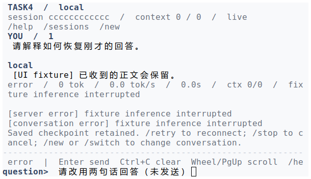

学号：待填写　　姓名：待填写　　专业：待填写　　班级：待填写

# 《Linux操作系统设计实践》实验四：综合应用

实验日期：2026 年 10 月 14 日　　选用方案：方案 4

个人分工：协作成员二——会话文件、断点恢复、服务发现及测试记录核对　　任务量占比：27.5%

## 一、实验环境

本实验以 Linux 下的本地模型流式对话系统为对象。课程客户端、服务端使用 C 语言编写，每轮生成由独立 Python 适配进程完成，模型推理依赖本机常驻的 llama-server。本篇重点说明辅助完成会话持久化、恢复及相关验证的任务，同时交代完整系统的运行条件。

| 项目 | 小组实验采用的环境 |
| --- | --- |
| 操作系统 | Ubuntu 24.04.2 LTS，WSL2，x86_64 |
| Linux 内核 | 6.6.87.2-microsoft-standard-WSL2 |
| 编译与构建 | GCC 13.3.0、GNU Make 4.3 |
| 编译选项 | `-std=c11 -Wall -Wextra -Wpedantic -Werror -O2 -g` |
| CPU | AMD Ryzen AI 7 H 350，8 核 16 线程 |
| GPU | NVIDIA GeForce RTX 5060 Laptop GPU，约 8 GB 显存 |
| 本地模型 | Qwen3.5-4B 的 Q5_K_M GGUF，文件大小 3,143,656,608 字节 |
| 推理运行环境 | llama.cpp b11429，提交 `d81235049384534c167caea52b85a694f6103d14`；CUDA 13.4 用户态运行库 |
| 模型容量 | 全层 GPU，2 个推理槽，每槽 16384 token；新轮每次尝试最多生成 4096 token |
| 辅助程序 | Python 3.12，模型适配和验证使用标准库 |

环境依据为 [硬件日志](../../logs/model-hardware.txt) 和 [本地模型说明](../../docs/local-model.md)。模型权重、运行库位于项目 `.runtime/`，推理请求使用本机回环地址。恢复旧轮次继续使用建立该轮时保存的配置，不能直接把当前新轮的容量设置套用到所有历史记录。

## 二、系统开发情况介绍

### 2.1 背景、需求与系统目标

本实验依据 [实验指导书](../../../../ppt/《Linux操作系统设计实践》2026-2027第一学期-实验指导书.pdf) 的实验四方案 4，实现多个客户端同时向本地小语言模型提问，生成内容逐步返回，且不同用户的上下文、输出文件和日志相互隔离。报告按照指导书的实验环境、开发情况、运行演示、结果总结、编程工作总结与注释源码要求组织。

从会话与恢复的角度看，仅能显示一次回答还不足以完成持续交互：网络断开时必须明确保存了哪些字节；重新连接时需要定位原会话；显式取消的回答不能被当作未完成回答继续生成；多轮历史不能混入另一个客户端的内容。因此，本人的协作任务围绕“状态能够解释、文件能够核对、恢复不会重复”展开，在主负责人确定的协议和核心流程基础上配合完成相关功能与验证。

完整系统由 C 客户端、C 服务端、每轮独立 Python 模型适配进程和本机 llama-server 组成。服务端按连接建立 worker，worker 独占对应会话；模型权重由常驻服务共享，两个推理槽可以同时推进不同请求。客户端负责输入、显示及本地 checkpoint，worker 保存正式回答和终态，适配器保存原始生成日志并处理模型接口。系统仅处理文字对话，不包含工具执行和视觉输入。

### 2.2 三人分工与本人任务范围

| 成员 | 姓名 / 学号 | 任务分配 | 综合任务占比 |
| --- | --- | --- | ---: |
| 主负责人（组长） | 待填写 / 待填写 | 总体方案、核心协议与服务端、客户端主流程、模型接入和最终集成；主要涉及 `src/net/protocol.c`、`src/server/main.c`、`src/client/main.c`、`src/backend/` 和模型适配核心 | 45% |
| 协作成员一 | 待填写 / 待填写 | 在主负责人基础上协助终端输入、界面呈现、控制联调与界面验证；主要涉及 `src/client/terminal.c`、`view.c`、`screen.c`、`status.c` 及相关头文件 | 27.5% |
| 协作成员二（本人） | 待填写 / 待填写 | 在主负责人基础上协助会话文件与断点恢复、服务发现、测试及运行记录核对 | 27.5% |

上述比例按设计、编码协助、联调、测试和报告整理等任务综合估算。核心系统主要由主负责人完成，本人的定位是协助完善相关模块及核对行为与证据。本报告采用小组已有的联合验证日志和截图说明结果，代码规模与测试覆盖数不直接换算为个人工作量。

| 本人分工中的具体任务 | 与其他成员的衔接 | 本篇说明重点 |
| --- | --- | --- |
| 会话目录、锁与本地归档 | 配合客户端主流程及会话切换界面 | 独立目录、独占写入、终态正文归档与软删除 |
| checkpoint 与异常恢复 | 配合协议游标、服务端缓存及模型原始日志 | 已落盘前缀、残尾处理、取消与中断的不同状态 |
| 服务发现 | 配合服务端启动及模型适配器 | 端口变化后的身份校验、歧义拒绝和原会话定位 |
| 验证与记录核对 | 配合主负责人最终集成与协作成员一界面联调 | 从文件、退出状态和日志检查恢复、隔离及错误路径 |

与这些任务直接相关的源码范围如下。行数按原报告对应源码统计，包含注释与空行；它们表示本篇说明及附录覆盖的模块规模。

| 文件 | 作用 | 行数 |
| --- | --- | ---: |
| `include/task4/checkpoint.h` | 客户端断点数据与持久操作接口 | 24 |
| `include/task4/client_state.h` | 会话列表、解析、软删除和正文归档接口 | 51 |
| `include/task4/discovery.h` | 课程服务发现与身份接口 | 38 |
| `include/task4/store.h` | 服务端会话、轮次及终态接口 | 31 |
| `src/client/state.c` | 本地会话目录与归档管理 | 574 |
| `src/net/discovery.c` | 主服务租约、端点发布及活动实例核验 | 405 |
| `src/storage/checkpoint.c` | checkpoint 追加、加载、纠偏队列与恢复 | 303 |
| `src/storage/files.c` | 完整写入与目录同步等文件辅助操作 | 37 |
| `src/storage/session.c` | 服务端会话隔离、轮次建立、历史与终态 | 235 |
| `src/model/discovery.py` | 本地模型地址解析、健康与身份核验 | 148 |
| 合计 | 4 个头文件、5 个 C 实现、1 个 Python 模块 | 1846 |

完整项目的协议、进程与界面模块协同构成可运行程序，不能只编译上述文件得到完整客户端或服务端。附录保留这些文件的完整注释源码，测试程序与其它模块通过项目路径引用。

### 2.3 文件组织与持久化顺序

| 位置 | 保存内容 | 恢复或核查时的用途 |
| --- | --- | --- |
| `state/clients/session-XXXXXX/checkpoint.ckpt` | 当前轮 token、请求号、原问题、正文增量和终态 | 客户端恢复时确定同一轮及已接收正文的字节偏移 |
| `<checkpoint>.lock` | 独占锁及锁持有者信息 | 阻止两个客户端同时修改同一个 checkpoint |
| `<checkpoint>.steer` | 已持久保存、尚待提交的纠偏要求 | 重启后先处理旧轮终态，再提交纠偏后的下一轮 |
| `<checkpoint>.history/` | 已完成或取消轮次的正式问题、回答和终态 | 切换或重开会话时恢复本地对话显示 |
| `state/model-server/<token>/turn-XXXXXXXX/` | 问题、正式回答、冻结配置、模型快照、原始生成 journal | 还原本会话本轮的服务端状态与模型续写前缀 |
| `done` / `cancelled` | 正常完成 / 显式取消的终态标记 | 区分完成、取消与仍可恢复的未完成轮次 |

持久化必须有明确先后关系。模型适配器先保存并同步原始生成片段，再解析成思考或回答；C worker 先把正式回答写入 `response.txt` 并同步，再发送 DELTA；客户端校验请求号、偏移及 UTF-8 后，先保存 checkpoint，再交给显示层。因此，原始日志可以比正式回答缓存更长，服务端缓存可以比客户端 checkpoint 更长；若客户端声称的前缀反而超过服务端记录，就不能直接继续。

checkpoint 使用带偏移和校验的追加记录。加载时可以修复尚未写完的尾部，但完整记录校验失败应报错，不能跳过后继续拼接。FNV-1a 在这里用于检测记录损坏，不承担网络认证功能。保存失败后，下一次同进程重试会用完整内存前缀重建文件，避免不确定的半次追加导致同一偏移被重复记录。

终态归档与活动 checkpoint 的用途不同：归档只恢复界面可见正文，不用于发起 `--resume`，也不被模型适配器当作历史来源。模型下一轮历史由服务端当前会话已完成的轮次构造，排除取消轮次、未完成回答、思考及状态信息。详细文件格式和约束见 [架构与持久化契约](../../docs/architecture.md)。

### 2.4 恢复、软删除与服务发现

断开连接后，客户端带着原 token、请求号、问题和已保存的正文偏移重连。服务端首先补发缓存缺口；模型适配器核对冻结快照与原始前缀后，再继续未完成的生成。已经完成的轮次可以重放保存的结果，不必重新调用模型。显式 `/stop` 则写入取消终态，不能再当作普通断点续写。恢复保证已保存前缀保持一致，不保存 GPU KV cache 或采样器状态，后续新生成的文本允许与不中断时不同。

软删除需要同时保护文件与锁。`/delete` 仅处理受管且未被其它客户端占用的会话目录，将 checkpoint、归档和原锁 inode 一起移动到 `.trash`，不删除服务端副本。路径解析成功不代表获得写权限，调用者还需取得锁并加载状态。暂停的客户端仍持有锁，不能通过删除 `.lock` 文件强行解除占用。归档冲突或损坏时明确报错，避免覆盖旧轮后只剩不完整的新轮记录。

课程服务端使用端口 0 让内核分配端口，发布记录同时绑定状态目录身份、主进程锁和启动实例标识。客户端不能仅凭一个旧端口号认定服务还活着；连接后先执行只读 `PROBE → SERVICE(instance)` 校验，再进行会话握手。恢复时依据 token 定位原服务状态目录，所以端口改变后仍可寻找原会话。多个服务同时匹配时应报歧义，不能任意选择。

模型发现另用 `.runtime/model-service.json` 管理健康端点。运行时地址可以改变，但当前轮推理参数、模型身份、构建和模板仍受快照约束。这样既能跟随自动端口，又不会把旧前缀无条件交给另一模型续写。

### 2.5 涉及的主要系统调用

| 系统调用或接口 | 本人分工相关用途 |
| --- | --- |
| `open/read/write/close`、`lseek`、`ftruncate` | 文件读取、完整写入、定位与残尾修复 |
| `flock` | checkpoint、服务端会话和主服务租约的独占访问 |
| `fstat/lstat`、`O_NOFOLLOW` | 检查普通文件、目录、inode 等条件并拒绝重定向路径 |
| `fsync` | 将文件内容及父目录变更同步后再确认发布 |
| `mkstemp/mkdtemp` | 建立临时文件、轮次目录与独立客户端会话目录 |
| `rename/renameat2` | 原子替换、发布轮次及不覆盖目标的软删除 |
| `socket/bind/getsockname/connect` | 分配实际监听端口、连接已发现服务 |
| `getrandom`、`/dev/urandom` | 生成会话 token 与服务实例标识 |

完整程序还通过 `fork/execvp` 建立生成进程，用 `poll` 同时处理数据、控制和退出事件，并用信号与 `waitpid` 处理取消和回收。这部分由主负责人负责核心流程，本人的文件与恢复任务必须服从这些进程生命周期，不能把子进程输出 EOF 直接解释为正常完成。

## 三、程序运行演示说明

### 3.1 编译与验证入口

以下命令均在 Linux 的 `homework/task4` 目录执行。完整系统的编译方式为：

```sh
make -j4 CFLAGS='-std=c11 -Wall -Wextra -Wpedantic -Werror -O2 -g'
make verify
make -q
```

本节结果引用小组已保存的 [完整检查记录](../../logs/verify-current.txt)，包含严格编译参数、checkpoint 故障注入以及会话、服务发现、模型适配等检查结果。自动检查使用真实 C 程序配合可控模型事件或本机 HTTP 测试服务，适合验证确定的边界条件；真实模型生成的效果另由相应运行记录说明。

| 既有检查 | 记录中的结果 | 对本人分工的说明 |
| --- | --- | --- |
| checkpoint 故障注入 | 9 项通过 | 包括 DELTA / END / CANCELLED 的同步失败、部分写、关闭失败与纠偏队列清理失败 |
| 会话与历史单元检查 | 9 项通过 | 独立目录、锁保护、归档幂等、损坏拒绝、软删除保留原锁 inode |
| 客户端会话联调 | 13 项通过 | 新建与切换、错误后重试、流式切出后的断点保留、归档失败阻止覆盖 |
| C 服务发现联调 | 6 项通过 | 自动端口、多个候选歧义、旧注册记录忽略、实例不匹配时拒绝握手 |

例如，`tests/verify_discovery.py` 的 P04 在服务异常退出后核查旧记录失效，并验证端口与实例标识改变后仍能按 token 恢复原 UTF-8 回答；`tests/verify_client_sessions.py` 的 M09 检查流式输出期间新建会话，切回原会话后等待 `/retry`，最终恢复准确的回答。上述内容是既有联合验证案例的解释，未把测试覆盖数换算为个人工作量。

### 3.2 启动与会话管理演示

准备模型依赖后，在三个终端分别启动模型服务、课程服务端和客户端：

```sh
python3 scripts/model/setup.py
bash scripts/model/serve.sh gpu
./bin/stream_server --state state/model-server
./bin/stream_client
```

第一条用于首次准备；后三条分别运行。默认客户端创建独立本地会话，可以通过 `/sessions` 查看、`/new` 新建、`/switch ID` 切换。生成期间切出会话会保留该轮断点，切回后使用 `/retry` 继续。下图展示会话切换与多轮正文恢复。


图 1 使用当前编译的 C 客户端和可控界面夹具，说明会话呈现及恢复操作，不是真实模型生成内容。截图来自全 stdio PTY 的实际重绘并重放到白底 xterm，采集来源见 [截图记录](../../logs/report-screenshots-current.json)。

网络或生成错误后，对话中保留错误提示，输入区仍可使用；`/retry` 继续当前轮，`/stop` 结束待完成轮。错误提示本身不进入模型历史。



图 2 同样使用可控夹具，展示窄窗口错误状态的实际客户端界面。既有会话联调日志进一步检查了重试时 token、请求、问题与持久字节偏移不变，补充了单张截图无法证明的恢复正确性。

### 3.3 真实模型中断后的恢复

命令行恢复可先列出已有会话，再指定原 checkpoint：

```sh
./bin/stream_client --list-sessions
./bin/stream_client --resume 路径/checkpoint.ckpt
./bin/stream_client --resume 路径/checkpoint.ckpt --resume-only
```

这里的“路径”应替换为列表中实际 checkpoint 所在位置。客户端 checkpoint 与对应服务端状态目录都需要保留，不能仅复制某一个回答文本文件就认为可以继续原轮次。

[真实模型控制记录](../../logs/model-controls.txt) 保存了一次 SIGTERM 中断后的续写验证。该恢复案例使用独立 `thinking=false` 配置，日常默认仍为 `thinking=true`，不能混写为默认配置下的所有状态都得到同样验证。

| 核查项 | 已有真实模型记录 |
| --- | --- |
| 中断时客户端退出码 | 143 |
| 已落盘正式回答前缀 | 8 字节 |
| 中断时原始 journal 文件 | 340 字节 |
| 恢复后的正式回答 | 140 字节，即新增后缀 132 字节 |
| 恢复过程耗时 | 1.751 秒，单次样本 |
| 一致性检查 | token、请求号、模型与模板快照不变；旧原始前缀保留；没有重复问题 |

这组记录支持“已保存前缀能够继续且不重复”的结论。8 字节是正式回答前缀，340 字节是包含记录结构的原始 journal 文件大小，两者含义不同；恢复后的 140 字节也不是 140 个 token。记录没有证明每次意外中断后都能生成与不中断运行逐 token 相同的后缀。

### 3.4 自动发现与双客户端隔离

既有 [自动端口真实模型实测](../../logs/model-smoke-auto-ports.txt) 通过两个真实 C 客户端，在同一连接中分别进行两轮对话。两路在第二轮分别回忆出自己的代号 MAPLE 和 CEDAR，token 不同、上下文隔离，均以 `request=2`、`done=1`、退出码 0 完成。总耗时为 21.825 秒，这是该输入和配置下的一次记录。

自动发现测试不仅检查“能连接”，还检查“连接的是原服务”。如果注册文件残留但锁已释放，它不能继续成为活动候选；如果目标端口被另一服务占用，实例校验应先阻止 HELLO，而不是错误地建立新会话。模型地址变化与推理配置冻结也分别验证，避免恢复时仅因端口更新就丢失原配置，或因可连接就忽略模型身份。


图 3 来自真实本地 Qwen 多轮 TUI 检查，内容为 SPRUCE 会话，相关记录为 [真实模型 TUI 日志](../../logs/model-tui-4096.txt)。它用于展示实际模型下的多轮界面；MAPLE / CEDAR 双客户端和 8 字节断点恢复分别由前述日志证明，三组记录的输入与检查目的不同。

## 四、实验结果总结

完整系统达到了方案 4 的基本目标：多个 C 客户端能访问同一本地模型，流式接收回答，并通过独立 token、会话目录、轮次文件和日志保持隔离。本人的协作范围使这些功能在重启、会话切换和异常路径中仍有可核查的状态：checkpoint 记录已交付正文，服务端保存正式缓存与终态，模型适配器保存原始前缀；服务发现负责把恢复请求送到经过身份核验的原状态目录。

既有自动验证记录显示，会话锁、归档、软删除、故障恢复及服务发现的所列检查均通过。真实模型记录进一步证明了一次 8 字节前缀恢复至 140 字节的续写，以及自动端口下两客户端的多轮上下文隔离。界面截图、可控功能检查和真实模型运行各自证明不同层面的行为，不能互相替代。

仍存在以下边界：恢复需要客户端与服务端状态同时保留；未保存在本地归档中的更早正文不会自动从服务端下载；显式取消的轮次不能继续推理；恢复不保存 KV cache 和随机采样状态；长历史及输出预算仍可能使生成停止并保留未完成状态。双推理槽也不保证每个客户端都达到单路短基准速度。后续改进应继续围绕明确的故障场景及状态一致性展开，避免只用一次成功演示推断全部异常都能正确恢复。

## 五、编程工作总结

本次分工让我把注意力从“程序能显示回答”转向“程序退出以后还留下什么”。会话管理表面上是若干文件读写，实际需要同时理解请求编号、字节偏移、文件锁和进程生命周期。主负责人负责核心协议与总体集成，我在协作任务中需要沿着这些约定核对文件层行为，不能只依据屏幕上出现的文字判断完成。一个回答已经显示，并不说明所有状态都已经正确保存；一个文件存在，也不说明它是完整、可信并且属于当前会话的记录。

对我帮助最大的是明确持久化顺序。原始片段、服务端正式回答和客户端断点分处不同层，故障可能发生在任意两个步骤之间。先保存再交付，使落盘前缀成为恢复依据；允许上游记录领先、禁止下游凭空领先，才能解释重放缺口的来源。文件同步失败之后也不能简单再追加一次，因为上一次写入可能已经部分成功。检查已有故障注入案例后，我认识到错误返回不等于文件完全没有变化，恢复代码必须处理这种不确定性。

会话锁和软删除也改变了我对“删除一个目录”的理解。同一文件可能被另一个进程使用，暂停的客户端并不会自动释放锁。删除锁文件虽然可能让界面看起来不再占用，却会破坏对原 inode 的互斥约定。把整个受管目录移动到回收位置并保留原锁，既能满足日常操作，又能保留恢复材料。路径检查、普通文件检查和锁检查各有用途，不能省略其中一个后指望另一个补足全部条件。

服务发现让我认识到，地址只是连接入口，不能替代服务身份。端口可以变化，也可能被其它进程复用；旧注册文件还在磁盘上，不代表原进程仍存活。因此需要结合状态目录、锁和实例标识核验，并在真正建立会话前检查连接对端。对模型服务还要另外核对模板和配置快照，因为连到一个可用模型与能够正确继续旧轮次是两件不同的事。

整理验证证据时，我也注意到测试结论需要与记录范围一致。可控对端容易安排残缺帧、同步失败和取消交叉等场景，真实模型则能检验实际生成链路；截图能够说明界面状态，却无法单独证明文件中没有重复字节。因此，本篇结合日志、文件语义和界面图进行说明，并保留单次样本、夹具来源和恢复配置的限制。这样的记录方式便于组内交接：遇到异常时，可以先定位哪一层状态发生变化，再决定补发、续写或终止，而不是反复重启直到偶然成功。

## 六、注释源码附录

下列 10 个文件从原始报告的源码附录提取，保留源码及原有注释。它们是本篇协作任务涉及的实现范围，完整构建仍需项目中的协议、客户端入口、服务端入口与模型适配等其它模块。行数用于描述模块规模，不作为个人贡献证明。

<!-- source-appendix -->

### 附录 1：include/task4/checkpoint.h

阅读要点：先看结构体中的会话 token、请求号、正文偏移与终态，再区分加载、保存、加锁和持久纠偏接口。它们把恢复所需状态与界面显示状态分开。

```c
#ifndef TASK4_CHECKPOINT_H
#define TASK4_CHECKPOINT_H
#include "task4/protocol.h"

struct t4_checkpoint {
    char session[33];
    /* done: 0 pending, 1 completed, 2 explicitly cancelled. */
    uint32_t request, offset, prompt_length, done;
    uint32_t file_lines;
    unsigned char prompt[T4_MAX_PROMPT + 1];
    unsigned char *answer;
    uint32_t saved_request, saved_offset, saved_done;
    int journal_loaded;
    /* A durable steering sidecar belongs to queued_request in this session. */
    uint32_t queued_request, queued_length;
    unsigned char queued_prompt[T4_MAX_PROMPT + 1];
};
int t4_checkpoint_load(const char *path, struct t4_checkpoint *c);
int t4_checkpoint_save(const char *path, struct t4_checkpoint *c);
int t4_checkpoint_lock(const char *path);
int t4_checkpoint_queue(const char *path, struct t4_checkpoint *c,
                        const unsigned char *prompt, uint32_t length);

#endif
```

### 附录 2：include/task4/client_state.h

阅读要点：接口注释说明了解析路径不等于获得锁，软删除和归档都有独立前置条件。调用者需要持有活动 checkpoint 的锁才能归档。

```c
#ifndef TASK4_CLIENT_STATE_H
#define TASK4_CLIENT_STATE_H

#include <stddef.h>
#include <limits.h>
#include "task4/checkpoint.h"

struct t4_client_session {
    char id[15], path[PATH_MAX], status[24];
    long owner;
};
typedef int (*t4_client_session_fn)(const struct t4_client_session *, void *);
typedef int (*t4_client_history_fn)(const struct t4_checkpoint *, void *);

/* Create private parents and a unique session-XXXXXX/checkpoint.ckpt path.
 * The checkpoint itself does not yet exist. Returns 0, or -1 with errno. */
int t4_client_state_new(const char *session_dir, char *out, size_t capacity);

/* List managed checkpoint paths and lock/file status without loading, changing
 * or revealing their question/answer contents. Missing directories are empty. */
int t4_client_state_list(const char *session_dir);

/* Stable ID ordering, callbacks return 0 to continue or -1 to abort. A missing
 * directory is empty. Enumeration never loads or changes the checkpoint. */
int t4_client_state_scan(const char *session_dir, t4_client_session_fn visit, void *opaque);

/* Resolve a managed session-XXXXXX ID or existing checkpoint path. The caller
 * must then acquire t4_checkpoint_lock and load; resolving grants no lock. */
int t4_client_state_resolve(const char *session_dir, const char *id_or_path,
                          char *out, size_t capacity);

/* Soft-delete an unlocked managed ID into session_dir/.trash. Checkpoint and
 * lock inode move together, never unlinking the lock. Refuses arbitrary paths,
 * symlinks and active sessions. Returns the recoverable directory in out. */
int t4_client_state_delete(const char *session_dir, const char *id,
                         char *out, size_t capacity);

/* A compact, checksummed display archive alongside path as path+.history.
 * Only terminal prompt/answer are stored; status, thinking and steering are
 * excluded. Caller holds the active checkpoint lock. Same turn is idempotent;
 * conflicting content returns EEXIST and is never replaced. */
int t4_client_history_archive(const char *path, const struct t4_checkpoint *c);
/* Visit completed/cancelled archives in request order. session must match the
 * current checkpoint. Each borrowed checkpoint is valid during its callback. */
int t4_client_history_scan(const char *path, const char *session,
                         t4_client_history_fn visit, void *opaque);

/* Explain a lock/load failure using the caller's saved errno. */
void t4_client_state_lock_error(const char *path, int error);

#endif
```

### 附录 3：include/task4/discovery.h

阅读要点：重点关注服务端身份与租约结构，以及客户端发现、选择和验证活动服务的接口。端点地址与启动实例需要一起核对。

```c
#ifndef TASK4_DISCOVERY_H
#define TASK4_DISCOVERY_H

#include <limits.h>
#include <stdint.h>

struct t4_endpoint {
    char host[16];
    uint16_t port;
    char state[PATH_MAX];
    char instance[33];
};

/* Only the master retains the lease. Workers close their inherited copies. */
struct t4_service {
    int lease_fd, state_fd, registry_fd;
    uint64_t device, inode;
    char state[PATH_MAX], entry[80], instance[33];
    int published;
};

/* 0: newly owned lease; 1: matching live service in existing; -1: error.
 * EBUSY means another master owns the state but has not published its endpoint. */
int t4_service_acquire(const char *state, struct t4_service *service,
                       struct t4_endpoint *existing);
int t4_service_publish(struct t4_service *service, const char *registry,
                       const char *host, uint16_t port);
void t4_service_child_close(struct t4_service *service);
void t4_service_close(struct t4_service *service);

/* explicit_state bypasses registry scanning. token filters saved sessions.
 * ENOENT: none live; EEXIST: ambiguous. Neither chooses an arbitrary server. */
int t4_service_discover(const char *registry, const char *explicit_state,
                        const char *token, struct t4_endpoint *endpoint);
/* Recheck the state lease and instance before the same-connection wire probe. */
int t4_service_validate(const struct t4_endpoint *endpoint);

#endif
```

### 附录 4：include/task4/store.h

阅读要点：该接口把服务端会话、轮次开始、历史构造及终态操作分开。客户端本地归档不会替代这里的模型历史。

```c
#ifndef TASK4_STORE_H
#define TASK4_STORE_H

#include <limits.h>
#include <stdint.h>
#include <stddef.h>
#include "task4/backend.h"
#include "task4/files.h"

struct t4_session {
    char token[33];
    char directory[PATH_MAX];
    char context[PATH_MAX];
    int lock_fd;
    int log_fd;
};

/* 同一会话只允许一个连接持有锁；空 token 创建独立会话。 */
int t4_session_open(const char *root, const char *token, struct t4_session *s);
void t4_session_close(struct t4_session *s);
int t4_event(struct t4_session *s, const char *event, uint32_t request, uint32_t offset);
/* 检查顺序及重试 prompt，返回持久回复长度、完成标志和本轮目录。 */
int t4_turn_open(struct t4_session *s, uint32_t request,
                 const unsigned char *prompt, uint32_t length,
                 char directory[PATH_MAX], uint32_t *cached, int *done,
                 const char *model_config, const struct t4_backend *backend);
int t4_turn_done(const char *directory);
/* A cancelled turn is terminal but never included in later model history. */
int t4_turn_cancel(const char *directory);

#endif
```

### 附录 5：src/client/state.c

阅读要点：查看独立会话目录建立、稳定枚举、目标解析、锁保护软删除以及终态正文归档。异常路径保留原 checkpoint 和锁身份，防止日常操作破坏可恢复状态。

```c
#include "task4/client_state.h"
#include "task4/files.h"
#include "task4/text.h"

#include <arpa/inet.h>
#include <dirent.h>
#include <errno.h>
#include <fcntl.h>
#include <limits.h>
#include <stdio.h>
#include <stdlib.h>
#include <string.h>
#include <sys/file.h>
#include <sys/stat.h>
#include <sys/syscall.h>
#include <unistd.h>

#define SESSION_LIMIT 10000U
#define HISTORY_HEADER 64U

static int private_directory(int fd)
{
    struct stat st;
    if (fstat(fd, &st) < 0) return -1;
    if (!S_ISDIR(st.st_mode) || st.st_uid != geteuid() || (st.st_mode & 0022)) {
        errno = EACCES; return -1;
    }
    return 0;
}

static int session_id(const char *id)
{
    if (!id || strlen(id) != 14 || strncmp(id, "session-", 8)) return 0;
    for (size_t i = 8; i < 14; ++i)
        if (!((id[i] >= '0' && id[i] <= '9') || (id[i] >= 'A' && id[i] <= 'Z') ||
              (id[i] >= 'a' && id[i] <= 'z'))) return 0;
    return 1;
}

/* Walk each component through a directory descriptor: existing symlinks and
 * regular files cannot become parents of automatically managed client state. */
static int directory_open(const char *path, int create)
{
    if (!path || !*path) { errno = EINVAL; return -1; }
    if (strlen(path) >= PATH_MAX) { errno = ENAMETOOLONG; return -1; }
    char copy[PATH_MAX];
    strcpy(copy, path);
    int fd = open(path[0] == '/' ? "/" : ".", O_RDONLY | O_DIRECTORY | O_CLOEXEC);
    if (fd < 0) return -1;
    char *save = NULL;
    for (char *part = strtok_r(copy, "/", &save); part; part = strtok_r(NULL, "/", &save)) {
        if (create) {
            if (mkdirat(fd, part, 0700) == 0) {
                if (fsync(fd) < 0) goto fail;
            } else if (errno != EEXIST) goto fail;
        }
        int child = openat(fd, part, O_RDONLY | O_DIRECTORY | O_NOFOLLOW | O_CLOEXEC);
        if (child < 0) goto fail;
        close(fd);
        fd = child;
    }
    return fd;
fail:
    {
        int saved = errno;
        close(fd);
        errno = saved;
        return -1;
    }
}

int t4_client_state_new(const char *session_dir, char *out, size_t capacity)
{
    if (!session_dir || !*session_dir || !out || !capacity) { errno = EINVAL; return -1; }
    out[0] = 0;
    char temporary[PATH_MAX];
    int n = snprintf(temporary, sizeof(temporary), "%s/session-XXXXXX", session_dir);
    static const char checkpoint[] = "/checkpoint.ckpt";
    if (n < 0 || (size_t)n >= sizeof(temporary) ||
        (size_t)n + sizeof(checkpoint) > capacity) { errno = ENAMETOOLONG; return -1; }
    int parent = directory_open(session_dir, 1);
    if (parent < 0) return -1;
    if (private_directory(parent) < 0) { int saved = errno; close(parent); errno = saved; return -1; }
    if (!mkdtemp(temporary)) { int saved = errno; close(parent); errno = saved; return -1; }
    if (fsync(parent) < 0) {
        int saved = errno;
        (void)rmdir(temporary);
        close(parent);
        errno = saved;
        return -1;
    }
    close(parent);
    memcpy(out, temporary, (size_t)n);
    memcpy(out + n, checkpoint, sizeof(checkpoint));
    return 0;
}

/* Metadata is informational only. Stale PID text is ignored unless flock says
 * that another client currently holds this exact lock inode. */
static const char *session_status(int directory, long *owner)
{
    *owner = 0;
    int fd = openat(directory, "checkpoint.ckpt.lock",
                    O_RDONLY | O_NONBLOCK | O_NOFOLLOW | O_CLOEXEC);
    if (fd >= 0) {
        struct stat lock_metadata;
        if (fstat(fd, &lock_metadata) < 0 || !S_ISREG(lock_metadata.st_mode) ||
            lock_metadata.st_nlink != 1 || lock_metadata.st_uid != geteuid()) {
            close(fd);
            return "invalid-lock";
        }
        if (flock(fd, LOCK_EX | LOCK_NB) < 0) {
            if (errno != EWOULDBLOCK && errno != EAGAIN) {
                close(fd);
                return "unavailable";
            }
            char metadata[64], extra;
            ssize_t n = pread(fd, metadata, sizeof(metadata) - 1, 0);
            if (n > 0) {
                metadata[n] = 0;
                long pid;
                if (sscanf(metadata, "pid=%ld %c", &pid, &extra) == 1 && pid > 0) *owner = pid;
            }
            close(fd);
            return "active";
        }
        close(fd);
    } else if (errno != ENOENT) return errno == ELOOP ? "invalid-lock" : "unavailable";
    struct stat st;
    if (fstatat(directory, "checkpoint.ckpt", &st, AT_SYMLINK_NOFOLLOW) < 0)
        return errno == ENOENT ? "uninitialized" : "unavailable";
    return S_ISREG(st.st_mode) ? "saved" : "invalid-file";
}

static int session_compare(const void *left, const void *right)
{
    const struct t4_client_session *a = left, *b = right;
    return strcmp(a->id, b->id);
}

int t4_client_state_scan(const char *session_dir, t4_client_session_fn visit, void *opaque)
{
    if (!visit) { errno = EINVAL; return -1; }
    int fd = directory_open(session_dir, 0);
    if (fd < 0) {
        if (errno != ENOENT) return -1;
        return 0;
    }
    if (private_directory(fd) < 0) { int saved = errno; close(fd); errno = saved; return -1; }
    DIR *directory = fdopendir(fd);
    if (!directory) { int saved = errno; close(fd); errno = saved; return -1; }
    int result = 0;
    size_t count = 0, capacity = 0;
    struct t4_client_session *sessions = NULL;
    struct dirent *entry;
    for (;;) {
        errno = 0;
        entry = readdir(directory);
        if (!entry) { if (errno) result = -1; break; }
        if (!session_id(entry->d_name)) continue;
        int child = openat(fd, entry->d_name, O_RDONLY | O_DIRECTORY | O_NOFOLLOW | O_CLOEXEC);
        if (child < 0) continue;
        if (private_directory(child) < 0) { close(child); continue; }
        long owner;
        const char *status = session_status(child, &owner);
        close(child);
        if (count == SESSION_LIMIT) { errno = EOVERFLOW; result = -1; break; }
        if (count == capacity) {
            size_t next = capacity ? capacity * 2 : 16;
            if (next > SESSION_LIMIT) next = SESSION_LIMIT;
            void *p = realloc(sessions, next * sizeof(*sessions));
            if (!p) { result = -1; break; }
            sessions = p; capacity = next;
        }
        struct t4_client_session *item = &sessions[count];
        snprintf(item->id, sizeof(item->id), "%.14s", entry->d_name);
        snprintf(item->status, sizeof(item->status), "%s", status);
        item->owner = owner;
        int n = snprintf(item->path, sizeof(item->path), "%s/%s/checkpoint.ckpt", session_dir, item->id);
        if (n < 0 || (size_t)n >= sizeof(item->path)) { errno = ENAMETOOLONG; result = -1; break; }
        ++count;
    }
    int saved = errno;
    if (closedir(directory) < 0 && !result) { result = -1; saved = errno; }
    if (!result) {
        if (count > 1) qsort(sessions, count, sizeof(*sessions), session_compare);
        for (size_t i = 0; i < count; ++i) {
            if (visit(&sessions[i], opaque) < 0) { result = -1; saved = errno; break; }
        }
    }
    free(sessions);
    errno = saved;
    return result;
}

static int session_print(const struct t4_client_session *item, void *opaque)
{
    size_t *count = opaque;
    if (printf("checkpoint=%s status=%s", item->path, item->status) < 0 ||
        (item->owner && printf(" pid=%ld", item->owner) < 0) || putchar('\n') == EOF) return -1;
    ++*count;
    return 0;
}

int t4_client_state_list(const char *session_dir)
{
    size_t count = 0;
    if (t4_client_state_scan(session_dir, session_print, &count) < 0) return -1;
    return !count && printf("No client sessions in %s\n", session_dir) < 0 ? -1 : 0;
}

/* Split a leaf from its securely opened real parent. Explicit checkpoints may
 * live outside the managed root, but no path component may be a symlink. */
static int path_parent(const char *path, char leaf[NAME_MAX + 1])
{
    if (!path || !*path) { errno = EINVAL; return -1; }
    char parent[PATH_MAX];
    if (strlen(path) >= sizeof(parent)) { errno = ENAMETOOLONG; return -1; }
    strcpy(parent, path);
    char *slash = strrchr(parent, '/');
    const char *name = slash ? slash + 1 : path;
    if (!*name || !strcmp(name, ".") || !strcmp(name, "..")) { errno = EINVAL; return -1; }
    if (strlen(name) > NAME_MAX) { errno = ENAMETOOLONG; return -1; }
    strcpy(leaf, name);
    if (!slash) strcpy(parent, ".");
    else if (slash == parent) slash[1] = 0;
    else *slash = 0;
    return directory_open(parent, 0);
}

static int regular_owned(int fd, off_t maximum)
{
    struct stat st;
    if (fstat(fd, &st) < 0) return -1;
    if (!S_ISREG(st.st_mode) || st.st_nlink != 1 || st.st_uid != geteuid() ||
        (st.st_mode & 0022) || st.st_size < 0 || st.st_size > maximum) {
        errno = EINVAL; return -1;
    }
    return 0;
}

int t4_client_state_resolve(const char *session_dir, const char *id_or_path,
                          char *out, size_t capacity)
{
    if (!session_dir || !*session_dir || !out || !capacity || !id_or_path || !*id_or_path) {
        errno = EINVAL; return -1;
    }
    out[0] = 0;
    char candidate[PATH_MAX], leaf[NAME_MAX + 1];
    int n = session_id(id_or_path)
        ? snprintf(candidate, sizeof(candidate), "%s/%s/checkpoint.ckpt", session_dir, id_or_path)
        : snprintf(candidate, sizeof(candidate), "%s", id_or_path);
    if (n < 0 || (size_t)n >= sizeof(candidate) || (size_t)n >= capacity) {
        errno = ENAMETOOLONG; return -1;
    }
    int parent = path_parent(candidate, leaf);
    if (parent < 0) return -1;
    int fd = openat(parent, leaf, O_RDONLY | O_NONBLOCK | O_NOFOLLOW | O_CLOEXEC);
    int result = fd < 0 ? -1 : regular_owned(fd, (off_t)T4_MAX_RESPONSE * 20 + T4_MAX_PROMPT + 256);
    int saved = errno;
    if (fd >= 0) close(fd);
    close(parent);
    if (!result) memcpy(out, candidate, (size_t)n + 1);
    errno = saved;
    return result;
}

static int random_name(char *out, size_t size, const char *prefix)
{
    unsigned char bytes[8];
    int fd = open("/dev/urandom", O_RDONLY | O_CLOEXEC);
    if (fd < 0) return -1;
    size_t offset = 0;
    while (offset < sizeof(bytes)) {
        ssize_t n = read(fd, bytes + offset, sizeof(bytes) - offset);
        if (n < 0 && errno == EINTR) continue;
        if (n <= 0) { int saved = n ? errno : EIO; close(fd); errno = saved; return -1; }
        offset += (size_t)n;
    }
    close(fd);
    int n = snprintf(out, size, "%s%02x%02x%02x%02x%02x%02x%02x%02x", prefix,
                     bytes[0], bytes[1], bytes[2], bytes[3], bytes[4], bytes[5], bytes[6], bytes[7]);
    if (n < 0 || (size_t)n >= size) { errno = ENAMETOOLONG; return -1; }
    return 0;
}

int t4_client_state_delete(const char *session_dir, const char *id, char *out, size_t capacity)
{
    if (!session_dir || !*session_dir || !session_id(id) || !out || !capacity) {
        errno = EINVAL; return -1;
    }
    out[0] = 0;
    char destination[64], prefix[32];
    snprintf(prefix, sizeof(prefix), "%s-", id);
    if (random_name(destination, sizeof(destination), prefix) < 0) return -1;
    int n = snprintf(out, capacity, "%s/.trash/%s", session_dir, destination);
    if (n < 0 || (size_t)n >= capacity) { out[0] = 0; errno = ENAMETOOLONG; return -1; }
    int parent = -1, child = -1, trash = -1, lock = -1, result = -1;
    parent = directory_open(session_dir, 0);
    if (parent < 0 || private_directory(parent) < 0) goto cleanup;
    child = openat(parent, id, O_RDONLY | O_DIRECTORY | O_NOFOLLOW | O_CLOEXEC);
    if (child < 0 || private_directory(child) < 0) goto cleanup;
    /* A symlink checkpoint must not be used as a way to affect external data. */
    struct stat checkpoint;
    if (fstatat(child, "checkpoint.ckpt", &checkpoint, AT_SYMLINK_NOFOLLOW) == 0) {
        if (!S_ISREG(checkpoint.st_mode) || checkpoint.st_uid != geteuid() || checkpoint.st_nlink != 1) {
            errno = EINVAL; goto cleanup;
        }
    } else if (errno != ENOENT) goto cleanup;
    lock = openat(child, "checkpoint.ckpt.lock",
                  O_RDWR | O_CREAT | O_NONBLOCK | O_NOFOLLOW | O_CLOEXEC, 0600);
    if (lock < 0 || regular_owned(lock, 1024) < 0 || flock(lock, LOCK_EX | LOCK_NB) < 0) goto cleanup;
    if (mkdirat(parent, ".trash", 0700) < 0 && errno != EEXIST) goto cleanup;
    trash = openat(parent, ".trash", O_RDONLY | O_DIRECTORY | O_NOFOLLOW | O_CLOEXEC);
    if (trash < 0 || private_directory(trash) < 0) goto cleanup;
    struct stat before, current, held, named;
    if (fstat(child, &before) < 0 || fstatat(parent, id, &current, AT_SYMLINK_NOFOLLOW) < 0 ||
        fstat(lock, &held) < 0 || fstatat(child, "checkpoint.ckpt.lock", &named, AT_SYMLINK_NOFOLLOW) < 0)
        goto cleanup;
    if (before.st_dev != current.st_dev || before.st_ino != current.st_ino ||
        held.st_dev != named.st_dev || held.st_ino != named.st_ino) { errno = ESTALE; goto cleanup; }
    /* Linux renameat2 avoids replacing even an unexpectedly created empty
     * destination. The lock remains held across rename and directory fsync. */
    if (syscall(SYS_renameat2, parent, id, trash, destination, 1U) < 0) goto cleanup;
    if (fsync(trash) < 0 || fsync(parent) < 0) {
        int saved = errno;
        (void)syscall(SYS_renameat2, trash, destination, parent, id, 1U);
        errno = saved; goto cleanup;
    }
    result = 0;
cleanup:
    {
        int saved = errno;
        if (lock >= 0) close(lock);
        if (trash >= 0) close(trash);
        if (child >= 0) close(child);
        if (parent >= 0) close(parent);
        if (result < 0) out[0] = 0;
        errno = saved;
        return result;
    }
}

static int token_valid(const char *token)
{
    if (!token || strlen(token) != 32) return 0;
    for (size_t i = 0; i < 32; ++i)
        if (!((token[i] >= '0' && token[i] <= '9') || (token[i] >= 'a' && token[i] <= 'f'))) return 0;
    return 1;
}

static uint32_t hash_bytes(uint32_t hash, const void *data, size_t length)
{
    const unsigned char *p = data;
    for (size_t i = 0; i < length; ++i) hash = (hash ^ p[i]) * UINT32_C(16777619);
    return hash;
}

static int history_directory(const char *path, int create)
{
    char leaf[NAME_MAX + 1], name[NAME_MAX + 1];
    int parent = path_parent(path, leaf);
    if (parent < 0) return -1;
    int n = snprintf(name, sizeof(name), "%s.history", leaf);
    int fd = -1;
    if (n < 0 || (size_t)n >= sizeof(name)) { errno = ENAMETOOLONG; goto cleanup; }
    if (create && mkdirat(parent, name, 0700) == 0) {
        if (fsync(parent) < 0) goto cleanup;
    } else if (create && errno != EEXIST) goto cleanup;
    fd = openat(parent, name, O_RDONLY | O_DIRECTORY | O_NOFOLLOW | O_CLOEXEC);
    if (fd >= 0 && private_directory(fd) < 0) { int saved = errno; close(fd); fd = -1; errno = saved; }
cleanup:
    { int saved = errno; close(parent); errno = saved; return fd; }
}

static int exact_read(int fd, void *buffer, size_t length)
{
    unsigned char *p = buffer;
    while (length) {
        ssize_t n = read(fd, p, length);
        if (n < 0 && errno == EINTR) continue;
        if (n <= 0) { if (!n) errno = EINVAL; return -1; }
        p += n; length -= (size_t)n;
    }
    return 0;
}

static int text_valid(const unsigned char *p, uint32_t length)
{
    for (uint32_t offset = 0; offset < length;) {
        unsigned width = t4_character_width(p[offset]);
        if (!width || width > length - offset || !t4_character_valid(p + offset, width)) return 0;
        offset += width;
    }
    return 1;
}

static int history_load(int directory, const char *name, struct t4_checkpoint *c)
{
    memset(c, 0, sizeof(*c));
    int fd = openat(directory, name, O_RDONLY | O_NONBLOCK | O_NOFOLLOW | O_CLOEXEC);
    if (fd < 0) return -1;
    int result = -1;
    unsigned char header[HISTORY_HEADER];
    uint32_t fields[6];
    if (regular_owned(fd, HISTORY_HEADER + T4_MAX_PROMPT + T4_MAX_RESPONSE) < 0 ||
        exact_read(fd, header, sizeof(header)) < 0) goto cleanup;
    if (memcmp(header, "T4HIST1\n", 8)) { errno = EINVAL; goto cleanup; }
    memcpy(c->session, header + 8, 32);
    memcpy(fields, header + 40, sizeof(fields));
    c->request = ntohl(fields[0]); c->prompt_length = ntohl(fields[1]);
    c->offset = ntohl(fields[2]); c->done = ntohl(fields[3]); c->file_lines = ntohl(fields[4]);
    if (!token_valid(c->session) || !c->request || c->request > SESSION_LIMIT ||
        c->prompt_length > T4_MAX_PROMPT || c->offset > T4_MAX_RESPONSE ||
        (c->done != 1 && c->done != 2)) { errno = EINVAL; goto cleanup; }
    struct stat st;
    if (fstat(fd, &st) < 0) goto cleanup;
    if (st.st_size != (off_t)(HISTORY_HEADER + c->prompt_length + c->offset)) { errno = EINVAL; goto cleanup; }
    c->answer = malloc((size_t)c->offset + 1);
    if (!c->answer || exact_read(fd, c->prompt, c->prompt_length) < 0 ||
        exact_read(fd, c->answer, c->offset) < 0) goto cleanup;
    c->answer[c->offset] = 0;
    uint32_t hash = hash_bytes(UINT32_C(2166136261), header, 60);
    hash = hash_bytes(hash, c->prompt, c->prompt_length);
    hash = hash_bytes(hash, c->answer, c->offset);
    if (hash != ntohl(fields[5]) || !text_valid(c->prompt, c->prompt_length) ||
        !text_valid(c->answer, c->offset)) { errno = EINVAL; goto cleanup; }
    result = 0;
cleanup:
    {
        int saved = errno;
        close(fd);
        if (result < 0) { free(c->answer); c->answer = NULL; }
        errno = saved; return result;
    }
}

static int history_same(int directory, const char *name, const struct t4_checkpoint *c)
{
    struct t4_checkpoint old;
    if (history_load(directory, name, &old) < 0) return -1;
    int same = !strcmp(old.session, c->session) && old.request == c->request &&
        old.prompt_length == c->prompt_length && old.offset == c->offset &&
        old.done == c->done && old.file_lines == c->file_lines &&
        !memcmp(old.prompt, c->prompt, c->prompt_length) &&
        (!c->offset || !memcmp(old.answer, c->answer, c->offset));
    free(old.answer);
    if (!same) { errno = EEXIST; return -1; }
    return 0;
}

int t4_client_history_archive(const char *path, const struct t4_checkpoint *c)
{
    if (!c || !token_valid(c->session) || !c->request || c->request > SESSION_LIMIT ||
        (c->done != 1 && c->done != 2) || c->prompt_length > T4_MAX_PROMPT ||
        c->offset > T4_MAX_RESPONSE || (c->offset && !c->answer) ||
        !text_valid(c->prompt, c->prompt_length) || !text_valid(c->answer, c->offset)) {
        errno = EINVAL; return -1;
    }
    int directory = history_directory(path, 1);
    if (directory < 0) return -1;
    char name[32], temporary[64] = "";
    snprintf(name, sizeof(name), "turn-%08u.ckpt", c->request);
    struct stat st;
    int result = -1, fd = -1;
    if (fstatat(directory, name, &st, AT_SYMLINK_NOFOLLOW) == 0) {
        result = history_same(directory, name, c); goto cleanup;
    }
    if (errno != ENOENT || random_name(temporary, sizeof(temporary), ".pending-") < 0) goto cleanup;
    fd = openat(directory, temporary, O_WRONLY | O_CREAT | O_EXCL | O_NOFOLLOW | O_CLOEXEC, 0600);
    if (fd < 0) { temporary[0] = 0; goto cleanup; }
    unsigned char header[HISTORY_HEADER];
    uint32_t fields[6] = {htonl(c->request), htonl(c->prompt_length), htonl(c->offset),
                          htonl(c->done), htonl(c->file_lines), 0};
    memcpy(header, "T4HIST1\n", 8); memcpy(header + 8, c->session, 32);
    memcpy(header + 40, fields, sizeof(fields));
    uint32_t hash = hash_bytes(UINT32_C(2166136261), header, 60);
    hash = hash_bytes(hash, c->prompt, c->prompt_length);
    hash = hash_bytes(hash, c->answer, c->offset);
    fields[5] = htonl(hash); memcpy(header + 60, &fields[5], 4);
    if (t4_write_all(fd, header, sizeof(header)) < 0 ||
        t4_write_all(fd, c->prompt, c->prompt_length) < 0 ||
        t4_write_all(fd, c->answer, c->offset) < 0 || fsync(fd) < 0) goto cleanup;
    if (close(fd) < 0) { fd = -1; goto cleanup; }
    fd = -1;
    /* Atomic publish without replacing existing content, including symlinks.
     * Pending files from an interrupted write are ignored by enumeration. */
    if (syscall(SYS_renameat2, directory, temporary, directory, name, 1U) < 0) {
        if (errno == EEXIST) result = history_same(directory, name, c);
        goto cleanup;
    }
    temporary[0] = 0;
    result = fsync(directory);
cleanup:
    {
        int saved = errno;
        if (fd >= 0) close(fd);
        if (*temporary) (void)unlinkat(directory, temporary, 0);
        close(directory);
        errno = saved; return result;
    }
}

static int request_compare(const void *a, const void *b)
{
    uint32_t left = *(const uint32_t *)a, right = *(const uint32_t *)b;
    return left > right ? 1 : left < right ? -1 : 0;
}

int t4_client_history_scan(const char *path, const char *session,
                         t4_client_history_fn visit, void *opaque)
{
    if (!token_valid(session) || !visit) { errno = EINVAL; return -1; }
    int fd = history_directory(path, 0);
    if (fd < 0) return errno == ENOENT ? 0 : -1;
    DIR *directory = fdopendir(fd);
    if (!directory) { int saved = errno; close(fd); errno = saved; return -1; }
    uint32_t *requests = malloc(SESSION_LIMIT * sizeof(*requests));
    if (!requests) { closedir(directory); return -1; }
    size_t count = 0;
    int result = 0;
    for (;;) {
        errno = 0;
        struct dirent *entry = readdir(directory);
        if (!entry) { if (errno) result = -1; break; }
        if (strlen(entry->d_name) != 18 || strncmp(entry->d_name, "turn-", 5) ||
            strcmp(entry->d_name + 13, ".ckpt")) continue;
        uint32_t request = 0;
        for (size_t i = 5; i < 13; ++i) {
            if (entry->d_name[i] < '0' || entry->d_name[i] > '9') { request = 0; break; }
            request = request * 10 + (unsigned)(entry->d_name[i] - '0');
        }
        if (!request || request > SESSION_LIMIT || count == SESSION_LIMIT) {
            errno = EINVAL; result = -1; break;
        }
        requests[count++] = request;
    }
    if (!result && count > 1) qsort(requests, count, sizeof(*requests), request_compare);
    for (size_t i = 0; !result && i < count; ++i) {
        char name[32];
        snprintf(name, sizeof(name), "turn-%08u.ckpt", requests[i]);
        struct t4_checkpoint c;
        if (history_load(fd, name, &c) < 0) { result = -1; break; }
        if (c.request != requests[i] || strcmp(c.session, session)) { errno = EINVAL; result = -1; }
        else result = visit(&c, opaque);
        free(c.answer);
    }
    int saved = errno;
    free(requests);
    if (closedir(directory) < 0 && !result) { result = -1; saved = errno; }
    errno = saved; return result;
}

void t4_client_state_lock_error(const char *path, int error)
{
    fprintf(stderr, "[client] checkpoint open/lock %s: ", path ? path : "(unspecified)");
    if (error == EWOULDBLOCK || error == EAGAIN) {
        fputs("checkpoint is in use: another client owns this checkpoint, possibly paused. Continue in its terminal, "
              "or start a new client for an independent session. Resume after the owner exits.\n", stderr);
    } else if (error == EINVAL) {
        fputs("invalid or damaged checkpoint/lock data. Keep this file for inspection; "
              "start a new client to create a separate session.\n", stderr);
    } else if (error == ENOENT) {
        fputs("file or parent directory is missing. --resume requires an existing checkpoint; "
              "a new client creates its own session directory.\n", stderr);
    } else if (error == EACCES || error == EPERM || error == EROFS) {
        fputs("cannot read or write this path. Check directory/file permissions and filesystem access.\n", stderr);
    } else if (error == ENOTDIR || error == ELOOP) {
        fputs("a path component is not a directory or is a symbolic link. "
              "Choose a regular checkpoint in a real directory.\n", stderr);
    } else {
        fprintf(stderr, "%s. Check the checkpoint path and storage.\n", strerror(error));
    }
}
```

### 附录 6：src/net/discovery.c

阅读要点：跟踪主服务锁、端点文件、目录身份和实例标识的联合验证。连接入口发生变化时，恢复仍需确认原会话及实际对端身份。

```c
#include "task4/discovery.h"

#include <arpa/inet.h>
#include <dirent.h>
#include <errno.h>
#include <fcntl.h>
#include <inttypes.h>
#include <stdio.h>
#include <stdlib.h>
#include <string.h>
#include <sys/file.h>
#include <sys/random.h>
#include <sys/stat.h>
#include <unistd.h>

#define RECORD_LIMIT (PATH_MAX + 160U)
#define ENDPOINT_FILE "server.endpoint"
#define LEASE_FILE "server.lock"

struct record { struct t4_endpoint endpoint; uint64_t device, inode; };

/* Newly created components are private; openat refuses symlink components. */
static int directory_open(const char *path, int create)
{
    if (!path || !*path) { errno = EINVAL; return -1; }
    if (strlen(path) >= PATH_MAX) { errno = ENAMETOOLONG; return -1; }
    char copy[PATH_MAX];
    strcpy(copy, path);
    int fd = open(path[0] == '/' ? "/" : ".", O_RDONLY | O_DIRECTORY | O_CLOEXEC);
    if (fd < 0) return -1;
    char *save = NULL;
    for (char *part = strtok_r(copy, "/", &save); part; part = strtok_r(NULL, "/", &save)) {
        if (create && mkdirat(fd, part, 0700) == 0) {
            if (fsync(fd) < 0) goto fail;
        } else if (create && errno != EEXIST) goto fail;
        int child = openat(fd, part, O_RDONLY | O_DIRECTORY | O_NOFOLLOW | O_CLOEXEC);
        if (child < 0) goto fail;
        close(fd); fd = child;
    }
    struct stat st;
    if (fstat(fd, &st) < 0) goto fail;
    if (st.st_uid != geteuid() || (st.st_mode & 0022)) { errno = EACCES; goto fail; }
    return fd;
fail:
    {
        int saved = errno;
        close(fd); errno = saved; return -1;
    }
}

static int regular(int fd)
{
    struct stat st;
    if (fstat(fd, &st) < 0) return -1;
    if (!S_ISREG(st.st_mode) || st.st_nlink != 1 || st.st_uid != geteuid()) {
        errno = EINVAL; return -1;
    }
    return 0;
}

/* O_NONBLOCK prevents a malicious FIFO from hanging before fstat rejects it. */
static int read_fd(int fd, char *buffer, size_t capacity)
{
    if (regular(fd) < 0 || lseek(fd, 0, SEEK_SET) < 0) return -1;
    size_t used = 0;
    while (used + 1 < capacity) {
        ssize_t count = read(fd, buffer + used, capacity - used - 1);
        if (count < 0 && errno == EINTR) continue;
        if (count < 0) return -1;
        if (!count) break;
        used += (size_t)count;
    }
    char extra;
    ssize_t count;
    do { count = read(fd, &extra, 1); } while (count < 0 && errno == EINTR);
    if (count < 0) return -1;
    if (count || memchr(buffer, 0, used)) { errno = EINVAL; return -1; }
    buffer[used] = 0; return 0;
}

static int read_at(int directory, const char *name, char *buffer, size_t capacity)
{
    int fd = openat(directory, name, O_RDONLY | O_NOFOLLOW | O_NONBLOCK | O_CLOEXEC);
    if (fd < 0) return -1;
    int result = read_fd(fd, buffer, capacity), saved = errno;
    close(fd); errno = saved; return result;
}

static int hex(const char *text, size_t width)
{
    if (!text || strlen(text) != width) return 0;
    for (size_t at = 0; at < width; ++at)
        if (!((text[at] >= '0' && text[at] <= '9') || (text[at] >= 'a' && text[at] <= 'f'))) return 0;
    return 1;
}

static int lines(char *buffer, char **fields, unsigned count)
{
    char *at = buffer;
    for (unsigned n = 0; n < count; ++n) {
        fields[n] = at;
        char *end = strchr(at, '\n');
        if (!end) { errno = EINVAL; return -1; }
        *end = 0; at = end + 1;
    }
    if (*at) { errno = EINVAL; return -1; }
    return 0;
}

static int read_instance(int fd, char instance[33])
{
    char buffer[64], *fields[2];
    if (read_fd(fd, buffer, sizeof(buffer)) < 0 || lines(buffer, fields, 2) < 0) return -1;
    if (strcmp(fields[0], "T4LEASE1") || !hex(fields[1], 32)) { errno = EINVAL; return -1; }
    memcpy(instance, fields[1], 33); return 0;
}

static int identity(char *text, uint64_t *device, uint64_t *inode)
{
    char *space = strchr(text, ' ');
    if (!space || strchr(space + 1, ' ')) { errno = EINVAL; return -1; }
    *space = 0;
    char *parts[2] = {text, space + 1};
    uint64_t *out[2] = {device, inode};
    for (unsigned n = 0; n < 2; ++n) {
        size_t length = strlen(parts[n]);
        if (!length || length > 16 || !hex(parts[n], length)) { errno = EINVAL; return -1; }
        char *end;
        errno = 0;
        uintmax_t value = strtoumax(parts[n], &end, 16);
        if (errno || *end || value > UINT64_MAX) { errno = EINVAL; return -1; }
        *out[n] = (uint64_t)value;
    }
    return 0;
}

static int read_record(int directory, const char *name, struct record *record)
{
    char buffer[RECORD_LIMIT], *fields[6];
    if (read_at(directory, name, buffer, sizeof(buffer)) < 0 || lines(buffer, fields, 6) < 0) return -1;
    struct in_addr ipv4;
    if (strcmp(fields[0], "T4ENDPOINT1") || inet_pton(AF_INET, fields[1], &ipv4) != 1 ||
        strlen(fields[1]) >= sizeof(record->endpoint.host) || fields[3][0] != '/' ||
        strlen(fields[3]) >= sizeof(record->endpoint.state) || strchr(fields[3], '\r') ||
        !hex(fields[5], 32) || identity(fields[4], &record->device, &record->inode) < 0) {
        errno = EINVAL; return -1;
    }
    uint32_t port = 0;
    for (const char *at = fields[2]; *at; ++at) {
        if (*at < '0' || *at > '9' || port > 6553) { errno = EINVAL; return -1; }
        port = port * 10 + (unsigned)(*at - '0');
    }
    if (!port || port > 65535) { errno = EINVAL; return -1; }
    strcpy(record->endpoint.host, fields[1]); record->endpoint.port = (uint16_t)port;
    strcpy(record->endpoint.state, fields[3]); memcpy(record->endpoint.instance, fields[5], 33);
    return 0;
}

static int equal(const struct record *left, const struct record *right)
{
    return left->device == right->device && left->inode == right->inode &&
        left->endpoint.port == right->endpoint.port && !strcmp(left->endpoint.host, right->endpoint.host) &&
        !strcmp(left->endpoint.state, right->endpoint.state) && !strcmp(left->endpoint.instance, right->endpoint.instance);
}

static int held(int lease)
{
    if (regular(lease) < 0) return -1;
    if (flock(lease, LOCK_EX | LOCK_NB) == 0) {
        (void)flock(lease, LOCK_UN); errno = ENOENT; return -1;
    }
    if (errno == EWOULDBLOCK || errno == EAGAIN) return 0;
    return -1;
}

static int current(int directory, int lease, const struct record *expected, struct record *out)
{
    char first[33], last[33];
    struct stat st;
    if (held(lease) < 0 || read_instance(lease, first) < 0 || fstat(directory, &st) < 0 ||
        read_record(directory, ENDPOINT_FILE, out) < 0) return -1;
    if (out->device != (uint64_t)st.st_dev || out->inode != (uint64_t)st.st_ino ||
        strcmp(first, out->endpoint.instance) || (expected && !equal(expected, out))) {
        errno = ENOENT; return -1;
    }
    /* A master may die and restart while files are read. Both lease checks and
     * nonce snapshots must still describe the same running instance. */
    if (held(lease) < 0 || read_instance(lease, last) < 0) return -1;
    if (strcmp(first, last)) { errno = ENOENT; return -1; }
    return 0;
}

static int live(const struct record *expected, const char *state, struct record *out, const char *token)
{
    int directory = directory_open(state, 0);
    if (directory < 0) return -1;
    int lease = openat(directory, LEASE_FILE, O_RDONLY | O_NOFOLLOW | O_NONBLOCK | O_CLOEXEC);
    int result = -1;
    if (lease >= 0 && current(directory, lease, expected, out) == 0) {
        result = 0;
        char *absolute = realpath(state, NULL);
        if (!absolute) result = -1;
        else {
            if (strcmp(absolute, out->endpoint.state)) { errno = EINVAL; result = -1; }
            free(absolute);
        }
        if (!result && token && *token) {
            int session = openat(directory, token, O_RDONLY | O_DIRECTORY | O_NOFOLLOW | O_CLOEXEC);
            struct stat st;
            if (session < 0) result = -1;
            else {
                if (fstat(session, &st) < 0 || st.st_uid != geteuid()) { errno = EACCES; result = -1; }
                close(session);
            }
        }
    }
    int saved = errno;
    if (lease >= 0) close(lease);
    close(directory); errno = saved; return result;
}

static int write_all(int fd, const char *text, size_t length)
{
    while (length) {
        ssize_t count = write(fd, text, length);
        if (count < 0 && errno == EINTR) continue;
        if (count <= 0) { if (!count) errno = EIO; return -1; }
        text += count; length -= (size_t)count;
    }
    return 0;
}

static int atomic_file(int directory, const char *name, const char *text, const char *instance)
{
    char temporary[96];
    int size = snprintf(temporary, sizeof(temporary), ".endpoint-%ld-%s", (long)getpid(), instance);
    if (size < 0 || (size_t)size >= sizeof(temporary)) { errno = ENAMETOOLONG; return -1; }
    int fd = openat(directory, temporary, O_WRONLY | O_CREAT | O_EXCL | O_NOFOLLOW | O_CLOEXEC, 0600);
    if (fd < 0) return -1;
    int result = write_all(fd, text, strlen(text));
    if (!result) result = fsync(fd);
    int saved = errno;
    if (close(fd) < 0 && !result) { result = -1; saved = errno; }
    if (!result && renameat(directory, temporary, directory, name) < 0) { result = -1; saved = errno; }
    if (!result && fsync(directory) < 0) { result = -1; saved = errno; }
    if (result) (void)unlinkat(directory, temporary, 0);
    errno = saved; return result;
}

void t4_service_child_close(struct t4_service *service)
{
    if (!service) return;
    if (service->lease_fd >= 0) close(service->lease_fd);
    if (service->state_fd >= 0) close(service->state_fd);
    if (service->registry_fd >= 0) close(service->registry_fd);
    service->lease_fd = service->state_fd = service->registry_fd = -1;
}

int t4_service_acquire(const char *state, struct t4_service *service, struct t4_endpoint *existing)
{
    if (!service || !existing) { errno = EINVAL; return -1; }
    memset(service, 0, sizeof(*service));
    service->lease_fd = service->state_fd = service->registry_fd = -1;
    service->state_fd = directory_open(state, 1);
    if (service->state_fd < 0) return -1;
    char *absolute = realpath(state, NULL);
    if (!absolute) goto fail;
    if (strlen(absolute) >= sizeof(service->state) || strchr(absolute, '\n') || strchr(absolute, '\r')) {
        free(absolute); errno = EINVAL; goto fail;
    }
    strcpy(service->state, absolute); free(absolute);
    struct stat st;
    if (fstat(service->state_fd, &st) < 0) goto fail;
    int canonical = directory_open(service->state, 0);
    if (canonical < 0) goto fail;
    struct stat checked;
    int verified = fstat(canonical, &checked), saved = errno;
    close(canonical);
    if (verified < 0) { errno = saved; goto fail; }
    if (checked.st_dev != st.st_dev || checked.st_ino != st.st_ino) { errno = EINVAL; goto fail; }
    service->device = (uint64_t)st.st_dev; service->inode = (uint64_t)st.st_ino;
    service->lease_fd = openat(service->state_fd, LEASE_FILE,
        O_RDWR | O_CREAT | O_NOFOLLOW | O_NONBLOCK | O_CLOEXEC, 0600);
    if (service->lease_fd < 0 || regular(service->lease_fd) < 0) goto fail;
    if (flock(service->lease_fd, LOCK_EX | LOCK_NB) < 0) {
        if (errno != EWOULDBLOCK && errno != EAGAIN) goto fail;
        struct record record;
        if (current(service->state_fd, service->lease_fd, NULL, &record) < 0 ||
            strcmp(record.endpoint.state, service->state)) { errno = EBUSY; goto fail; }
        *existing = record.endpoint;
        t4_service_child_close(service); return 1;
    }
    unsigned char random[16];
    size_t used = 0;
    while (used < sizeof(random)) {
        ssize_t count = getrandom(random + used, sizeof(random) - used, 0);
        if (count < 0 && errno == EINTR) continue;
        if (count <= 0) { if (!count) errno = EIO; goto fail; }
        used += (size_t)count;
    }
    for (size_t at = 0; at < sizeof(random); ++at)
        (void)snprintf(service->instance + 2 * at, 3, "%02x", random[at]);
    char metadata[64];
    (void)snprintf(metadata, sizeof(metadata), "T4LEASE1\n%s\n", service->instance);
    if (ftruncate(service->lease_fd, 0) < 0 || lseek(service->lease_fd, 0, SEEK_SET) < 0 ||
        write_all(service->lease_fd, metadata, strlen(metadata)) < 0 || fsync(service->lease_fd) < 0) goto fail;
    if (unlinkat(service->state_fd, ENDPOINT_FILE, 0) < 0 && errno != ENOENT) goto fail;
    if (fsync(service->state_fd) < 0) goto fail;
    return 0;
fail:
    {
        int saved = errno;
        t4_service_child_close(service); errno = saved; return -1;
    }
}

int t4_service_publish(struct t4_service *service, const char *registry, const char *host, uint16_t port)
{
    if (!service || service->lease_fd < 0 || service->state_fd < 0 || !port || !host) { errno = EINVAL; return -1; }
    struct in_addr ipv4;
    if (inet_pton(AF_INET, host, &ipv4) != 1) { errno = EINVAL; return -1; }
    const char *advertised = !strcmp(host, "0.0.0.0") ? "127.0.0.1" : host;
    char record[RECORD_LIMIT];
    int count = snprintf(record, sizeof(record), "T4ENDPOINT1\n%s\n%u\n%s\n%" PRIx64 " %" PRIx64 "\n%s\n",
        advertised, port, service->state, service->device, service->inode, service->instance);
    if (count < 0 || (size_t)count >= sizeof(record)) { errno = ENAMETOOLONG; return -1; }
    int directory = directory_open(registry, 1);
    if (directory < 0) return -1;
    count = snprintf(service->entry, sizeof(service->entry), "%" PRIx64 "-%" PRIx64 ".endpoint",
                     service->device, service->inode);
    if (count < 0 || (size_t)count >= sizeof(service->entry)) { close(directory); errno = ENAMETOOLONG; return -1; }
    if (service->registry_fd >= 0) close(service->registry_fd);
    service->registry_fd = directory;
    if (atomic_file(service->state_fd, ENDPOINT_FILE, record, service->instance) < 0) return -1;
    service->published = 1;
    return atomic_file(directory, service->entry, record, service->instance);
}

static void remove_owned(int directory, const char *name, const struct t4_service *service)
{
    if (directory < 0 || !*name) return;
    struct record record;
    if (read_record(directory, name, &record) == 0 && record.device == service->device &&
        record.inode == service->inode && !strcmp(record.endpoint.state, service->state) &&
        !strcmp(record.endpoint.instance, service->instance)) {
        if (unlinkat(directory, name, 0) == 0) (void)fsync(directory);
    }
}

void t4_service_close(struct t4_service *service)
{
    if (!service) return;
    if (service->published && service->lease_fd >= 0) {
        remove_owned(service->registry_fd, service->entry, service);
        remove_owned(service->state_fd, ENDPOINT_FILE, service);
    }
    t4_service_child_close(service); service->published = 0;
}

int t4_service_discover(const char *registry, const char *explicit_state,
                        const char *token, struct t4_endpoint *endpoint)
{
    if (!endpoint || (token && *token && !hex(token, 32))) { errno = EINVAL; return -1; }
    struct record record;
    if (explicit_state && *explicit_state) {
        if (live(NULL, explicit_state, &record, token) < 0) return -1;
        *endpoint = record.endpoint; return 0;
    }
    int fd = directory_open(registry, 0);
    if (fd < 0) return -1;
    DIR *directory = fdopendir(fd);
    if (!directory) { int saved = errno; close(fd); errno = saved; return -1; }
    unsigned found = 0;
    int result = 0, saved = ENOENT;
    for (;;) {
        errno = 0;
        struct dirent *entry = readdir(directory);
        if (!entry) { if (errno) { result = -1; saved = errno; } break; }
        size_t length = strlen(entry->d_name);
        if (length < 10 || length >= 80 || strcmp(entry->d_name + length - 9, ".endpoint")) continue;
        struct record advertised;
        if (read_record(fd, entry->d_name, &advertised) < 0) continue;
        char name[80];
        (void)snprintf(name, sizeof(name), "%" PRIx64 "-%" PRIx64 ".endpoint", advertised.device, advertised.inode);
        if (strcmp(name, entry->d_name) || live(&advertised, advertised.endpoint.state, &record, token) < 0) continue;
        *endpoint = record.endpoint;
        if (++found > 1) { result = -1; saved = EEXIST; break; }
    }
    if (!result && !found) result = -1;
    if (closedir(directory) < 0 && !result) { result = -1; saved = errno; }
    if (result) errno = saved;
    return result;
}

int t4_service_validate(const struct t4_endpoint *endpoint)
{
    if (!endpoint || !hex(endpoint->instance, 32)) { errno = EINVAL; return -1; }
    struct record record;
    if (live(NULL, endpoint->state, &record, NULL) < 0) return -1;
    if (record.endpoint.port != endpoint->port || strcmp(record.endpoint.host, endpoint->host) ||
        strcmp(record.endpoint.state, endpoint->state) || strcmp(record.endpoint.instance, endpoint->instance)) {
        errno = ENOENT; return -1;
    }
    return 0;
}
```

### 附录 7：src/storage/checkpoint.c

阅读要点：沿加载与保存路径检查记录校验、残尾修复和失败后重建；再看纠偏队列如何在旧轮终结、新轮提交之间持久保存。保存顺序决定重试是否重复。

```c
#include "task4/checkpoint.h"
#include "task4/files.h"
#include "task4/text.h"

#include <arpa/inet.h>
#include <errno.h>
#include <fcntl.h>
#include <stdio.h>
#include <stdlib.h>
#include <string.h>
#include <sys/file.h>
#include <sys/stat.h>
#include <unistd.h>

int t4_checkpoint_lock(const char *path)
{
    char lock[PATH_MAX];
    int n = snprintf(lock, sizeof(lock), "%s.lock", path);
    if (n < 0 || n >= PATH_MAX) { errno = ENAMETOOLONG; return -1; }
    int fd = open(lock, O_RDWR | O_CREAT | O_NOFOLLOW | O_CLOEXEC, 0600);
    if (fd < 0) return -1;
    if (flock(fd, LOCK_EX | LOCK_NB) < 0) { int saved = errno; close(fd); errno = saved; return -1; }
    /* Only the lock owner may update this informational PID. A paused/live
     * owner's lock fails above and is never changed or unlinked here. */
    struct stat metadata;
    if (fstat(fd, &metadata) < 0) { int saved = errno; close(fd); errno = saved; return -1; }
    if (!S_ISREG(metadata.st_mode) || metadata.st_nlink != 1) {
        close(fd); errno = EINVAL; return -1;
    }
    char owner[64];
    n = snprintf(owner, sizeof(owner), "pid=%ld\n", (long)getpid());
    if (n < 0 || (size_t)n >= sizeof(owner) || lseek(fd, 0, SEEK_SET) < 0 ||
        t4_write_all(fd, owner, (size_t)n) < 0 || ftruncate(fd, n) < 0 || fsync(fd) < 0) {
        int saved = errno; close(fd); errno = saved; return -1;
    }
    return fd;
}

/* FNV-1a 检测残缺/损坏记录，不作为安全校验或网络认证。 */
static uint32_t checksum(const void *header, const void *body, size_t length)
{
    const unsigned char *p = header, *b = body;
    uint32_t hash = UINT32_C(2166136261);
    for (size_t i = 0; i < 12; ++i) hash = (hash ^ p[i]) * UINT32_C(16777619);
    for (size_t i = 0; i < length; ++i) hash = (hash ^ b[i]) * UINT32_C(16777619);
    return hash;
}

static int record_write(int fd, uint32_t type, uint32_t offset, const void *body, uint32_t length)
{
    unsigned char record[20];
    uint32_t header[4] = {htonl(type), htonl(offset), htonl(length), 0};
    header[3] = htonl(checksum(header, body, length));
    memcpy(record, header, sizeof(header));
    if (length) memcpy(record + sizeof(header), body, length);
    return t4_write_all(fd, record, sizeof(header) + length);
}

static int steer_path(char target[PATH_MAX], const char *path)
{
    int n = snprintf(target, PATH_MAX, "%s.steer", path);
    if (n < 0 || n >= PATH_MAX) { errno = ENAMETOOLONG; return -1; }
    return 0;
}

static int parent_path(char parent[PATH_MAX], const char *path)
{
    if (strlen(path) >= PATH_MAX) { errno = ENAMETOOLONG; return -1; }
    strcpy(parent, path);
    char *slash = strrchr(parent, '/');
    if (!slash) strcpy(parent, ".");
    else if (slash == parent) slash[1] = 0;
    else *slash = 0;
    return 0;
}

/* The main checkpoint lock also covers this sidecar. A queued correction is
 * durable before CANCEL is sent, and disappears only after the next turn's
 * checkpoint has atomically replaced the previous turn. */
static int steer_remove(const char *path, struct t4_checkpoint *c)
{
    char target[PATH_MAX], parent[PATH_MAX];
    if (steer_path(target, path) < 0 || parent_path(parent, path) < 0) return -1;
    if (unlink(target) < 0 && errno != ENOENT) return -1;
    if (t4_directory_sync(parent) < 0) return -1;
    c->queued_request = c->queued_length = 0;
    return 0;
}

static int steer_load(const char *path, struct t4_checkpoint *c)
{
    char target[PATH_MAX];
    if (steer_path(target, path) < 0) return -1;
    int fd = open(target, O_RDONLY | O_NOFOLLOW | O_CLOEXEC);
    if (fd < 0) return errno == ENOENT ? 0 : -1;
    FILE *f = fdopen(fd, "r");
    if (!f) { close(fd); return -1; }
    char magic[32], token[64], numbers[128], extra;
    int result = -1;
    if (!fgets(magic, sizeof(magic), f) || strcmp(magic, "T4STEER1\n") ||
        !fgets(token, sizeof(token), f) || strlen(token) != 33 || token[32] != '\n' ||
        memcmp(token, c->session, 32) || !fgets(numbers, sizeof(numbers), f) ||
        sscanf(numbers, "%u %u %c", &c->queued_request, &c->queued_length, &extra) != 2 ||
        !c->queued_request || c->queued_request > 10000 || !c->queued_length || c->queued_length > T4_MAX_PROMPT ||
        fread(c->queued_prompt, 1, c->queued_length, f) != c->queued_length ||
        memchr(c->queued_prompt, 0, c->queued_length) || fgetc(f) != EOF || ferror(f)) {
        errno = EINVAL;
        goto cleanup;
    }
    c->queued_prompt[c->queued_length] = 0;
    if (c->queued_request != c->request) {
        /* Crash after replacing the checkpoint but before deleting the queue. */
        if (c->queued_request + 1 != c->request || c->queued_length != c->prompt_length ||
            memcmp(c->queued_prompt, c->prompt, c->prompt_length)) { errno = EINVAL; goto cleanup; }
        result = steer_remove(path, c);
    } else result = 0;
cleanup:
    {
        int saved = errno;
        fclose(f);
        errno = saved;
        return result;
    }
}

int t4_checkpoint_queue(const char *path, struct t4_checkpoint *c,
                        const unsigned char *prompt, uint32_t length)
{
    if (!c->request || !length || length > T4_MAX_PROMPT || memchr(prompt, 0, length) ||
        c->queued_length) { errno = EINVAL; return -1; }
    char target[PATH_MAX], temporary[PATH_MAX], parent[PATH_MAX], header[160];
    if (steer_path(target, path) < 0 || parent_path(parent, path) < 0) return -1;
    int n = snprintf(temporary, sizeof(temporary), "%s.tmp-XXXXXX", target);
    if (n < 0 || n >= PATH_MAX) { errno = ENAMETOOLONG; return -1; }
    int fd = mkstemp(temporary);
    if (fd < 0) return -1;
    int result = -1;
    n = snprintf(header, sizeof(header), "T4STEER1\n%s\n%u %u\n", c->session, c->request, length);
    if (n < 0 || (size_t)n >= sizeof(header) || t4_write_all(fd, header, (size_t)n) < 0 ||
        t4_write_all(fd, prompt, length) < 0 || fsync(fd) < 0) goto cleanup;
    if (close(fd) < 0) { fd = -1; goto cleanup; }
    fd = -1;
    if (rename(temporary, target) < 0 || t4_directory_sync(parent) < 0) goto cleanup;
    c->queued_request = c->request; c->queued_length = length;
    memcpy(c->queued_prompt, prompt, length); c->queued_prompt[length] = 0;
    result = 0;
cleanup:
    {
        int saved = errno;
        if (fd >= 0) close(fd);
        if (result < 0) unlink(temporary);
        errno = saved;
        return result;
    }
}

int t4_checkpoint_load(const char *path, struct t4_checkpoint *c)
{
    c->session[0] = 0;
    c->request = c->offset = c->prompt_length = c->file_lines = 0;
    c->queued_request = c->queued_length = 0;
    c->done = 1; c->journal_loaded = 0;
    int fd = open(path, O_RDWR | O_NOFOLLOW | O_CLOEXEC);
    if (fd < 0) return errno == ENOENT ? 0 : -1;
    FILE *f = fdopen(fd, "r+");
    if (!f) { close(fd); return -1; }
    char magic[32], token[64], numbers[128], extra;
    int result = -1;
    if (!fgets(magic, sizeof(magic), f) || strcmp(magic, "T4CHECK2\n") ||
        !fgets(token, sizeof(token), f) || strlen(token) != 33 || token[32] != '\n' ||
        !fgets(numbers, sizeof(numbers), f) ||
        sscanf(numbers, "%u %u %u %c", &c->request, &c->prompt_length, &c->file_lines, &extra) != 3 ||
        c->prompt_length > T4_MAX_PROMPT || c->request > 10000) goto invalid;
    for (size_t i = 0; i < 32; ++i)
        if (!((token[i] >= '0' && token[i] <= '9') ||
              (token[i] >= 'a' && token[i] <= 'f'))) goto invalid;
    memcpy(c->session, token, 32); c->session[32] = 0;
    if (fread(c->prompt, 1, c->prompt_length, f) != c->prompt_length ||
        memchr(c->prompt, 0, c->prompt_length)) goto invalid;
    c->prompt[c->prompt_length] = 0;
    c->done = 0;
    off_t last_good = ftello(f);
    if (last_good < 0) goto cleanup;
    for (;;) {
        uint32_t header[4];
        unsigned char body[4];
        size_t n = fread(header, 1, sizeof(header), f);
        if (ferror(f)) goto cleanup;
        if (!n) break;
        if (n != sizeof(header)) goto torn_tail;
        uint32_t type = ntohl(header[0]), offset = ntohl(header[1]), length = ntohl(header[2]);
        if (length > 4 || offset != c->offset || c->done) goto invalid;
        if (fread(body, 1, length, f) != length) {
            if (ferror(f)) goto cleanup;
            goto torn_tail;
        }
        if (ntohl(header[3]) != checksum(header, body, length)) goto invalid;
        if (type == T4_DELTA) {
            if (!t4_character_valid(body, length) || length > T4_MAX_RESPONSE - c->offset) goto invalid;
            memcpy(c->answer + c->offset, body, length);
            c->offset += length;
        } else if ((type == T4_END || type == T4_CANCELLED) && !length)
            c->done = type == T4_END ? 1U : 2U;
        else goto invalid;
        last_good = ftello(f);
        if (last_good < 0) goto cleanup;
    }
    goto loaded;
torn_tail:
    /* 崩溃写出半条记录时，只回退最后一条，不承认半个 UTF-8 字符。 */
    if (ftruncate(fd, last_good) < 0 || fsync(fd) < 0) goto cleanup;
loaded:
    c->saved_request = c->request; c->saved_offset = c->offset; c->saved_done = c->done;
    c->journal_loaded = 1;
    result = 0;
    goto cleanup;
invalid:
    errno = EINVAL;
cleanup:
    {
        int saved = errno;
        fclose(f);
        errno = saved;
        return result == 0 ? steer_load(path, c) : result;
    }
}

static int checkpoint_replace(const char *path, struct t4_checkpoint *c)
{
    char temp[PATH_MAX], parent[PATH_MAX], header[160];
    int n = snprintf(temp, sizeof(temp), "%s.tmp-XXXXXX", path);
    if (n < 0 || n >= PATH_MAX || strlen(path) >= PATH_MAX) { errno = ENAMETOOLONG; return -1; }
    strcpy(parent, path);
    char *slash = strrchr(parent, '/');
    if (!slash) strcpy(parent, ".");
    else if (slash == parent) slash[1] = 0;
    else *slash = 0;
    int fd = mkstemp(temp);
    if (fd < 0) return -1;
    n = snprintf(header, sizeof(header), "T4CHECK2\n%s\n%u %u %u\n",
                 c->session, c->request, c->prompt_length, c->file_lines);
    int result = -1;
    if (n < 0 || (size_t)n >= sizeof(header) ||
        t4_write_all(fd, header, (size_t)n) < 0 ||
        t4_write_all(fd, c->prompt, c->prompt_length) < 0) goto cleanup;
    /* 新轮次通常 offset=0；必要时重建也保留完整历史前缀。 */
    for (uint32_t offset = 0; offset < c->offset;) {
        unsigned width = t4_character_width(c->answer[offset]);
        if (!width || width > c->offset - offset ||
            !t4_character_valid(c->answer + offset, width) ||
            record_write(fd, T4_DELTA, offset, c->answer + offset, width) < 0) goto cleanup;
        offset += width;
    }
    if ((c->done && record_write(fd, c->done == 2 ? T4_CANCELLED : T4_END,
                                 c->offset, NULL, 0) < 0) || fsync(fd) < 0) goto cleanup;
    if (close(fd) < 0) { fd = -1; goto cleanup; }
    fd = -1;
    if (rename(temp, path) < 0 || t4_directory_sync(parent) < 0) goto cleanup;
    result = 0;
cleanup:
    {
        int saved = errno;
        if (fd >= 0) close(fd);
        if (result < 0) unlink(temp);
        errno = saved;
        return result;
    }
}

int t4_checkpoint_save(const char *path, struct t4_checkpoint *c)
{
    int result;
    if (!c->journal_loaded || c->request != c->saved_request) result = checkpoint_replace(path, c);
    else {
        if (c->offset == c->saved_offset && c->done == c->saved_done) return 0;
        if (c->offset < c->saved_offset || c->saved_done) { errno = EINVAL; return -1; }
        int fd = open(path, O_WRONLY | O_APPEND | O_NOFOLLOW | O_CLOEXEC);
        if (fd < 0) return -1;
        result = 0;
        uint32_t n = c->offset - c->saved_offset;
        if (n && (n > 4 || !t4_character_valid(c->answer + c->saved_offset, n) ||
                  record_write(fd, T4_DELTA, c->saved_offset, c->answer + c->saved_offset, n) < 0)) result = -1;
        if (!result && c->done && record_write(fd, c->done == 2 ? T4_CANCELLED : T4_END,
                                             c->offset, NULL, 0) < 0) result = -1;
        if (!result) result = fsync(fd);
        int saved = errno;
        if (close(fd) < 0 && !result) { result = -1; saved = errno; }
        errno = saved;
    }
    if (!result) {
        c->journal_loaded = 1; c->saved_request = c->request;
        c->saved_offset = c->offset; c->saved_done = c->done;
        if (c->queued_length && c->request == c->queued_request + 1)
            result = steer_remove(path, c);
    }
    /* A failed write/fsync/close may still have changed the journal. Its last
     * disk offset is now uncertain: a same-process retry must atomically
     * rebuild from the complete in-memory prefix, never append the record
     * again. Also retry a failed steering cleanup even when offset/done are
     * unchanged; otherwise the fast path could leave an old correction live. */
    if (result < 0) c->journal_loaded = 0;
    return result;
}
```

### 附录 8：src/storage/files.c

阅读要点：完整写入处理短写与中断，目录同步用于配合文件发布和重命名。上层不能只检查一次 write 的返回值就认定整个记录已保存。

```c
#include "task4/files.h"

#include <errno.h>
#include <fcntl.h>
#include <stdio.h>
#include <unistd.h>

int t4_path(char result[PATH_MAX], const char *directory, const char *name)
{
    int n = snprintf(result, PATH_MAX, "%s/%s", directory, name);
    if (n < 0 || n >= PATH_MAX) { errno = ENAMETOOLONG; return -1; }
    return 0;
}

int t4_write_all(int fd, const void *data, size_t length)
{
    const unsigned char *p = data;
    while (length) {
        ssize_t n = write(fd, p, length);
        if (n < 0 && errno == EINTR) continue;
        if (n <= 0) { if (!n) errno = EIO; return -1; }
        p += n;
        length -= (size_t)n;
    }
    return 0;
}

int t4_directory_sync(const char *directory)
{
    int fd = open(directory, O_RDONLY | O_DIRECTORY | O_CLOEXEC);
    if (fd < 0) return -1;
    int result = fsync(fd);
    int saved = errno;
    close(fd);
    errno = saved;
    return result;
}
```

### 附录 9：src/storage/session.c

阅读要点：关注会话锁、临时轮次目录发布、顺序请求检查与完成标记。历史只选择已正常完成的轮次，取消或未完成正文不会混入下一轮。

```c
#include "task4/store.h"
#include "task4/backend.h"
#include "task4/protocol.h"

#include <dirent.h>
#include <errno.h>
#include <fcntl.h>
#include <stdio.h>
#include <stdlib.h>
#include <string.h>
#include <sys/file.h>
#include <sys/stat.h>
#include <unistd.h>

static int make_directory(const char *path)
{
    struct stat st;
    if (mkdir(path, 0700) < 0 && errno != EEXIST) return -1;
    if (lstat(path, &st) < 0) return -1;
    if (!S_ISDIR(st.st_mode)) { errno = ENOTDIR; return -1; }
    return 0;
}

static int token_valid(const char *token)
{
    if (strlen(token) != 32) return 0;
    for (size_t i = 0; i < 32; ++i)
        if (!((token[i] >= '0' && token[i] <= '9') ||
              (token[i] >= 'a' && token[i] <= 'f'))) return 0;
    return 1;
}

int t4_event(struct t4_session *s, const char *event, uint32_t request, uint32_t offset)
{
    char record[256];
    int n = snprintf(record, sizeof(record), "pid=%ld event=%s request=%u offset=%u\n",
                     (long)getpid(), event, request, offset);
    if (n < 0 || (size_t)n >= sizeof(record)) { errno = EOVERFLOW; return -1; }
    return t4_write_all(s->log_fd, record, (size_t)n) < 0 ? -1 : fsync(s->log_fd);
}

int t4_session_open(const char *root, const char *token, struct t4_session *s)
{
    char path[PATH_MAX];
    memset(s, 0, sizeof(*s));
    s->lock_fd = s->log_fd = -1;
    if (make_directory(root) < 0) return -1;
    if (*token) {
        if (!token_valid(token)) { errno = EINVAL; return -1; }
        memcpy(s->token, token, 33);
        if (t4_path(s->directory, root, token) < 0) return -1;
        struct stat st;
        if (lstat(s->directory, &st) < 0) return -1;
        if (!S_ISDIR(st.st_mode)) { errno = ENOTDIR; return -1; }
    } else {
        unsigned char random[16];
        int fd = open("/dev/urandom", O_RDONLY | O_CLOEXEC);
        if (fd < 0) return -1;
        size_t have = 0;
        while (have < sizeof(random)) {
            ssize_t n = read(fd, random + have, sizeof(random) - have);
            if (n < 0 && errno == EINTR) continue;
            if (n <= 0) { close(fd); return -1; }
            have += (size_t)n;
        }
        close(fd);
        for (size_t i = 0; i < sizeof(random); ++i)
            snprintf(s->token + 2 * i, 3, "%02x", random[i]);
        if (t4_path(s->directory, root, s->token) < 0 ||
            mkdir(s->directory, 0700) < 0 || t4_directory_sync(root) < 0) return -1;
    }
    if (t4_path(path, s->directory, "session.lock") < 0) goto fail;
    s->lock_fd = open(path, O_RDWR | O_CREAT | O_NOFOLLOW | O_CLOEXEC, 0600);
    if (s->lock_fd < 0 || flock(s->lock_fd, LOCK_EX | LOCK_NB) < 0) goto fail;
    if (t4_path(path, s->directory, "events.log") < 0) goto fail;
    s->log_fd = open(path, O_WRONLY | O_CREAT | O_APPEND | O_NOFOLLOW | O_CLOEXEC, 0600);
    if (s->log_fd < 0 || t4_path(s->context, s->directory, "context.txt") < 0 ||
        t4_event(s, "connected", 0, 0) < 0) goto fail;
    return 0;
fail:
    {
        int saved = errno;
        t4_session_close(s);
        errno = saved;
        return -1;
    }
}

void t4_session_close(struct t4_session *s)
{
    if (s->log_fd >= 0) close(s->log_fd);
    if (s->lock_fd >= 0) close(s->lock_fd);
    s->log_fd = s->lock_fd = -1;
}

static int turn_path(char path[PATH_MAX], const char *session, uint32_t id)
{
    char name[32];
    snprintf(name, sizeof(name), "turn-%08u", id);
    return t4_path(path, session, name);
}

static int copy_file(int output, const char *path)
{
    unsigned char buffer[4096];
    int input = open(path, O_RDONLY | O_NOFOLLOW | O_CLOEXEC);
    if (input < 0) return -1;
    int result = 0;
    for (;;) {
        ssize_t n = read(input, buffer, sizeof(buffer));
        if (n < 0 && errno == EINTR) continue;
        if (n < 0 || (n > 0 && t4_write_all(output, buffer, (size_t)n) < 0)) {
            result = -1; break;
        }
        if (!n) break;
    }
    close(input);
    return result;
}

/* 历史从已完成轮次重建，避免断电发生于追加历史时造成重复对话。 */
static int context_build(struct t4_session *s, uint32_t request)
{
    int fd = open(s->context, O_WRONLY | O_CREAT | O_TRUNC | O_NOFOLLOW | O_CLOEXEC, 0600);
    if (fd < 0) return -1;
    int result = -1;
    for (uint32_t i = 1; i < request; ++i) {
        char directory[PATH_MAX], path[PATH_MAX];
        if (turn_path(directory, s->directory, i) < 0 ||
            t4_path(path, directory, "cancelled") < 0) goto cleanup;
        /* Explicit cancellation is terminal, but partial output is not history. */
        if (access(path, F_OK) == 0) continue;
        if (t4_path(path, directory, "done") < 0 || access(path, F_OK) < 0) goto cleanup;
        if (t4_write_all(fd, "user: ", 6) < 0 ||
            t4_path(path, directory, "prompt.txt") < 0 || copy_file(fd, path) < 0 ||
            t4_write_all(fd, "\nassistant: ", 12) < 0 ||
            t4_path(path, directory, "response.txt") < 0 || copy_file(fd, path) < 0 ||
            t4_write_all(fd, "\n", 1) < 0) goto cleanup;
    }
    result = fsync(fd);
cleanup:
    close(fd);
    return result;
}

static void staging_remove(const char *directory)
{
    const char *names[] = {"prompt.txt", "response.txt", "backend.txt", "model-config.json"};
    char path[PATH_MAX];
    for (size_t i = 0; i < sizeof(names) / sizeof(names[0]); ++i)
        if (t4_path(path, directory, names[i]) == 0) unlink(path);
    rmdir(directory);
}

int t4_turn_open(struct t4_session *s, uint32_t request,
                 const unsigned char *prompt, uint32_t length,
                 char directory[PATH_MAX], uint32_t *cached, int *done,
                 const char *model_config, const struct t4_backend *backend)
{
    char path[PATH_MAX];
    struct stat st;
    if (!request || request > 10000 || length > T4_MAX_PROMPT ||
        memchr(prompt, 0, length)) { errno = EINVAL; return -1; }
    if (context_build(s, request) < 0 || turn_path(directory, s->directory, request) < 0)
        return -1;
    if (lstat(directory, &st) < 0) {
        if (errno != ENOENT) return -1;
        char staging[PATH_MAX];
        if (t4_path(staging, s->directory, ".pending-XXXXXX") < 0 || !mkdtemp(staging)) return -1;
        int fd = -1, result = -1;
        if (t4_path(path, staging, "prompt.txt") < 0) goto staged;
        fd = open(path, O_WRONLY | O_CREAT | O_EXCL | O_CLOEXEC, 0600);
        if (fd < 0 || t4_write_all(fd, prompt, length) < 0 || fsync(fd) < 0) goto staged;
        close(fd); fd = -1;
        if (backend->prepare(model_config, staging) < 0 ||
            t4_path(path, staging, "backend.txt") < 0) goto staged;
        fd = open(path, O_WRONLY | O_CREAT | O_EXCL | O_CLOEXEC, 0600);
        if (fd < 0 || t4_write_all(fd, backend->name, strlen(backend->name)) < 0 || fsync(fd) < 0)
            goto staged;
        close(fd); fd = -1;
        if (t4_path(path, staging, "response.txt") < 0) goto staged;
        fd = open(path, O_WRONLY | O_CREAT | O_EXCL | O_CLOEXEC, 0600);
        if (fd < 0 || fsync(fd) < 0) goto staged;
        close(fd); fd = -1;
        if (t4_directory_sync(staging) < 0 || rename(staging, directory) < 0 ||
            t4_directory_sync(s->directory) < 0) goto staged;
        result = 0;
staged:
        if (fd >= 0) close(fd);
        if (result < 0) { int saved = errno; staging_remove(staging); errno = saved; return -1; }
    } else if (!S_ISDIR(st.st_mode)) { errno = ENOTDIR; return -1; }
    /* Resume only turns explicitly created for this model backend. */
    if (t4_path(path, directory, "backend.txt") < 0) return -1;
    int identity = open(path, O_RDONLY | O_NOFOLLOW | O_CLOEXEC);
    if (identity < 0) return -1;
    {
        char name[64];
        ssize_t size = read(identity, name, sizeof(name));
        close(identity);
        if (size != (ssize_t)strlen(backend->name) || memcmp(name, backend->name, (size_t)size)) {
            errno = EINVAL; return -1;
        }
    }
    if (t4_path(path, directory, "prompt.txt") < 0) return -1;
    int fd = open(path, O_RDONLY | O_NOFOLLOW | O_CLOEXEC);
    unsigned char original[T4_MAX_PROMPT + 1];
    if (fd < 0) return -1;
    ssize_t n = read(fd, original, sizeof(original));
    close(fd);
    if (n != (ssize_t)length || memcmp(original, prompt, length)) { errno = EINVAL; return -1; }
    if (t4_path(path, directory, "response.txt") < 0 || lstat(path, &st) < 0) return -1;
    if (!S_ISREG(st.st_mode) || st.st_size < 0 || st.st_size > T4_MAX_RESPONSE) {
        errno = EFBIG; return -1;
    }
    *cached = (uint32_t)st.st_size;
    if (t4_path(path, directory, "done") < 0) return -1;
    *done = access(path, F_OK) == 0;
    if (t4_path(path, directory, "cancelled") < 0) return -1;
    if (access(path, F_OK) == 0) *done = 2;
    return t4_event(s, *done ? "replay" : "generate", request, *cached);
}

static int turn_terminal(const char *directory, const char *marker)
{
    char path[PATH_MAX];
    if (t4_path(path, directory, marker) < 0) return -1;
    int fd = open(path, O_WRONLY | O_CREAT | O_EXCL | O_NOFOLLOW | O_CLOEXEC, 0600);
    if (fd < 0) return -1;
    int result = fsync(fd);
    close(fd);
    return result < 0 ? -1 : t4_directory_sync(directory);
}

int t4_turn_done(const char *directory) { return turn_terminal(directory, "done"); }
int t4_turn_cancel(const char *directory) { return turn_terminal(directory, "cancelled"); }
```

### 附录 10：src/model/discovery.py

阅读要点：查看受管模型端点的解析、回环限制及健康和身份验证。运行时地址更新与本轮冻结推理参数的职责不同。

```python
"""Discover only compatible healthy loopback llama services.

The owned runtime registry stores transport location, not inference settings.
Every candidate is checked against live /health and /props. An explicit URL
always bypasses discovery. TASK4_MODEL_SERVICE_FILE isolates tests/custom runs.
"""

import http.client
import json
import os
from pathlib import Path
import stat
import tempfile

ROOT = Path(__file__).resolve().parents[2]
DEFAULT_REGISTRY = ROOT / ".runtime" / "model-service.json"
LEGACY_ENDPOINT = "http://127.0.0.1:8081"
MAX_REGISTRY = 65536


def registry_path():
    return Path(os.environ.get("TASK4_MODEL_SERVICE_FILE", str(DEFAULT_REGISTRY))).absolute()


def owned_regular(descriptor, label):
    info = os.fstat(descriptor)
    if (not stat.S_ISREG(info.st_mode) or info.st_uid != os.getuid()
            or info.st_nlink != 1 or info.st_mode & 0o077):
        raise ValueError(f"{label} must be a private regular file owned by this user")


def runtime_directory(path):
    path = Path(path)
    path.mkdir(parents=True, exist_ok=True, mode=0o700)
    info = path.lstat()
    if not stat.S_ISDIR(info.st_mode) or info.st_uid != os.getuid() or info.st_mode & 0o022:
        raise ValueError("model discovery directory must be owned and not writable by other users")
    return path


def registry_records(document):
    """Read the original single-service format and the multi-service format."""
    if document is None:
        return []
    return [document] if document["version"] == 1 else document["services"]


def read_registry(path=None):
    path = Path(path) if path is not None else registry_path()
    try:
        descriptor = os.open(path, os.O_RDONLY | os.O_NOFOLLOW | os.O_CLOEXEC | os.O_NONBLOCK)
    except FileNotFoundError:
        return None
    try:
        owned_regular(descriptor, "model service registry")
        with os.fdopen(descriptor, "rb", closefd=False) as source:
            content = source.read(MAX_REGISTRY + 1)
        if len(content) > MAX_REGISTRY:
            raise ValueError("model service registry is oversized")
        document = json.loads(content.decode("utf-8"))
        if not isinstance(document, dict) or document.get("version") not in (1, 2):
            raise ValueError("unsupported model service registry")
        if document["version"] == 2 and not isinstance(document.get("services"), list):
            raise ValueError("invalid model service registry list")
        from transport import normalize_config
        endpoints = set()
        for record in registry_records(document):
            if not isinstance(record, dict):
                raise ValueError("invalid model service registry record")
            endpoint = normalize_config({"endpoint": record.get("endpoint")})["endpoint"]
            if endpoint == "auto":
                raise ValueError("registry endpoint must be a concrete loopback URL")
            if endpoint in endpoints:
                raise ValueError("duplicate model service registry endpoint")
            record["endpoint"] = endpoint
            endpoints.add(endpoint)
        return document
    finally:
        os.close(descriptor)


def write_registry(path, document):
    path = Path(path)
    runtime_directory(path.parent)
    # Never follow/overwrite an unsafe pre-existing entry.
    read_registry(path)
    descriptor, temporary = tempfile.mkstemp(prefix=path.name + ".tmp-", dir=path.parent)
    try:
        with os.fdopen(descriptor, "wb") as output:
            output.write((json.dumps(document, ensure_ascii=False, sort_keys=True,
                                     indent=2, allow_nan=False) + "\n").encode("utf-8"))
            output.flush(); os.fsync(output.fileno())
        os.replace(temporary, path)
        directory = os.open(path.parent, os.O_RDONLY | os.O_DIRECTORY | os.O_NOFOLLOW)
        try: os.fsync(directory)
        finally: os.close(directory)
    finally:
        try: os.unlink(temporary)
        except FileNotFoundError: pass


def compatible_properties(config, properties):
    if not isinstance(properties, dict) or properties.get("model_alias") != config["model"]:
        return False
    path = properties.get("model_path")
    if not isinstance(path, str) or not path or not config["model_file"]:
        return False
    expected = Path(config["model_file"])
    if not expected.is_absolute(): expected = ROOT / expected
    if Path(path).resolve() != expected.resolve():
        return False
    settings = properties.get("default_generation_settings", {})
    capacity = settings.get("n_ctx") if isinstance(settings, dict) else None
    slots = properties.get("total_slots")
    return (type(capacity) is int and capacity >= config["context_tokens"]
            and type(slots) is int and slots >= config["slots"]
            and isinstance(properties.get("chat_template"), str)
            and bool(properties["chat_template"]))


def probe_service(endpoint, config, timeout=1.0):
    from transport import LocalServer, normalize_config
    concrete = normalize_config({**config, "endpoint": endpoint})
    if concrete["endpoint"] == "auto":
        raise ValueError("service probe needs a concrete loopback endpoint")
    server = LocalServer(concrete, timeout=timeout)
    try:
        if server.json_request("/health").get("status") != "ok": return None
        properties = server.json_request("/props")
        return properties if compatible_properties(config, properties) else None
    except (OSError, ValueError, RuntimeError, http.client.HTTPException):
        return None


def candidates(config, path=None, preferred=LEGACY_ENDPOINT):
    document = read_registry(path)
    endpoints = [record["endpoint"] for record in registry_records(document)]
    endpoints += [preferred] if preferred else []
    return list(dict.fromkeys(endpoints))


def resolve_endpoint(config, path=None, preferred=LEGACY_ENDPOINT):
    if config["endpoint"] != "auto":
        return config["endpoint"]
    for endpoint in candidates(config, path, preferred):
        if probe_service(endpoint, config) is not None:
            return endpoint
    raise RuntimeError("no compatible healthy local model service found; run bash scripts/model/serve.sh gpu")
```
